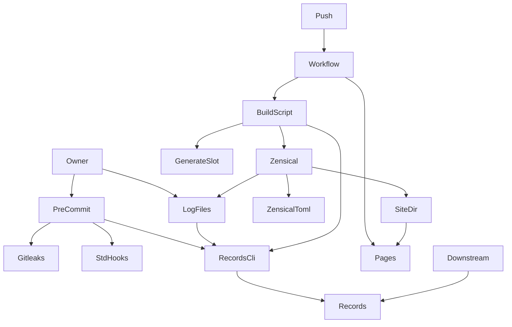
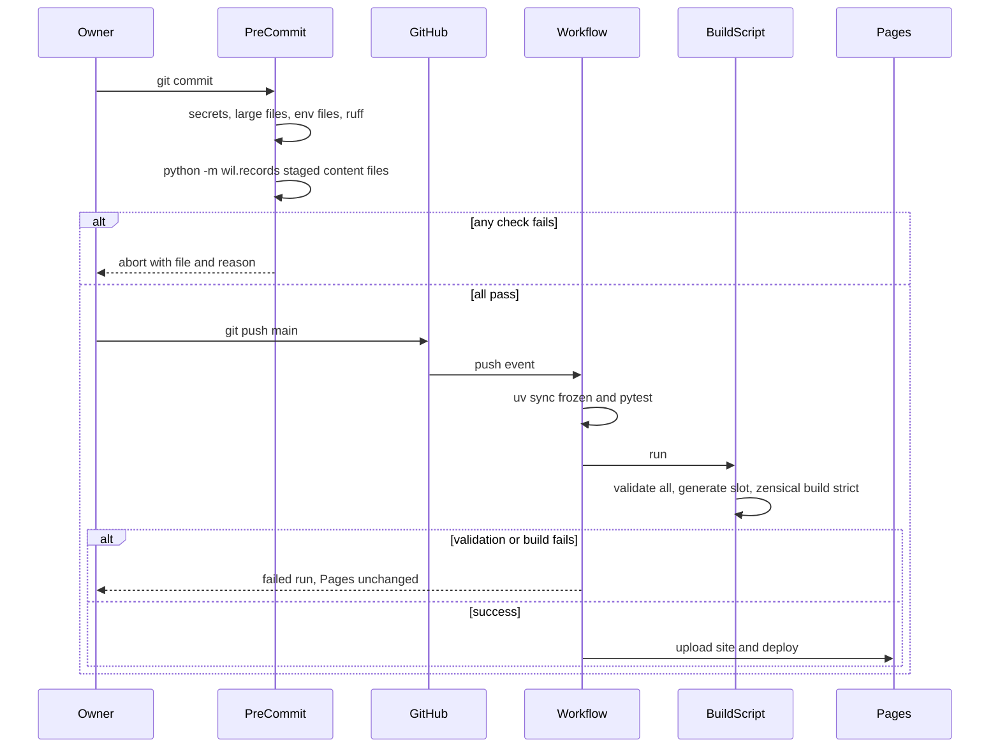

# Design Document: daily-log-page

## Overview
**Purpose**: サイトのオーナーが `content/logs/YYYY-MM-DD.md` を 1 つ書いて `main` に push するだけで、`https://kjman678.github.io/what_i_learned/logs/YYYY-MM-DD/` として公開される最小構成を提供する。ログの記録形式と、その読み取り・検証を行う共有モジュール `wil.records` を定義し、後続 6 spec の共通契約とする。

**Users**: オーナー（書き手・閲覧者）が日々の記録と公開に使い、後続 spec の実装者が `wil.records` を通じてログを読む。

**Impact**: 実質空のリポジトリに、Zensical プロジェクト（`zensical.toml`、`pyproject.toml`、`uv.lock`）、公開コンテンツディレクトリ `content/`、共有パッケージ `src/wil/`、`.gitignore`、pre-commit 設定、GitHub Actions ワークフロー、手順書 `README.md` を追加する。

### Goals
- 1 ログ = 1 ファイル = 1 ページ。必須 frontmatter は `tags` のみ
- 「`content/` に置いたものだけが公開される」を構造で保証し、許可外ファイル・秘密情報・大きなファイルをコミット前に止める
- コミット前とビルド時で同一の検証規則（`wil.records`）を使う
- 手元と CI が同じ `scripts/build.sh` でビルドし、log-index が生成段を差し込める

### Non-Goals
- 一覧・アーカイブページ、ビルド前生成器（log-index）
- テーマ・CSS・見た目（site-design）。既定テーマ + `language = "ja"` のみ
- タグ正規化・技術インデックス（tech-timeline）
- 日本語検索の品質改善（組み込み検索は英語のみと公式に記載。リスクとして記録）
- Pages の Source 切り替え（オーナー作業）

## Boundary Commitments

### This Spec Owns
- ログの記録形式: 置き場所 `content/logs/`、ファイル名 `YYYY-MM-DD.md`、frontmatter（`tags` 必須、`summary` 任意、他キーは無視）、本文は自由な Markdown
- `wil.records` の公開契約: `Record` / `Section` / `RecordError` / `RecordsInvalid` 型、`parse_record` / `load_records` / `check_paths` 関数、CLI `python -m wil.records`
- 公開コンテンツの許可リスト（`content/index.md` と `content/logs/YYYY-MM-DD.md`）。定義は `wil.records.ALLOWED_PATTERNS` の 1 か所のみ
- Zensical 設定 `zensical.toml` のうち `docs_dir` / `site_dir` / `site_url` / `language` / tags プラグイン。テーマ節（palette、font、features）と `extra_css`、`nav` は site-design が所有する
- ビルド手順 `scripts/build.sh` と、その中の「生成段」の位置
- GitHub Actions ワークフロー `.github/workflows/deploy.yml`
- `.gitignore`（下流 spec は log-index による `content/generated/` の 1 行追記のみ可）
- `.pre-commit-config.yaml`、`pyproject.toml` / `uv.lock` / `.python-version`（下流 spec は依存の追加のみ可）
- 手順書 `README.md`（下流 spec は節の追記のみ可）、トップページ `content/index.md` の初版作成、サンプルログ 1 件。初版作成後、トップページの見出し・説明文は site-design が所有する

### Out of Boundary
- ビルド前生成器と、その出力先サブディレクトリ名（log-index）
- テーマ上書き、CSS、テンプレート上書き、`zensical.toml` のテーマ節と `extra_css`、`nav`（ナビゲーションの構成）、トップページの見出し・説明文（site-design）
- タグの正規化・別名表（tech-timeline）。`wil.records` は tags を書かれたとおりに返し、正規化しない
- MCP サーバー、Claude skill
- GitHub リポジトリ設定の変更

### Allowed Dependencies
- 外部: Zensical（固定版）、PyYAML、pre-commit とそのフック群、GitHub Actions 公式アクション、astral-sh/setup-uv
- `wil.records` は Python 標準ライブラリと PyYAML のみに依存する。Zensical を import しない
- 依存方向: 後続 spec のモジュール → `wil.records`。`wil.records` は他の `wil.*` を import しない
- `scripts/build.sh` → `wil.records` CLI → Zensical CLI の順に呼ぶ。逆方向の呼び出しは無い

### Revalidation Triggers
- `Record` / `Section` のフィールド名・型・意味の変更（全下流 spec）
- ログの置き場所、ファイル名規則、`tags` / `summary` の検証規則の変更（全下流 spec）
- `url_path` の形式（`logs/YYYY-MM-DD/`）や `use_directory_urls` の変更（log-index、knowledge-mcp）
- `ALLOWED_PATTERNS` の構造変更、または `scripts/build.sh` の段構成の変更（log-index、tech-timeline、learning-recommendation、site-design）
- `docs_dir` / `site_dir` / `site_url` の変更（全下流 spec）
- `zensical.toml` の `docs_dir` / `language` / tags プラグイン設定の変更（site-design）
- Zensical のバージョン更新（全体のビルド確認）

## Architecture

### Architecture Pattern & Boundary Map



- `LogFiles` = `content/`、`Records` = `wil.records` の関数群、`RecordsCli` = `python -m wil.records`、`GenerateSlot` = build.sh 内の空の生成段、`Downstream` = 後続 spec のモジュール
- **Selected pattern**: 静的サイト + ビルド前スクリプト。検証ロジックは 1 モジュールに集約し、pre-commit と CI はそれを呼ぶだけの薄い入口
- **Steering compliance**: プラグイン・hooks 非依存（hooks は Zensical 未対応と公式に明記）、パースは `wil.records` のみ、依存最小（標準ライブラリ + PyYAML）

### Technology Stack

| Layer | Choice / Version | Role in Feature | Notes |
|-------|------------------|-----------------|-------|
| Site generator | Zensical `==0.1.1`（完全一致で固定） | Markdown → 静的 HTML、組み込み検索・tags | オーナー判断で 0.1.1 に固定（uv の `exclude-newer = "1 week"` 運用。research.md）。uv の symlink link-mode は使わない |
| Runtime | Python 3.14（`.python-version`、`requires-python = ">=3.14,<3.15"`） | `wil` とツール実行 | Zensical は `>=3.11` |
| Package / env | uv、`pyproject.toml` + `uv.lock`、ビルドバックエンド `uv_build` | 依存固定、`src/wil` のインストール | CI は `uv sync --frozen` |
| Parsing | PyYAML `>=6.0.2`（直接依存として明示） | frontmatter の解析（`yaml.safe_load`） | Zensical の推移的依存と同じ |
| Test / lint | pytest、ruff | 単体テスト、lint/format | dev 依存グループ |
| Commit guard | pre-commit、pre-commit-hooks、gitleaks、ruff-pre-commit | コミット前検査 | `rev` は実装時の最新タグに固定 |
| CI / Hosting | GitHub Actions、GitHub Pages | ビルドと公開 | `actions/checkout`、`astral-sh/setup-uv`、`actions/configure-pages`、`actions/upload-pages-artifact`、`actions/deploy-pages`。メジャー版は実装時に確認して固定 |

## File Structure Plan

### Directory Structure
```
.
├── zensical.toml                 # サイト設定（site_url, docs_dir, site_dir, language, tags）
├── pyproject.toml                # プロジェクト定義、依存、wil パッケージ、pytest/ruff 設定
├── uv.lock                       # 依存のロック（コミットする）
├── .python-version               # 3.14
├── .gitignore                    # 生成物・環境・キャッシュ・秘密情報・旧 Astro 生成物
├── .pre-commit-config.yaml       # コミット前検査の定義
├── README.md                     # 書き方の手順書（公開されない）
├── scripts/
│   └── build.sh                  # 唯一のビルド手順: 検証 → 生成段（空）→ zensical build
├── .github/workflows/
│   └── deploy.yml                # main への push でテスト → build.sh → Pages へデプロイ
├── content/                      # 公開コンテンツディレクトリ（docs_dir）。ここだけが公開される
│   ├── index.md                  # トップページ
│   └── logs/
│       └── 2026-11-23.md         # サンプルログ（形式の見本）
├── src/wil/
│   ├── __init__.py               # 空（パッケージ宣言のみ）
│   └── records.py                # ログ形式の型・パース・検証・許可リスト・CLI
└── tests/
    └── test_records.py           # wil.records の単体テスト + 実 content/ の検証
```

### Modified Files
- `.gitignore` — 空ファイルを置き換え、無視対象を定義する（4.4）

`docs/`、`.kiro/`、`.claude/` は変更しない（`docs_dir` 外なので公開されない）。

## System Flows



- いずれかの段が非ゼロ終了したら後続段は実行しない（`set -eu` と Actions の既定動作）。デプロイ段に到達しない限り Pages は直前の内容のまま（6.4）
- pre-commit は変更されたファイルのみ、ビルドは `content/` 全体を検査する。規則は同一（2.9）

## Requirements Traceability

| Requirement | Summary | Components | Interfaces | Flows |
|-------------|---------|------------|------------|-------|
| 1.1 | `content/logs/YYYY-MM-DD.md` = 1 日 | Records, ZensicalConfig | `ALLOWED_PATTERNS`, `parse_record` | — |
| 1.2 | 日付はファイル名のみから | Records | `Record.date` | — |
| 1.3 | 必須は `tags`（1 個以上の文字列） | Records | `parse_record` | — |
| 1.4 | `summary` は 1 行文字列 | Records | `Record.summary` | — |
| 1.5 | 自由な Markdown 本文 | Records, ZensicalConfig | `Record.body` | — |
| 1.6 | 未知キーは無視 | Records | `parse_record` | — |
| 1.7 | UTF-8 | Records | `parse_record` | — |
| 2.1–2.6 | 各書式誤りの検出と理由表示 | Records | `RecordError`, `check_paths` | コミット・ビルド |
| 2.7 | 全件報告 | Records | `check_paths`, `RecordsInvalid` | — |
| 2.8 | 成功/失敗の終了コード | RecordsCli | `main` | — |
| 2.9 | コミット前とビルドで同一規則 | RecordsCli, PreCommitConfig, BuildScript | `python -m wil.records` | コミット・ビルド |
| 3.1 | URL に日付 | ZensicalConfig | `use_directory_urls`（既定 true） | — |
| 3.2 | タイトル未指定時、タイトル/ナビで日付が識別可能 | ZensicalConfig | ファイル名由来タイトル（H1 / `title` があればそれが優先され、日付は URL で識別） | — |
| 3.3 | 見出し・入れ子箇条書き・コード表示 | ZensicalConfig | Zensical 既定 Markdown 拡張 | — |
| 3.4 | tags の表示 | ZensicalConfig | `[project.plugins.tags]` | — |
| 3.5 | トップページ | SiteContent | `content/index.md` | — |
| 3.6 | サブパスで動作 | ZensicalConfig | `site_url` | ビルド |
| 3.7 | `lang="ja"` | ZensicalConfig | `[project.theme] language` | — |
| 3.8 | サイト内検索 | ZensicalConfig | 組み込み search（既定有効） | — |
| 4.1, 4.2 | 公開ディレクトリの分離 | ZensicalConfig | `docs_dir = "content"` | — |
| 4.3 | 許可外ファイルの検出 | Records | `ALLOWED_PATTERNS`, `check_paths` | コミット・ビルド |
| 4.4 | 無視対象 | GitIgnore | `.gitignore` | — |
| 5.1 | 秘密情報 | PreCommitConfig | gitleaks, detect-private-key, env fail フック | コミット |
| 5.2 | 500KB 超 | PreCommitConfig | `check-added-large-files --maxkb=500` | コミット |
| 5.3, 5.4 | 許可外ファイル・書式誤り | PreCommitConfig, RecordsCli | `wil-records` ローカルフック | コミット |
| 5.5 | 問題なければ通す | PreCommitConfig | — | コミット |
| 5.6 | 手元で全件検査 | PreCommitConfig, Guide | `uv run pre-commit run --all-files` | — |
| 6.1 | push で検証→ビルド→公開 | DeployWorkflow, BuildScript | `deploy.yml` | デプロイ |
| 6.2, 6.3 | 検証失敗・ビルド失敗・リンク切れで中止 | BuildScript | `set -eu`, `--strict` | デプロイ |
| 6.4 | 失敗時は直前の公開を維持 | DeployWorkflow | deploy 段に到達しない | デプロイ |
| 6.5 | 単一ビルド手順と生成段 | BuildScript | `scripts/build.sh` | ビルド |
| 6.6 | バージョン固定 | ProjectConfig | `zensical==0.1.1`, `uv.lock`, `uv sync --frozen` | — |
| 7.1–7.5 | 下流向け読み取り | Records | `load_records`, `Record`, `Section` | — |
| 7.6 | 自動テスト | RecordsTests | `tests/test_records.py` | — |
| 8.1, 8.2, 8.4 | 手順書（非公開） | Guide | `README.md`（`content/` 外） | — |
| 8.3 | サンプルログ | SiteContent | `content/logs/2026-11-23.md` | — |

## Components and Interfaces

| Component | Domain/Layer | Intent | Req Coverage | Key Dependencies | Contracts |
|-----------|--------------|--------|--------------|------------------|-----------|
| Records | 共有ドメイン（`src/wil/records.py`） | ログ形式の型・パース・検証・許可リスト | 1.1–1.7, 2.1–2.7, 4.3, 7.1–7.5 | PyYAML (P0) | Service |
| RecordsCli | 入口（`src/wil/records.py` の `main`） | ファイル列または全体を検査し終了コードで返す | 2.7, 2.8, 2.9, 5.3, 5.4 | Records (P0) | Batch |
| RecordsTests | テスト（`tests/test_records.py`） | 正常系・全誤りケース・実 content の検証 | 7.6 | Records (P0), pytest (P1) | — |
| ZensicalConfig | サイト設定（`zensical.toml`） | 公開範囲・URL・言語・tags・検索 | 1.1, 1.5, 3.1–3.8, 4.1, 4.2 | Zensical (P0) | State |
| SiteContent | 公開コンテンツ（`content/`） | トップページとサンプルログ | 3.5, 8.3 | Records 形式 (P0) | — |
| BuildScript | ビルド（`scripts/build.sh`） | 検証 → 生成段 → ビルドの唯一の手順 | 2.9, 6.2, 6.3, 6.5 | RecordsCli (P0), Zensical (P0) | Batch |
| DeployWorkflow | CI（`.github/workflows/deploy.yml`） | push で test → build → Pages デプロイ | 6.1, 6.4 | BuildScript (P0), GitHub Pages (P0) | Batch |
| PreCommitConfig | コミット前（`.pre-commit-config.yaml`） | 秘密情報・大きさ・env・許可外・書式の検査 | 2.9, 5.1–5.6 | RecordsCli (P0), gitleaks (P1) | Batch |
| GitIgnore | リポジトリ（`.gitignore`） | 生成物・環境・秘密の再混入防止 | 4.4 | — | — |
| ProjectConfig | リポジトリ（`pyproject.toml`, `uv.lock`, `.python-version`） | 依存とバージョンの固定、`wil` の配布 | 6.6 | uv (P0) | — |
| Guide | 文書（`README.md`） | 書き方・確認・初回作業の手順 | 5.6, 8.1, 8.2, 8.4 | — | — |

### 共有ドメイン

#### Records（`wil.records`）

| Field | Detail |
|-------|--------|
| Intent | ログ形式の唯一の定義。読み取りと検証を同じ規則で行う |
| Requirements | 1.1–1.7, 2.1–2.7, 4.3, 7.1–7.5 |

**Responsibilities & Constraints**
- ログ 1 件のパースと検証、`content/` 全体の読み込み、パス列の許可リスト検査を提供する
- 規則（ファイル名・frontmatter・許可リスト）はこのモジュールにだけ存在する。他モジュール・設定ファイルに規則を複製しない
- 副作用はファイル読み取りのみ。書き込みはしない
- tags は書かれた文字列をそのまま（前後空白のみ除去せず、順序維持で）返す。正規化は tech-timeline の責務

**Dependencies**
- Inbound: RecordsCli — 検査（P0）／後続 spec のモジュール — ログ読み取り（P0）
- External: PyYAML `yaml.safe_load` — frontmatter 解析（P0）

**Contracts**: Service [x]

##### Service Interface
```python
from dataclasses import dataclass
from datetime import date
from pathlib import Path
from typing import Iterable

CONTENT_DIR: Path          # リポジトリルート基準の Path("content")。既定の読み込み元
LOGS_SUBDIR: str = "logs"  # content 内のログ用サブディレクトリ
ALLOWED_PATTERNS: tuple[str, ...]
# content からの相対 POSIX パスに対する正規表現（fullmatch）。
# 初期値: r"index\.md", r"logs/\d{4}-\d{2}-\d{2}\.md"
# 後続 spec が公開ファイルの種類を増やすときはここに追加する（唯一の定義箇所）

@dataclass(frozen=True)
class Section:
    level: int        # 0 = 最初の見出しより前の本文, 1..6 = ATX 見出しの階層
    title: str        # 見出し文字列（"#" と前後空白を除く）。level 0 は ""
    body: str         # 次の見出し行の直前までの本文（見出し行自体は含まない）

@dataclass(frozen=True)
class Record:
    date: date                    # ファイル名から得た日付
    path: Path                    # ログファイルのパス（呼び出し時に渡された基準のまま）
    url_path: str                 # サイトルート相対の URL パス。例 "logs/2026-11-23/"
    tags: tuple[str, ...]         # 1 個以上。書かれた順
    summary: str | None           # 無ければ None
    body: str                     # frontmatter を除いた本文（Markdown 原文）
    sections: tuple[Section, ...] # 本文を見出し単位に分割したもの（出現順）

class RecordError(Exception):
    path: Path
    reason: str       # 日本語の理由。例 "frontmatter に tags がありません"
    # str(err) == f"{path}: {reason}"

class RecordsInvalid(Exception):
    errors: tuple[RecordError, ...]   # 1 件以上。パス順

def parse_record(path: Path) -> Record: ...
def load_records(content_dir: Path = CONTENT_DIR) -> list[Record]: ...
def check_paths(paths: Iterable[Path], content_dir: Path = CONTENT_DIR) -> list[RecordError]: ...
def main(argv: list[str] | None = None) -> int: ...   # RecordsCli 参照
```

- `parse_record(path)`
  - Preconditions: `path` のファイル名が日付候補であること（呼び出し側は許可リストで絞り込み済みでもよい）
  - Postconditions: 規則を満たせば `Record` を返す。1 つでも違反があれば最初に見つかった違反を `RecordError` として送出（1 ファイル 1 理由）
  - 検査順: ファイル名形式（2.1）→ 暦日（2.2）→ UTF-8 読み取り（2.6）→ frontmatter 区切り・YAML・mapping であること（2.3）→ `tags`（2.4）→ `summary`（2.5）
- `load_records(content_dir)`
  - `content_dir/logs/*.md` を対象に `parse_record` を実行し、日付昇順の `list[Record]` を返す（7.1）
  - 1 件でも失敗があれば、全件の `RecordError` を集めて `RecordsInvalid` を送出する。不正なログを黙って除外しない（7.4）
  - ログが 0 件なら空リスト
- `check_paths(paths, content_dir)`
  - 各パスについて: `content_dir` 外 → 対象外（無視）。ドットで始まる要素を含む → 無視。存在しない（削除済み）→ 無視。`ALLOWED_PATTERNS` に一致しない → `RecordError("公開ディレクトリに置けないファイルです …")`（4.3）。ログパターンに一致 → `parse_record` を実行し失敗を収集
  - 戻り値は全件の誤り（空なら成功）（2.7）
- Invariants: `Record.date.isoformat()` はファイル名の stem と一致する。`url_path == f"logs/{date.isoformat()}/"`

**Implementation Notes**
- frontmatter: ファイル先頭行が `---` であり、以降に単独行の `---` が存在すること。間を `yaml.safe_load` し、結果が `dict` でなければ 2.3 のエラー。空の frontmatter（`---\n---`）は「`tags` がありません」
- YAML の型の罠（`tags: [2026]` は int、`[yes]` は bool）は「文字列以外の要素」として 2.4 で検出する
- `tags` 要素は `str` かつ `strip()` 後に空でないこと。`summary` は `str` かつ `\n` を含まないこと（空文字は許容）
- 見出し分割: 行頭 `#{1,6}` + 空白（または行末）の ATX 見出しのみ。行頭が ` ``` ` または `~~~` の行でフェンスの開閉を切り替え、フェンス内の `#` 行は見出しにしない。Setext 見出しは扱わない。level 0 区間は本文が空白のみなら作らない
- 暦日検査は `date.fromisoformat` の成否で行う

#### RecordsCli（`python -m wil.records`）

| Field | Detail |
|-------|--------|
| Intent | pre-commit とビルドの共通入口 |
| Requirements | 2.7, 2.8, 2.9, 5.3, 5.4 |

**Contracts**: Batch [x]

##### Batch / Job Contract
- Trigger: `uv run python -m wil.records [PATH ...]`（カレントディレクトリはリポジトリルート）
- Input: 引数あり → そのパス列を `check_paths` で検査（pre-commit 用）。引数なし → `content/` 以下の全ファイル（ドットファイル除く）を `check_paths` で検査（ビルド用）
- Output: 誤りごとに `path: reason` を標準エラーへ 1 行ずつ出力。誤りが 0 件なら終了コード 0、1 件以上なら 1（2.8）
- Idempotency: 読み取り専用。何度実行しても同じ結果

### サイト設定・コンテンツ

#### ZensicalConfig（`zensical.toml`）

| Field | Detail |
|-------|--------|
| Intent | 公開範囲・URL・言語・tags を宣言する |
| Requirements | 1.1, 1.5, 3.1–3.8, 4.1, 4.2 |

**Contracts**: State [x]

##### State Management（設定値）
```toml
[project]
site_name = "What I Learned"
site_url = "https://kjman678.github.io/what_i_learned/"
docs_dir = "content"
site_dir = "site"
# use_directory_urls は既定 true のまま（logs/2026-11-23/ 形式の URL）
# nav は本 spec では書かない（site-design が所有し、トップと一覧ページだけを並べる。それまではフォルダ構造からの既定ナビ）

[project.theme]
language = "ja"

[project.plugins.tags]
```
- 検索は既定で有効なため設定しない。strict はコマンド引数 `--strict` で指定する（設定ファイルではなく build.sh に集約）
- ドットファイルは Zensical が既定で公開から除外する

**Implementation Notes**
- Validation: ビルド後に (a) `site/index.html` と `site/logs/2026-11-23/index.html` が存在、(b) `<html lang="ja">`、(c) HTML 内の `href`/`src` に `"/assets` などルート絶対パスが無い、(d) H1 を持たないログページのタイトル・ナビ表示に日付が含まれる、(e) タグがページに表示される、(f) `<h2>`・入れ子の `<ul>`・`<pre><code>` が生成される、を確認する
- タイトル: H1 や frontmatter `title` を書いた場合はそれがタイトルになる（Zensical の優先順位）。日付の識別は URL が保証する。書き手には `##` 以下の見出しを推奨する（手順書）
- Risks: 組み込み検索は英語のみと公式に記載。日本語の検索品質は保証しない

#### SiteContent（`content/`）
- `content/index.md`: サイトの説明 1〜2 文と「左のナビゲーションからログを選ぶ」旨。一覧の自動生成はしない（log-index の責務）（3.5）
- `content/logs/2026-11-23.md`: 全規則を満たすサンプル。`tags`（2 個以上）と `summary`、`##` 見出し、入れ子の箇条書き、コードブロックを含む（8.3）

### ビルド・公開

#### BuildScript（`scripts/build.sh`）

| Field | Detail |
|-------|--------|
| Intent | 手元と CI で共通の唯一のビルド手順 |
| Requirements | 2.9, 6.2, 6.3, 6.5 |

**Contracts**: Batch [x]

##### Batch / Job Contract
- Trigger: リポジトリルートで `./scripts/build.sh`（手元・CI 共通）
- 段構成（`set -eu`。いずれかが失敗したら非ゼロで即終了）:
  1. 検証: `uv run python -m wil.records`
  2. 生成: `# --- pre-build generation: 後続 spec がここに生成コマンドを追加する ---`（現時点ではコマンドなし）
  3. ビルド: `uv run zensical build --clean --strict`
- Output: `site/`（gitignore 対象）
- Idempotency: `--clean` で毎回キャッシュを捨てて再生成

#### DeployWorkflow（`.github/workflows/deploy.yml`）

| Field | Detail |
|-------|--------|
| Intent | `main` への push でテスト・ビルド・Pages デプロイ |
| Requirements | 6.1, 6.4 |

**Contracts**: Batch [x]

##### Batch / Job Contract
- Trigger: `push`（branches: `main`）と `workflow_dispatch`
- Permissions: ワークフロー既定は `{}`（権限なし）。ジョブごとに最小限を与える
- Concurrency: group `pages`、`cancel-in-progress: false`
- Job `build`（`ubuntu-latest`、権限 `contents: read` のみ）の段:
  1. `actions/checkout`（`persist-credentials: false`）
  2. `astral-sh/setup-uv`（uv の版を固定、キャッシュ無効）
  3. `uv sync --frozen`（ロックファイルと不一致なら失敗）
  4. `uv run pytest`
  5. `./scripts/build.sh`
  6. `actions/upload-pages-artifact`（path: `site`）
- Job `deploy`（`needs: build`、environment `github-pages`、権限 `pages: write`・`id-token: write`）の段:
  7. `actions/configure-pages`
  8. `actions/deploy-pages`
- サプライチェーン対策: action はすべてコミット SHA で固定し、版はコメントで残す。リポジトリのコードと依存を実行するのは `build` だけで、Pages への書き込み権限を持つ `deploy` は公式 action しか動かさない
- Recovery: `build` のいずれかの段が失敗すると `deploy` は実行されず、Pages は直前の公開内容のまま（6.4）
- Zensical のビルドキャッシュは CI でキャッシュしない（公式が現時点で非推奨）
- 前提: リポジトリの Pages の Source が「GitHub Actions」であること（オーナー作業、手順書に記載）

#### PreCommitConfig（`.pre-commit-config.yaml`）

| Field | Detail |
|-------|--------|
| Intent | 公開事故をコミット前に止める |
| Requirements | 2.9, 5.1–5.6 |

**Contracts**: Batch [x]

##### Batch / Job Contract（フック一覧）
| Hook | Source | 対象 | Req |
|------|--------|------|-----|
| `gitleaks` | `github.com/gitleaks/gitleaks` | 全ステージファイル | 5.1 |
| `detect-private-key` | `github.com/pre-commit/pre-commit-hooks` | 全ステージファイル | 5.1 |
| `check-added-large-files`（`--maxkb=500`） | 同上 | 追加ファイル | 5.2 |
| `forbid-env-files`（local, `language: fail`） | local | `(^|/)\.env(\..*)?$` | 5.1 |
| `wil-records`（local, `language: system`, `entry: uv run python -m wil.records`） | local | `files: ^content/` | 5.3, 5.4 |
| `ruff` / `ruff-format` | `github.com/astral-sh/ruff-pre-commit` | `*.py` | steering |

- 有効化はオーナーが `uv run pre-commit install` を 1 回実行する（手順書）
- 全件検査は `uv run pre-commit run --all-files`（5.6）
- `rev` は実装時点の最新タグに固定する

#### GitIgnore（`.gitignore`）
- 無視対象: `site/`、Zensical のキャッシュディレクトリ（名前は実装時に初回ビルドで確認して追記）、`.venv/`、`__pycache__/`、`*.py[cod]`、`.pytest_cache/`、`.ruff_cache/`、`dist/`、`node_modules/`、`.astro/`、`.env`、`.env.*`、`.DS_Store`（4.4）

#### ProjectConfig（`pyproject.toml` ほか）
- `[project]` name `wil`、`requires-python = ">=3.14,<3.15"`、dependencies `["pyyaml==6.0.3"]`
- `[dependency-groups] dev = ["zensical==0.1.1", "pytest==9.2.0", "ruff==0.17.5", "pre-commit==4.7.0"]`（`uv sync` で既定導入。すべて完全一致で固定）
- `[tool.uv] exclude-newer = "1 week"`（公開から 1 週間未満の版は解決に使わない）
- `[build-system]` `uv_build`、`[tool.uv.build-backend] module-name = "wil"`（`src/wil` を import 可能にする）
- `[tool.pytest.ini_options] testpaths = ["tests"]`
- `.python-version`: `3.14`
- uv の `link-mode = "symlink"` は設定しない（Zensical 非対応）

#### Guide（`README.md`）
- 内容: ログの置き場所とファイル名規則、frontmatter の例（`tags` 必須・`summary` 任意、`tags: aws` のような単一文字列は不可）、見出しは `##` 以下の ATX 形式を推奨、プレビュー `uv run zensical serve`、検証 `uv run python -m wil.records` / `uv run pre-commit run --all-files`、ビルド `./scripts/build.sh`、公開の流れ（`main` に push）（8.1）
- 初回作業: `uv sync`、`uv run pre-commit install`、Pages の Source を GitHub Actions に切り替え（8.4）
- `content/` の外に置くため公開されない（8.2）

## Data Models

### Domain Model
- 集約は `Record`（1 ログ = 1 ファイル = 1 日）。識別子は `date`（ファイル名から一意。同日 2 ファイルはファイルシステム上あり得ない）
- `Section` は `Record` に従属する値オブジェクト。`Record.sections` を連結すると `body` の見出し構造を復元できる（見出し行は `level`/`title` に、その他の行は `body` に入る）
- 不変条件:
  - `tags` は 1 個以上の空でない文字列
  - `summary` は `None` または改行を含まない文字列
  - `url_path == f"logs/{date.isoformat()}/"`
  - `load_records` の戻り値は `date` の昇順で重複なし

### Data Contracts & Integration

**ログファイルの形式（書き手が書くもの）**
```markdown
---
tags:
  - aws
  - lambda
summary: Lambda のコールドスタート対策を調べた   # 任意
---

## 学んだこと

- SnapStart
  - Java 以外でも使える条件
```

| 項目 | 規則 | 違反時の理由（例） |
|------|------|------------------|
| 置き場所 | `content/logs/` 直下 | 公開ディレクトリに置けないファイルです |
| ファイル名 | `YYYY-MM-DD.md` | ファイル名が YYYY-MM-DD.md 形式ではありません |
| 日付 | 暦上存在する日付 | 存在しない日付です |
| 文字コード | UTF-8 | UTF-8 として読み取れません |
| frontmatter | 先頭 `---` と終了 `---`、YAML の mapping | frontmatter の開始/終了の `---` がありません／YAML として解釈できません |
| `tags` | 必須。空でない文字列のリスト、1 個以上 | tags がありません／tags はリストで書いてください／tags に空または文字列でない要素があります |
| `summary` | 任意。改行なしの文字列 | summary は 1 行の文字列で書いてください |
| その他のキー | 許容・無視 | — |
| 本文 | 自由な Markdown | — |

**下流 spec の利用方法**
- 読み取りは `from wil.records import load_records` のみを使う。ファイルを直接パースしない
- 公開 URL は `zensical.toml` の `site_url` と `Record.url_path` を連結して得る
- 生成ページを `content/` 配下に追加する spec は、`ALLOWED_PATTERNS` へのパターン追加と 生成段（log-index が導入する `scripts/generate.sh`）への 1 行追記で統合する（log-index は `generated/.+\.md`、site-design は `stylesheets/extra\.css` を追加）
- `content/index.md` は daily-log-page が初版を作成し、以降の見出し・説明文は site-design が所有する。log-index、tech-timeline、learning-recommendation は末尾へのリンク行追記のみ行う
- `zensical.toml` のテーマ節（palette、font、features）と `extra_css`、`nav` は site-design が所有する。`docs_dir` / `site_dir` / `site_url` / `language` / tags プラグインは daily-log-page が所有し、他 spec は変更しない
- `README.md` には下流 spec が節を追記してよい
- `.gitignore` には log-index が `content/generated/` を 1 行追記してよい
- `pyproject.toml` / `uv.lock` には下流 spec が依存を追加してよい（例: knowledge-mcp が `mcp>=2.3,<3` を追加）

## Error Handling

### Error Strategy
- 書式エラーは例外 `RecordError`（1 ファイル 1 理由）として生成し、CLI と `load_records` が全件を集めて報告する。最初の 1 件で止めない（2.7）
- 理由メッセージは日本語で、何を直せばよいかが分かる文にする
- CLI は `path: reason` を標準エラーに出し、終了コード 1。pre-commit と build.sh はこの終了コードで中断する
- Zensical のリンク切れは `--strict` により終了コード 1 となり build.sh が失敗する（6.3）
- CI の失敗は Actions の実行ログで確認する。追加の通知は設けない

## Testing Strategy

### Unit Tests（`tests/test_records.py`、`tmp_path` に一時ファイルを作って検証）
- 正常系: tags + summary + 見出し + 入れ子箇条書きのログが `Record` になり、`date`・`url_path`・`tags`・`summary`・`body` が期待どおり（1.1–1.5, 7.2）
- 未知キー（`hide`, `title`）があっても成功し、`Record` に影響しない（1.6）
- 誤りケース（各 1 テスト、理由文字列の一部を検査）: `2026-1-5.md`、`notes.md`（2.1）、`2026-02-30.md`（2.2）、frontmatter 無し・終了 `---` 欠落・壊れた YAML・mapping でない YAML（2.3）、`tags` 欠落・`tags: []`・`tags: aws`・`tags: [2026]`・`tags: [""]`（2.4）、`summary` がリスト・複数行（2.5）、Shift_JIS バイト列（2.6）
- 見出し分割: `##`/`###` で区間が分かれ、` ```bash ` フェンス内の `# comment` は見出しにならず、最初の見出し前の本文は level 0 区間になる（7.3）

### Integration Tests
- `load_records` が複数ログを日付昇順で返し、不正ログが 1 件混じると全誤りを持つ `RecordsInvalid` を送出する（7.1, 7.4）
- `check_paths`: `content/` 内の `foo.txt`・`content/2026-11-23.md`（logs 外）を許可外として報告し、`content/.DS_Store`・`content/` 外のパス・存在しないパスは無視する（4.3）
- `main([...])` が誤り 2 件で終了コード 1 かつ標準エラーに 2 行、正常で 0 を返す（2.7, 2.8）
- 実リポジトリの `content/` に対して `main([])` が 0 を返す（サンプルログと index.md が規則を満たす）（8.3）

### Build / E2E Checks（実装タスクで手動または CI で確認）
- `./scripts/build.sh` が成功し `site/logs/2026-11-23/index.html` が生成される（3.1, 6.5）
- 生成 HTML: `<html lang="ja">`、ルート絶対パスの `href`/`src` が無い、H1 なしログのタイトル/ナビに日付、`<h2>`・入れ子 `<ul>`・`<pre><code>`、タグ表示、検索 UI の存在（3.2–3.4, 3.6–3.8）
- コミット前検査の確認は 2 段階で行う。(a) 実装時（何もステージしない）: `SKIP=gitleaks uv run pre-commit run --files <パス...>` で detect-private-key・`.env` 拒否・`wil-records`・ruff を確認し、gitleaks は `pre-commit validate-config` で設定の妥当性のみ確認する。gitleaks は `--files` を無視してステージ内容を走査し、`check-added-large-files` は `--enforce-all` なしでは追加（ステージ）ファイルしか見ないため、この段階では確認できない。(b) 最終確認（オーナーが新規ファイルを `git add` した後）: gitleaks と 500KB 超の拒否を含む全フックを確認する。`--all-files` は追跡中（ステージ済みを含む）のファイルしか検査しない
- 不正ログを置くと build.sh が Zensical 実行前に失敗する。存在しないページへのリンクを書くと `--strict` で失敗する（6.2, 6.3）
- (b) の段階で `uv run pre-commit run --all-files` が成功し、ダミーの秘密情報・600KB ファイルをステージすると gitleaks・大きなファイル検査が失敗する（確認後にダミーのみステージを外して削除する）。ダミー秘密鍵・`.env`・`content/foo.txt` の拒否は (a) で確認する（5.1–5.5）

## Security Considerations
- 公開範囲は `docs_dir = "content"` という構造で決まり、除外パターンへの依存を最小化する。非公開文書（`docs/`、`.kiro/`、`.claude/`）はビルド入力に入らない
- 秘密情報は pre-commit（gitleaks、detect-private-key、`.env` 拒否）と `.gitignore` の二重で防ぐ。CI 側で秘密情報スキャンは行わない（公開リポジトリのため push 時点で手遅れであり、手元で止めることを主とする）
- ワークフローの権限は Pages デプロイに必要な最小（`contents: read`、`pages: write`、`id-token: write`）。シークレットは使わない
- `yaml.safe_load` のみを使い、任意オブジェクトの生成を防ぐ

## Migration Strategy
- 旧 Astro 生成物は作業ツリー・index とも除去済みで、`.gitignore` で再混入を防ぐ。HEAD の `docs/superpowers/*` はこの spec では操作しない。`docs/` は `docs_dir` 外なので公開されない
