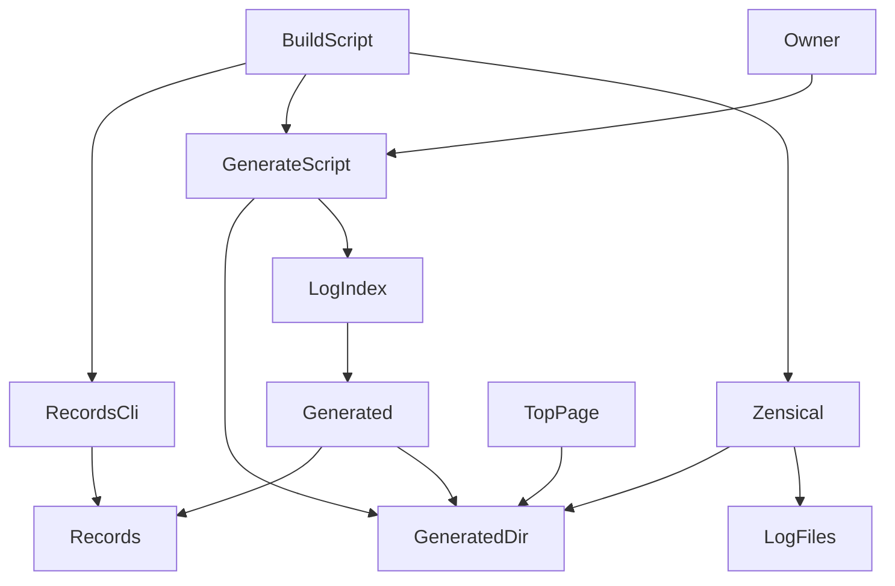
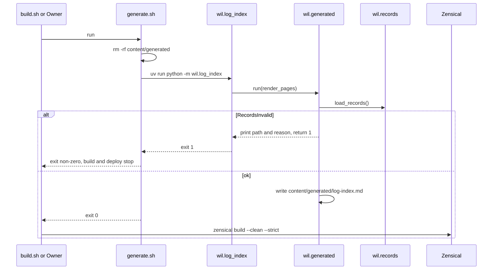

# Design Document: log-index

## Overview
**Purpose**: 全ログを新しい順に、年度（4 月始まり）と月でグルーピングした一覧ページ `generated/log-index/` を、ビルドのたびにログから自動生成する。あわせて「ビルド前生成」の共通方式（生成器モジュールの置き場所、出力先、登録箇所、ナビゲーションへの載せ方、手元での実行方法）を定義し、tech-timeline・learning-recommendation が同じ方式に従う契約とする。

**Users**: サイトのオーナーと閲覧者が一覧ページで過去ログを見渡す。後続 spec の実装者がビルド前生成の方式に従って生成器を追加する。

**Impact**: daily-log-page が用意した `scripts/build.sh` の空の生成段を埋め、`content/generated/`（gitignore）に一覧ページを生成する。共有ヘルパー `wil.generated`、生成器 `wil.log_index`、生成スクリプト `scripts/generate.sh` を追加し、上流所有ファイルには許可された追記のみを行う。

### Goals
- 新しいログを push するだけで一覧が更新される（手で一覧を編集しない）
- 生成は `Record` 列 → Markdown 文字列の純粋関数で、年度境界を含めて単体テストできる
- 後続の生成器は `scripts/generate.sh` に 1 行足すだけで、手元・CI・検証・gitignore のすべてに統合される

### Non-Goals
- タグ別ページ・技術タイムライン（tech-timeline）
- 一覧の見た目（CSS、テンプレート上書き、ナビの並びやラベルの調整）（site-design）
- 全文検索の改善
- ログ形式・検証規則・CI ワークフローの変更（daily-log-page）

## Boundary Commitments

### This Spec Owns
- ビルド前生成の共通方式（下流が従う契約）:
  - 生成ページの区域 `content/generated/`（gitignore、毎回作り直し）
  - 登録箇所 `scripts/generate.sh`（区域の削除 → 各生成器の実行）
  - 共有ヘルパー `wil.generated`（区域の定数、`run()`: 読み取り・誤り報告・書き出し・終了コード）
  - 生成器の形（`wil.<feature>` モジュール、純粋な描画関数 + `main()`、`python -m wil.<feature>` で実行）
  - ナビゲーションへの載せ方（site-design のナビ契約に従い、一覧ページ 1 項目だけを `nav` 末尾に追記。本 spec の項目「学習ログ一覧」は site-design が書くため、本 spec は `zensical.toml` を変更しない）
- 一覧ページ生成器 `wil.log_index`（年度計算、並び順、行の書式、Markdown エスケープ）と出力 `content/generated/log-index.md`
- 上流ファイルへの追記（いずれも上流設計が許可した、または既存内容を変えない追加のみ）:
  - `scripts/build.sh` の生成段に `./scripts/generate.sh` の 1 行（上流が明示的に許可）
  - `wil.records.ALLOWED_PATTERNS` に `r"generated/.+\.md"` の 1 要素（上流が明示的に許可）
  - `.gitignore` に `content/generated/` の 1 行（追記のみ）
  - `content/index.md` に一覧へのリンク 1 行（既存の説明文は変えない、追記のみ）
  - `README.md` にビルド前生成と手元プレビューの節（追記のみ）
- テスト `tests/test_log_index.py`、`tests/test_generated.py`

### Out of Boundary
- `wil.records` の型・関数・検証規則（`ALLOWED_PATTERNS` への 1 要素追加を除く）
- `scripts/build.sh` の検証段・ビルド段、`.github/workflows/deploy.yml`、`zensical.toml`、Zensical のバージョン
- 見た目・CSS・テンプレート、ナビゲーションの構成（`zensical.toml` の `nav`。site-design）
- タグの正規化・技術インデックス（tech-timeline）。一覧は tags を書かれたとおり表示する
- 後続生成器の中身（tech-timeline、learning-recommendation がそれぞれ所有）

### Allowed Dependencies
- `wil.log_index` → `wil.generated` → `wil.records`。各生成器は `wil.records` と `wil.generated` のみを import し、他の生成器を import しない。例外として、steering（roadmap）に従い learning-recommendation は tech-timeline のインデックス API（`build_index`、`tech_key`、`Tech`、`AliasError`）を import してよい
- `wil.generated` は `wil.records` と標準ライブラリのみに依存する。生成器を import しない
- 標準ライブラリ（`html`、`itertools`、`pathlib`、`sys`、`collections.abc`）。新規の外部依存は追加しない。Zensical・Jinja2 を import しない
- 呼び出し方向: `scripts/build.sh` → `scripts/generate.sh` → `python -m wil.<feature>`。逆方向なし

### Revalidation Triggers
- 区域のパス `content/generated/`、または `ALLOWED_PATTERNS` の生成パターンの変更（tech-timeline、learning-recommendation）
- `scripts/generate.sh` の段構成（削除 → 生成器の順次実行）や呼び出し形式 `uv run python -m wil.<feature>` の変更（後続生成器）
- `wil.generated.run` のシグネチャ・終了コード・書き出し規則、または `wil.generated.escape_inline` のエスケープ規則の変更（後続生成器）
- 生成ページを Markdown 以外（`.md` 以外の拡張子）で出したい後続 spec が現れた場合（`ALLOWED_PATTERNS` と `run` の名前検査の変更が必要）
- `content/generated/log-index.md` のパス変更（トップページのリンク、site-design）
- 上流の `Record` / `load_records` / `LOGS_SUBDIR` / `use_directory_urls` の変更（本 spec の再確認が必要）

## Architecture

### Existing Architecture Analysis
- 上流（daily-log-page、未実装の設計契約）: `docs_dir = "content"`、ログは `content/logs/YYYY-MM-DD.md`、`wil.records.load_records()` が日付昇順の `list[Record]` を返し、不正があれば `RecordsInvalid`（全件の `RecordError`）を送出する
- `scripts/build.sh` は `set -eu` で「検証 → 生成段（空）→ `zensical build --clean --strict`」。CI は `uv run pytest` → `./scripts/build.sh`
- 検証段（引数なしの `python -m wil.records`）は `content/` 以下の全ファイルを `ALLOWED_PATTERNS` で検査し、生成段より前に走る。手元に前回の生成物が残っていても失敗しないよう、生成区域を許可パターンに含める
- `load_records` は `content/logs/*.md` を全件パースするため、生成ページを `content/logs/` に置かない

### Architecture Pattern & Boundary Map



- `BuildScript` = `scripts/build.sh`（上流所有）、`RecordsCli` = `python -m wil.records`（上流）、`Records` = `wil.records`（上流）、`LogFiles` = `content/logs/`（上流）、`TopPage` = `content/index.md`（上流所有、本 spec はリンク追記のみ）
- 本 spec の所有: `GenerateScript` = `scripts/generate.sh`、`Generated` = `wil.generated`、`LogIndex` = `wil.log_index`、`GeneratedDir` = `content/generated/`
- **Selected pattern**: ビルド前生成スクリプト + 生成専用ディレクトリ。生成器は純粋な描画関数を持ち、I/O は共有ヘルパーに集約する
- **Dependency direction**: `wil.records` ← `wil.generated` ← `wil.<feature>`（左ほど下位。上位方向の import は禁止）
- **Steering compliance**: プラグイン・hooks 非依存、パースは `wil.records` のみ、生成は純粋変換、生成物は gitignore、新規依存なし

### Technology Stack

| Layer | Choice / Version | Role in Feature | Notes |
|-------|------------------|-----------------|-------|
| Generator | Python 3.14 標準ライブラリ | 一覧 Markdown の生成 | 新規依存なし。上流の `uv` 環境・`pyproject.toml` をそのまま使う |
| Shared parser | `wil.records`（daily-log-page） | ログの読み取り | 再実装しない |
| Build glue | POSIX sh（`scripts/generate.sh`） | 区域の作り直しと生成器の順次実行 | 上流 `build.sh` と同じく `set -eu` |
| Site generator | Zensical `==0.1.1`（上流で固定） | 生成ページを含めてビルド | 設定変更なし |
| Test | pytest（上流 dev 依存） | 単体テスト | CI の既存 `uv run pytest` で実行される |

## File Structure Plan

### Directory Structure
```
.
├── scripts/
│   └── generate.sh            # 新規。ビルド前生成の唯一の登録箇所: content/generated/ を削除 → 各生成器を実行
├── src/wil/
│   ├── generated.py           # 新規。共有ヘルパー: 区域の定数と run()（読み取り・誤り報告・書き出し・終了コード）
│   └── log_index.py           # 新規。一覧生成器: fiscal_year / render / main（python -m wil.log_index）
├── tests/
│   ├── test_generated.py      # 新規。run() の書き出し・不正ログ時の終了コードと非書き出し・名前検査
│   └── test_log_index.py      # 新規。年度境界・並び順・行書式・エスケープ・0 件・リンク・決定性
└── content/
    └── generated/             # 生成物（gitignore、コミットしない）
        └── log-index.md       # 一覧ページ。URL は generated/log-index/
```

### Modified Files（上流所有。いずれも追記のみ）
- `scripts/build.sh` — 生成段のコメント行の下に `./scripts/generate.sh` を 1 行追加（5.2、6.1）。検証段・ビルド段は変更しない
- `src/wil/records.py` — `ALLOWED_PATTERNS` に `r"generated/.+\.md"` を 1 要素追加（5.4）。他は変更しない
- `.gitignore` — `content/generated/` を 1 行追加（5.4）
- `content/index.md` — 末尾に一覧へのリンク `[学習ログ一覧](generated/log-index.md)` を含む 1 行を追加（4.1、4.4）。既存の文は変更しない
- `README.md` — 「一覧ページとビルド前生成」の節を追加（7.1、7.3）。既存の節は変更しない

`zensical.toml`、`.github/workflows/deploy.yml`、`.pre-commit-config.yaml` は変更しない。

## System Flows



- build.sh では検証段が先に全ログを検査するため、通常は不正ログで生成段まで到達しない。生成器単体での実行（手元）でも同じ規則で失敗する（5.6）
- いずれかの段が非ゼロで終わると後続は実行されず、CI はデプロイ段に到達しない。Pages は直前の内容のまま（5.5、上流 6.4）
- `generate.sh` は最初に区域を丸ごと削除するため、生成器が削除・改名されても古いページは残らない（6.6）

## Requirements Traceability

| Requirement | Summary | Components | Interfaces | Flows |
|-------------|---------|------------|------------|-------|
| 1.1 | 全ログを 1 ページに列挙 | LogIndex, Generated | `run`, `render` | 生成 |
| 1.2 | 年度グループを新しい順 | LogIndex | `render`, `fiscal_year` | — |
| 1.3 | 年度内の月グループを新しい順 | LogIndex | `render` | — |
| 1.4 | 月内は日付の新しい順 | LogIndex | `render` | — |
| 1.5 | 「YYYY 年度」「YYYY 年 M 月」見出し | LogIndex | `render`（見出し書式） | — |
| 1.6 | 空の年度・月見出しを出さない | LogIndex | `render`（ログからのみグループ生成） | — |
| 1.7 | 総件数表示 | LogIndex | `render` | — |
| 1.8 | 0 件でもページが存在し空状態の文 | LogIndex, Generated | `render`, `run` | 生成 |
| 2.1 | 4/1〜翌 3/31 を開始暦年の年度 | LogIndex | `fiscal_year` | — |
| 2.2 | 3/31 と 4/1 の境界 | LogIndex | `fiscal_year` | — |
| 2.3 | 年度内で翌年 1〜3 月が先 | LogIndex | `render`（日付降順の連続グループ化） | — |
| 3.1 | 日付 YYYY-MM-DD 表示 | LogIndex | `render`（行書式） | — |
| 3.2 | 日付から詳細ページへ | LogIndex | `render`（`../logs/YYYY-MM-DD.md` リンク） | ビルド（`--strict`） |
| 3.3 | tags を書かれた順に全部 | LogIndex | `render` | — |
| 3.4 | summary があれば表示 | LogIndex | `render` | — |
| 3.5 | summary 無しなら空欄を出さない | LogIndex | `render` | — |
| 3.6 | 書かれた文字列のまま、構造を崩さない | LogIndex, Generated | `wil.generated.escape_inline` | — |
| 4.1 | トップページからリンク | TopPageLink | `content/index.md` 追記行 | — |
| 4.2 | ナビゲーションに項目 | GeneratedArea | site-design の `nav` の項目「学習ログ一覧」（site-design 実装前は既定ナビ） | ビルド |
| 4.3 | サブパス配下の固定の場所 | GeneratedArea | `content/generated/log-index.md` → `generated/log-index/` | ビルド |
| 4.4 | トップの説明文・ログ URL を変えない | TopPageLink, GeneratedArea | 追記のみ、`content/logs/` 不変 | — |
| 5.1 | ビルドのたびに作り直す | GenerateScript, BuildSlot | `generate.sh`、build.sh 生成段 | 生成 |
| 5.2 | push で検証 → 生成 → ビルド → 公開 | BuildSlot | build.sh 生成段（CI は上流の deploy.yml が build.sh を呼ぶ） | 生成 |
| 5.3 | 同じ入力から同一内容 | LogIndex | `render`（純粋・決定的） | — |
| 5.4 | 生成物をコミットせず、検査で誤検出しない | GeneratedArea | `.gitignore`、`ALLOWED_PATTERNS` 追加要素 | — |
| 5.5 | 生成失敗でビルド・公開しない | GenerateScript, BuildSlot | `set -eu`、終了コード | 生成 |
| 5.6 | 不正ログで生成せず、パスと理由を表示 | Generated | `run`（`RecordsInvalid` → stderr、終了コード 1、書き出しなし） | 生成 |
| 6.1 | 手元と CI で共通の 1 つの生成手順 | GenerateScript | `scripts/generate.sh` | 生成 |
| 6.2 | 専用区域にだけ書き出す | Generated, GenerateScript | `run`（名前検査）、区域の削除は `content/generated/` のみ | — |
| 6.3 | 機能名がわかる名前 | LogIndex, Generated | `PAGE_NAME = "log-index.md"`、命名規約 | — |
| 6.4 | ログ読み取りは共有機能のみ | Generated | `load_records` | — |
| 6.5 | 登録 1 か所で全体に反映 | GenerateScript, GeneratedArea | `generate.sh` の 1 行。gitignore・許可パターンは区域単位で一度だけ | — |
| 6.6 | 古い生成ページを残さない | GenerateScript | `rm -rf content/generated` | 生成 |
| 7.1 | 手元で生成 → プレビューの手順書 | GuideSection | `README.md` 追記節 | — |
| 7.2 | 手元でも CI と同じ内容 | GenerateScript | 同じ `generate.sh` | 生成 |
| 7.3 | 生成なしプレビューの注意 | GuideSection | `README.md` 追記節 | — |
| 8.1 | 年度境界のテスト | LogIndexTests | `tests/test_log_index.py` | — |
| 8.2 | 並び・summary 有無・tags・0 件のテスト | LogIndexTests | `tests/test_log_index.py` | — |
| 8.3 | リンク先のテスト | LogIndexTests | `tests/test_log_index.py` | — |
| 8.4 | CI でテストを実行し失敗で公開しない | LogIndexTests, GeneratedTests | 上流 deploy.yml の `uv run pytest`（`testpaths = ["tests"]`） | — |

## Components and Interfaces

| Component | Domain/Layer | Intent | Req Coverage | Key Dependencies | Contracts |
|-----------|--------------|--------|--------------|------------------|-----------|
| Generated | 共有ヘルパー（`src/wil/generated.py`） | 生成区域への書き出しと誤り報告・終了コードの共通規則、インライン文字列のエスケープ | 1.1, 1.8, 3.6, 5.6, 6.2, 6.3, 6.4 | Records (P0) | Service |
| LogIndex | 生成器（`src/wil/log_index.py`） | `Record` 列 → 一覧 Markdown の純粋変換と CLI | 1.1–1.8, 2.1–2.3, 3.1–3.6, 5.3, 6.3 | Generated (P0), Records (P0) | Service, Batch |
| GenerateScript | ビルド前生成（`scripts/generate.sh`） | 区域の作り直しと全生成器の実行。唯一の登録箇所 | 5.1, 5.5, 6.1, 6.2, 6.5, 6.6, 7.2 | LogIndex (P0) | Batch |
| BuildSlot | 上流 build.sh への追記（`scripts/build.sh`） | 検証とビルドの間で GenerateScript を呼ぶ | 5.1, 5.2, 5.5 | GenerateScript (P0) | Batch |
| GeneratedArea | 区域の宣言（`.gitignore`、`src/wil/records.py` の `ALLOWED_PATTERNS`） | 生成物のコミット防止と検証での許可、ナビ掲載 | 4.2, 4.3, 4.4, 5.4, 6.5 | Records (P0), Zensical (P1) | State |
| TopPageLink | トップページ追記（`content/index.md`） | トップから一覧への到達 | 4.1, 4.4 | GeneratedArea (P0) | — |
| GuideSection | 手順書追記（`README.md`） | 生成とプレビュー手順、後続向け追加手順 | 7.1, 7.3 | — | — |
| LogIndexTests | テスト（`tests/test_log_index.py`） | 年度・並び・行書式・エスケープ・0 件・リンク・決定性 | 8.1, 8.2, 8.3, 8.4 | LogIndex (P0) | — |
| GeneratedTests | テスト（`tests/test_generated.py`） | `run` の書き出し・誤り時の振る舞い・名前検査、`escape_inline` | 3.6, 5.6, 6.2, 8.4 | Generated (P0) | — |

### 共有ヘルパー

#### Generated（`wil.generated`）

| Field | Detail |
|-------|--------|
| Intent | 全生成器に共通の「読む → 誤りなら報告して 1 → 区域に書く → 0」とインライン文字列のエスケープを 1 か所に固定する |
| Requirements | 1.1, 1.8, 3.6, 5.6, 6.2, 6.3, 6.4 |

**Responsibilities & Constraints**
- ログの読み取りは `wil.records.load_records` のみ（6.4）。機能固有の描画ロジックを持たない
- `escape_inline` は全生成器が共有する（tech-timeline・learning-recommendation は独自のコピーを持たず、これを使う）（3.6）
- 書き出し先は `content_dir / "generated"` の配下だけ（6.2）。区域の削除はしない（`generate.sh` の責務）
- 不正ログ時は 1 ファイルも書き出さない（5.6）

**Dependencies**
- Inbound: 各生成器の `main()`（P0）
- Outbound: `wil.records.load_records`, `CONTENT_DIR`, `RecordsInvalid`（P0）

**Contracts**: Service [x]

##### Service Interface
```python
from collections.abc import Callable, Mapping, Sequence
from pathlib import Path
from wil.records import CONTENT_DIR, Record

GENERATED_SUBDIR: str = "generated"   # content_dir からの相対。区域の唯一の定義（Python 側）

RenderPages = Callable[[Sequence[Record]], Mapping[str, str]]
# 戻り値: 区域からの相対 POSIX パス → Markdown 本文。
# パスは生成元の機能名で始める（例 "log-index.md"、"tech-timeline/aws.md"）

def run(render_pages: RenderPages, content_dir: Path = CONTENT_DIR) -> int: ...

def escape_inline(text: str) -> str: ...
# & < > を HTML 実体参照に置換したのち、\ ` * _ { } [ ] ( ) # + - . ! をバックスラッシュでエスケープ
```
- Preconditions: カレントディレクトリはリポジトリルート（既定 `content_dir` 使用時）
- Postconditions:
  - `load_records(content_dir)` が `RecordsInvalid` を送出した場合: 各 `RecordError` を `str(err)`（`path: reason`）で標準エラーに 1 行ずつ出し、何も書き出さず `1` を返す
  - 成功時: `render_pages(records)` の全エントリを `content_dir/generated/<name>` に UTF-8・改行 `\n` で書き出し（親ディレクトリは作成）、`0` を返す
- Errors: `name` が絶対パス、`..` を含む、または `.md` で終わらない場合は `ValueError`（プログラムの誤り。書き出し前に全件検査し、1 件でも違反があれば何も書かない）
- Invariants: 書き出しは区域の外に出ない。同じ入力からは同じバイト列を書く

### 生成器

#### LogIndex（`wil.log_index`）

| Field | Detail |
|-------|--------|
| Intent | 全ログの一覧 Markdown を作る純粋関数と、その CLI |
| Requirements | 1.1–1.8, 2.1–2.3, 3.1–3.6, 5.3, 6.3 |

**Responsibilities & Constraints**
- `render` は I/O・現在時刻・環境に依存しない（5.3）
- tags・summary は加工（正規化・並べ替え・省略）せず、エスケープのみ行う（3.3、3.6）

**Dependencies**
- Outbound: `wil.generated.run` / `escape_inline`（P0）、`wil.records.Record` / `LOGS_SUBDIR`（P0）

**Contracts**: Service [x] / Batch [x]

##### Service Interface
```python
from collections.abc import Sequence
from datetime import date
from wil.generated import escape_inline   # 共有ヘルパーから使う（本モジュールでは定義しない）
from wil.records import Record

PAGE_NAME: str = "log-index.md"   # 区域内のページ名（機能名）

def fiscal_year(d: date) -> int: ...
# d.month >= 4 なら d.year、そうでなければ d.year - 1

def render(records: Sequence[Record]) -> str: ...

def main() -> int: ...   # run(lambda rs: {PAGE_NAME: render(rs)}) を返す
```
- `render` の入力は任意順でよい（内部で日付降順に並べ替える）。同一日付の重複は上流の不変条件により無い

##### Batch / Job Contract
- Trigger: `uv run python -m wil.log_index`（リポジトリルートで。通常は `scripts/generate.sh` 経由）
- Output: `content/generated/log-index.md`。終了コードは `run` に従う（0 成功 / 1 不正ログ）
- Idempotency: 同じログ集合から同一内容を上書きする

**出力 Markdown の構造**（Data Contracts 参照）
1. `# 学習ログ一覧`
2. 空行、`全 N 件（新しい順）`（1.7）。0 件のときはこの行の代わりに `まだログがありません。`（1.8）
3. ログを日付降順に並べ、年度が変わるたびに `## YYYY 年度`、(暦年, 月) が変わるたびに `### YYYY 年 M 月`（月はゼロ埋めなし）を出す（1.2–1.6、2.3）
4. 各ログ 1 行のリスト項目（3.1–3.5）:
   - summary あり: `- [YYYY-MM-DD](../logs/YYYY-MM-DD.md) — {summary}（tags: {tag1}, {tag2}）`
   - summary なし: `- [YYYY-MM-DD](../logs/YYYY-MM-DD.md)（tags: {tag1}, {tag2}）`
   - `{summary}`・`{tagN}` は `escape_inline` 済み。リンク先は `f"../{LOGS_SUBDIR}/{date.isoformat()}.md"`（生成ページからのソース相対パス）
5. 見出し・リストの前後は空行 1 つ。ファイル末尾は改行 1 つ

### ビルド前生成

#### GenerateScript（`scripts/generate.sh`）

| Field | Detail |
|-------|--------|
| Intent | ビルド前生成の唯一の入口かつ唯一の登録箇所 |
| Requirements | 5.1, 5.5, 6.1, 6.2, 6.5, 6.6, 7.2 |

**Contracts**: Batch [x]

##### Batch / Job Contract
- Trigger: リポジトリルートで `./scripts/generate.sh`（`scripts/build.sh` の生成段から、または手元で直接）
- 段構成（`#!/bin/sh`、`set -eu`。実行権限付きでコミット）:
  1. `rm -rf content/generated`（区域のみ。他のパスは削除しない）
  2. 生成器を 1 行ずつ: `uv run python -m wil.log_index`
  3. （後続 spec はこの下に `uv run python -m wil.<feature>` を 1 行ずつ追加する）
- Output: `content/generated/` 以下の生成ページ
- Failure: いずれかの生成器が非ゼロで終わると即座に非ゼロ終了
- Idempotency: 毎回区域を作り直す

#### BuildSlot（`scripts/build.sh` への追記）
- 上流の生成段コメント `# --- pre-build generation: ... ---` の直下に `./scripts/generate.sh` を 1 行追加する。検証段（`uv run python -m wil.records`）とビルド段（`uv run zensical build --clean --strict`）は変更しない
- 結果の順序: 検証 → 生成 → ビルド（5.2）。CI は上流の `deploy.yml` が `./scripts/build.sh` を呼ぶため、ワークフローの変更は不要

### サイトへの組み込み

#### GeneratedArea（`.gitignore` と `ALLOWED_PATTERNS`）

**Contracts**: State [x]

##### State Management（設定値）
- `.gitignore`: `content/generated/`（区域単位。後続生成器は追記不要）
- `wil.records.ALLOWED_PATTERNS` に追加: `r"generated/.+\.md"`（区域内の Markdown をすべて許可。前回の生成物が残る手元でも検証段が通る。gitignore により通常はステージされない）
- ナビゲーション: 本 spec は `zensical.toml` を変更しない。site-design が `nav` に `{ "学習ログ一覧" = "generated/log-index.md" }` を書き、区分名は H1「学習ログ一覧」と同じ。site-design の実装前はフォルダ構造の既定ナビに載る。ログページは site-design 以後ナビに載らず、一覧ページのリンクと検索で到達する（4.2）
- 公開場所: `use_directory_urls`（既定 true）により `https://kjman678.github.io/what_i_learned/generated/log-index/`（4.3）
- 区域名はドットや `templates` で始めない（Zensical の既定除外に当たらない）

**Implementation Notes**
- Validation: 最初のビルドで (a) `site/generated/log-index/index.html` が存在する（gitignore されたファイルを Zensical がビルド対象に含めること）、(b) ナビに一覧ページの項目が出る、(c) 一覧内リンクが `../../logs/YYYY-MM-DD/` 形式の相対 URL でルート絶対パスが無い、を確認する
- Risks: (a) が成り立たない場合は設計に戻る。(b) のナビゲーションの構成（区分名・並び・長さ）は site-design が所有する

#### TopPageLink（`content/index.md` への追記）
- 末尾に 1 行追加: `[学習ログ一覧](generated/log-index.md) から、すべてのログを新しい順に見られます。`（4.1）
- 既存の説明文は変更しない（4.4）。`--strict` のリンク検証は、生成後のビルドでのみ成立する（build.sh は常に生成後にビルドする）

#### GuideSection（`README.md` への追記）
- 節「一覧ページとビルド前生成」:
  - 一覧はビルド時に自動生成され、手で編集しない。生成物 `content/generated/` はコミットしない
  - 手元プレビュー: `./scripts/generate.sh && uv run zensical serve`（7.1）
  - 生成せずに `zensical serve` を起動すると一覧ページが無い・古い、トップのリンクが切れる警告が出る。ログを追加・変更したら `./scripts/generate.sh` を再実行する（7.3）
  - 後続機能向け: 生成器 `src/wil/<feature>.py` を作り、`scripts/generate.sh` に `uv run python -m wil.<feature>` を 1 行追加する

## Data Models

### Domain Model
- 入力は上流の `Record`（`date`、`tags`、`summary` を使用。`body`・`sections` は使わない）
- 派生値: `fiscal_year(date)`、月キー `(date.year, date.month)`。グルーピングは日付降順の列に対する連続区間として決まり、空のグループは生じない（1.6）
- 不変条件: 一覧の行数 = 入力ログ数（1.1）。行の順序は日付の厳密な降順

### Data Contracts & Integration

**生成例**（入力: 2026-11-23〔summary あり、tags aws, lambda〕、2026-04-01〔summary なし、tags python〕、2026-03-31〔summary あり、tags `c++`〕）
```markdown
# 学習ログ一覧

全 3 件（新しい順）

## 2026 年度

### 2026 年 11 月

- [2026-11-23](../logs/2026-11-23.md) — Lambda のコールドスタート対策を調べた（tags: aws, lambda）

### 2026 年 4 月

- [2026-04-01](../logs/2026-04-01.md)（tags: python）

## 2025 年度

### 2026 年 3 月

- [2026-03-31](../logs/2026-03-31.md) — \[メモ\] 年度末のふりかえり（tags: c\+\+）
```

**後続 spec が従うビルド前生成の契約（要約）**
| 項目 | 規約 |
|------|------|
| 生成器の置き場所 | `src/wil/<feature_name>.py`（snake_case のモジュール名） |
| 生成器の形 | 純粋な描画関数（`Sequence[Record]` → Markdown。ログ由来の文字列は `wil.generated.escape_inline` でエスケープ）+ `main() -> int` が `wil.generated.run` を呼ぶ。`if __name__ == "__main__": raise SystemExit(main())` |
| 出力先 | `content/generated/` 配下。ページ名は機能名で始める（`<feature-name>.md` または `<feature-name>/...md`） |
| 登録 | `scripts/generate.sh` に `uv run python -m wil.<feature_name>` を 1 行追加（唯一の登録箇所） |
| コミット・検証 | 追加作業なし（`.gitignore` と `ALLOWED_PATTERNS` は区域単位で設定済み） |
| ナビ | site-design のナビ契約に従い、`zensical.toml` の `nav` 末尾に一覧ページ 1 項目 `{ "<区分名>" = "generated/<feature-name>.md" }` だけを追記する。生成器の登録より先に書かず、配下のページ（技術別など）は載せない。トップや他ページからのリンクはソース相対パス（例 `generated/<feature-name>.md`） |
| 手元実行 | `./scripts/generate.sh && uv run zensical serve`、全体確認は `./scripts/build.sh` |
| テスト | `tests/test_<feature_name>.py` で描画関数を `Record` を直接組み立てて検証 |

## Error Handling

### Error Strategy
- 不正ログ: `run` が `RecordsInvalid` を受けて全誤りを `path: reason` で標準エラーに出し、終了コード 1。書き出しは行わない（5.6）
- 生成器の失敗は `generate.sh` → `build.sh` の `set -eu` で伝播し、Zensical ビルドと CI のデプロイ段に到達しない（5.5）
- プログラムの誤り（区域外・`.md` 以外のページ名）は `ValueError` で即失敗（6.2）
- 不正ログの判定規則は `wil.records` のもののみ。生成器側で独自の検査・除外をしない

## Testing Strategy

### Unit Tests（`tests/test_log_index.py`。`Record` を直接組み立てて `render` / `fiscal_year` を呼ぶ）
- `fiscal_year`: 2026-03-31 → 2025、2026-04-01 → 2026、2026-01-10 → 2025、2026-12-31 → 2026（2.1, 2.2, 8.1）
- 並び: 入力を昇順で渡しても、年度降順 → 年度内で 2027 年 1 月が 2026 年 12 月より前 → 月内で日付降順になる（1.2–1.4, 2.3, 8.2）
- 見出し: `## 2026 年度`、`### 2026 年 4 月`（ゼロ埋めなし）が出て、ログの無い月・年度の見出しが出ない（1.5, 1.6）
- 件数: `全 3 件（新しい順）`（1.7）
- 行: summary ありで ` — summary` を含み、なしで `—` を含まない。tags が書かれた順で全部出る（3.3–3.5, 8.2）
- リンク: 各行が `[YYYY-MM-DD](../logs/YYYY-MM-DD.md)` を含む（3.1, 3.2, 8.3）
- エスケープ: summary `[メモ] *重要* <b>` と tag `c++` で、出力にエスケープ済みの文字列が入り、生の `[`・`*`・`<b>` が行に残らない（3.6）
- 0 件: `render([])` が H1 と `まだログがありません。` を含み、年度見出しを含まない（1.8, 8.2）
- 決定性: 同じ入力（順序を変えたもの含む）で `render` の結果が一致する（5.3）

### Integration Tests（`tests/test_generated.py`。`tmp_path` に `content/logs/` を作る）
- 正常: 有効なログ 2 件で、受け取った件数を書くスタブ描画関数（`{"stub.md": ...}` を返す）を渡した `run(...)` が 0 を返し、`tmp/content/generated/stub.md` に 2 件分が書かれる（`wil.log_index` には依存しない）（1.1）
- 0 件: ログが無くてもページが書かれる（1.8）
- 不正ログ: tags 欠落のログ 1 件を混ぜると 1 を返し、標準エラー（`capsys`）にそのパスと理由が出て、区域にファイルが作られない（5.6）
- `escape_inline`: `[メモ] *重要* <b>` → `\[メモ\] \*重要\* &lt;b&gt;`、`c++` → `c\+\+`（3.6）
- 名前検査: `"../x.md"`・`"/abs.md"`・`"x.txt"` を返す描画関数で `ValueError`、何も書かれない（6.2）

### Build / E2E Checks（実装タスクで手元実行）
- `./scripts/build.sh` が成功し `site/generated/log-index/index.html` が生成される（gitignore 済みでもビルドされる）（4.3, 5.1, 5.2）
- 生成 HTML: 一覧の各リンクがログページの相対 URL、トップページにリンク、ナビに項目がある（3.2, 4.1, 4.2）
- `content/generated/` に古いダミーファイルを置いて `./scripts/generate.sh` を実行すると消える（6.6）
- 前回生成物が残った状態で `uv run python -m wil.records` が 0 を返す。`git status` に `content/generated/` が出ない（5.4）
- 不正ログを置くと `./scripts/generate.sh` が非ゼロで終わり、パスと理由が表示される（5.5, 5.6）
- `uv run pytest` が新テストを含めて成功する（CI の既存段で実行される）（8.4）

## Security Considerations
- 生成物はログの内容を再掲するだけで、新しい情報源を公開しない。区域は `content/` 内に限定し、`run` の名前検査で区域外への書き込みを防ぐ
- summary・tags の HTML 特殊文字はエスケープし、一覧ページに生の HTML を出さない
- 生成物は gitignore され、リポジトリにコミットされない
