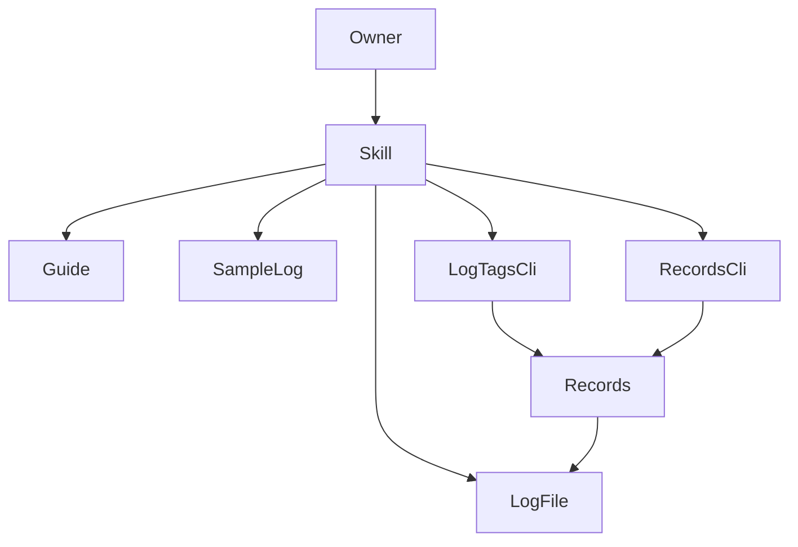
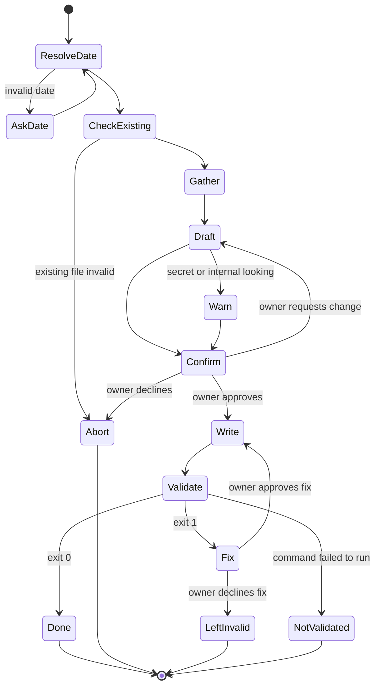

# Design Document: log-writing-skill

## Overview
**Purpose**: サイトのオーナーが Claude Code で `/wil-log` を呼ぶと、その日の学習内容を対話で聞き取って整理し、オーナーの承認を得てから `content/logs/YYYY-MM-DD.md` を作成または追記し、daily-log-page の検証を実行して結果を示す。

**Users**: オーナー（ログの書き手）が、Claude Code との壁打ちの流れの中で使う。

**Impact**: リポジトリに Claude Code の skill `.claude/skills/wil-log/SKILL.md` と、既存 tags の一覧・表記ゆれ候補を返す小さな補助 CLI `wil.log_tags` とその単体テストを追加する。daily-log-page の成果物は変更しない。

### Goals
- 1 回の呼び出しで「聞き取り → 案 → 注意喚起 → 承認 → 書き込み → 検証」までを終える
- 書かれたログが daily-log-page の検証を通る。通らなければその場で理由を示す
- tags の表記を既存ログに揃える提案を、決定的な規則で出す

### Non-Goals
- ログ形式の定義・変更（daily-log-page）
- タグの正規化規則・別名表（tech-timeline）
- 過去知見の検索（knowledge-mcp）、おすすめ生成（learning-recommendation）
- commit・push・ステージング
- 秘密情報の機械検出ツールの新設（pre-commit の gitleaks が既にある）

## Boundary Commitments

### This Spec Owns
- skill `wil-log` の対話手順: 対象日の決定、聞き取り、整理、tags 提案、注意喚起、承認、書き込み、検証、終了時の案内
- 補助 CLI `python -m wil.log_tags` の契約（既存 tags の使用回数つき一覧と、表記ゆれ候補の出力）
- 提案専用の比較キー `variant_key`。保存も公開もせず、正規化規則の契約ではない

### Out of Boundary
- ログ形式の規則と検証規則（daily-log-page の `wil.records`、README、サンプルログが正本）。skill は規則を書き写さず、実行時に README とサンプルログを読む
- `wil.records`・`scripts/build.sh`・pre-commit 設定・`zensical.toml` の変更
- タグの正規化・別名の解決（tech-timeline）
- git 操作全般、`content/logs/` の対象日ファイル以外への書き込み

### Allowed Dependencies
- `wil.log_tags` → `wil.records`（`load_records`, `Record`, `RecordsInvalid`）と Python 標準ライブラリのみ。ファイルを独自にパースしない
- skill → `wil.records` CLI、`wil.log_tags` CLI、`README.md`、サンプルログ（読み取りのみ）、Claude Code 標準ツール（Read / Write / Edit / Bash）
- 新しい外部依存は追加しない

### Revalidation Triggers
- daily-log-page のログ置き場所・ファイル名・`tags`/`summary` 規則の変更
- `Record.tags` の型・意味、`load_records` / `RecordsInvalid` の挙動の変更
- `python -m wil.records` の引数・終了コード・標準エラー形式（`path: reason`）の変更
- README の書き方の節やサンプルログのパスの変更
- tech-timeline がタグ正規化規則を公開したとき（`variant_key` を置き換えるか見直す）

## Architecture

### Architecture Pattern & Boundary Map



- `Skill` = `.claude/skills/wil-log/SKILL.md`、`LogTagsCli` = `python -m wil.log_tags`、`Records` / `RecordsCli` / `Guide` / `SampleLog` = daily-log-page の成果物、`LogFile` = `content/logs/YYYY-MM-DD.md`
- **Selected pattern**: 手順書としての skill + 決定的な処理だけを持つ薄い補助 CLI。判断（整理・注意喚起）は Claude、規則の判定は Python
- **Dependency direction**: Skill → CLI 群 → `wil.records`。`wil.records` は本機能のモジュールを import しない
- **Steering compliance**: パースは `wil.records` のみ、依存追加なし、ローカル専用ツールはリポジトリの skill ディレクトリと `wil` のサブモジュール

### Technology Stack

| Layer | Choice / Version | Role in Feature | Notes |
|-------|------------------|-----------------|-------|
| Agent runtime | Claude Code project skill | 対話手順の実行 | `.claude/skills/wil-log/SKILL.md` |
| Helper | Python 3.12、標準ライブラリ（`unicodedata`, `collections`） | tags 一覧と表記ゆれ候補 | `src/wil/log_tags.py` |
| Upstream | `wil.records`（daily-log-page） | 読み取り・検証 | 変更しない |
| Test | pytest（既存 dev 依存） | 補助 CLI の単体テスト | `tests/test_log_tags.py` |

## File Structure Plan

### Directory Structure
```
.
├── .claude/skills/wil-log/
│   └── SKILL.md              # skill 本体: frontmatter と対話手順（形式規則は README・サンプルログを参照）
├── src/wil/
│   └── log_tags.py           # 既存 tags の一覧と表記ゆれ候補を返す CLI（wil.records 経由で読む）
└── tests/
    └── test_log_tags.py      # log_tags の単体テスト
```

### Modified Files
- なし（daily-log-page の README・`wil.records`・設定は変更しない）

## System Flows



- `Abort` ではファイルを作成・変更しない（4.5, 5.5）。`Write` に入る経路は必ず `Confirm` か `Fix` の承認を通る（4.6）
- `Done`・`LeftInvalid`・`NotValidated` の各終端で、commit と push はオーナーが行う旨を伝える（7.2）

## Requirements Traceability

| Requirement | Summary | Components | Interfaces | Flows |
|-------------|---------|------------|------------|-------|
| 1.1 | 呼び出しで聞き取り開始 | WilLogSkill | `/wil-log [YYYY-MM-DD]` | ResolveDate → Gather |
| 1.2 | 既定は当日 | WilLogSkill | `date +%F` | ResolveDate |
| 1.3 | 指定日を使う | WilLogSkill | `$ARGUMENTS` | ResolveDate |
| 1.4 | 不正な日付は書かずに再指定 | WilLogSkill | 日付検査コマンド | AskDate |
| 1.5 | 置き場所は上流規則 | WilLogSkill | README、サンプルログ | ResolveDate |
| 2.1 | 1 回でまとめて質問 | WilLogSkill | 聞き取り手順 | Gather |
| 2.2 | 会話中の内容を候補に | WilLogSkill | 聞き取り手順 | Gather |
| 2.3 | 見出しと入れ子箇条書きに整理 | WilLogSkill | 整理規則 | Draft |
| 2.4 | 内容を足さない | WilLogSkill | 整理規則 | Draft |
| 2.5 | コード・コマンド・URL をそのまま | WilLogSkill | 整理規則 | Draft |
| 2.6 | tags が決まらないときだけ質問 | WilLogSkill | 聞き取り手順 | Gather |
| 2.7 | 追加質問の限定 | WilLogSkill | 聞き取り手順 | Gather |
| 3.1 | 既存 tags を上流経由で取得 | LogTags, WilLogSkill | `python -m wil.log_tags` | Draft |
| 3.2 | 表記ゆれ候補の提案 | LogTags, WilLogSkill | `find_variants`, `variant_key` | Draft |
| 3.3 | 最終決定はオーナー | WilLogSkill | 確認手順 | Confirm |
| 3.4 | 読み取れなければ提案なしで続行 | LogTags, WilLogSkill | 終了コード 1 + 標準エラー | Draft |
| 3.5 | tags は規則を満たすリスト | WilLogSkill | README、検証 | Draft, Validate |
| 4.1 | パスと全文を提示して承認 | WilLogSkill | 確認手順 | Confirm |
| 4.2 | 秘密情報らしき箇所の注意 | WilLogSkill | 注意喚起チェックリスト | Warn |
| 4.3 | 社外秘・個人情報らしき箇所の注意 | WilLogSkill | 注意喚起チェックリスト | Warn |
| 4.4 | 修正後に全文を再提示 | WilLogSkill | 確認手順 | Confirm → Draft |
| 4.5 | 非承認なら何も書かない | WilLogSkill | 確認手順 | Abort |
| 4.6 | 承認なしに書かない | WilLogSkill | 確認手順 | Confirm, Fix |
| 5.1 | 新規作成 | WilLogSkill | Write | Write |
| 5.2 | 既存本文・他キーを保って末尾に追記 | WilLogSkill | 追記規則 | Draft, Write |
| 5.3 | 既存 tags を残して未登録分を追加 | WilLogSkill | 追記規則 | Draft |
| 5.4 | summary 変更は前後を提示 | WilLogSkill | 追記規則 | Confirm |
| 5.5 | 既存ファイルが不正なら追記しない | WilLogSkill | `python -m wil.records <path>` | CheckExisting → Abort |
| 5.6 | 対象ファイル以外を変えない | WilLogSkill | 実行規則（`--frozen`、書き込み先の固定） | Write |
| 6.1 | 書き込み後に検証 | WilLogSkill | `python -m wil.records <path>` | Validate |
| 6.2 | 成功とパスを伝える | WilLogSkill | 終了コード 0 | Done |
| 6.3 | 失敗理由をそのまま伝え修正案 | WilLogSkill | 標準エラー `path: reason` | Fix |
| 6.4 | 修正を断られたら不正な状態を伝える | WilLogSkill | 終了時の案内 | LeftInvalid |
| 6.5 | 検証できなければ検証済みと言わない | WilLogSkill | 終了時の案内 | NotValidated |
| 7.1 | git 操作をしない | WilLogSkill | 実行規則 | — |
| 7.2 | commit・push はオーナーと伝える | WilLogSkill | 終了時の案内 | 全終端 |
| 7.3 | 検索・おすすめをしない | WilLogSkill | 実行規則 | — |

## Components and Interfaces

| Component | Domain/Layer | Intent | Req Coverage | Key Dependencies | Contracts |
|-----------|--------------|--------|--------------|------------------|-----------|
| WilLogSkill | Agent 手順（`.claude/skills/wil-log/SKILL.md`） | 対話でログを作成・追記し検証する | 1.1–1.5, 2.1–2.7, 3.1–3.5, 4.1–4.6, 5.1–5.6, 6.1–6.5, 7.1–7.3 | LogTags (P1), RecordsCli (P0), Guide (P0) | State |
| LogTags | 補助 CLI（`src/wil/log_tags.py`） | 既存 tags の一覧と表記ゆれ候補 | 3.1, 3.2, 3.4 | `wil.records` (P0) | Service, Batch |
| LogTagsTests | テスト（`tests/test_log_tags.py`） | LogTags の判定と CLI の検証 | 3.1, 3.2, 3.4 | LogTags (P0), pytest (P1) | — |

### Agent 手順

#### WilLogSkill

| Field | Detail |
|-------|--------|
| Intent | 聞き取りから検証までを 1 回の呼び出しで行う手順書 |
| Requirements | 1.1–1.5, 2.1–2.7, 3.1–3.5, 4.1–4.6, 5.1–5.6, 6.1–6.5, 7.1–7.3 |

**Responsibilities & Constraints**
- skill 名は `wil-log`（`kiro-*` と区別）。frontmatter: `name: wil-log`、`description`（「その日の学習ログを対話で作成・追記する」旨と起動語）、`argument-hint: [YYYY-MM-DD]`
- `allowed-tools` には読み取り専用の固定コマンド（`date`、`git rev-parse --show-toplevel`、`uv run --frozen python -m wil.records`、`uv run --frozen python -m wil.log_tags`、ResolveDate の日付検査コマンド）だけを列挙する。複合コマンド（`cd ... && uv run ...`）が事前許可パターンに一致しない場合は許可確認が出るだけで動作は変わらない。一致の可否は実装時に確認する。Write / Edit / git の他サブコマンドは列挙しない。`allowed-tools` は事前許可であり禁止ではないため、7.1・5.6 は本文の実行規則で守る（記法は実装時に公式ドキュメントで確認）
- ログ形式の規則（ファイル名、frontmatter の各キーの条件）を SKILL.md に書き写さない。手順の最初に `README.md` の書き方の節とサンプルログ `content/logs/2026-11-23.md` を読み、それに従うと指示する
- すべてのコマンドはリポジトリルートで実行する: `cd "$(git rev-parse --show-toplevel)" && uv run --frozen python -m ...`（`CONTENT_DIR` が相対パスのため。`--frozen` で `uv.lock` を変えない）

**Contracts**: State [x]

##### State Management（手順の各段）
| 段 | 振る舞い | Req |
|----|---------|-----|
| ResolveDate | 引数なし → `date +%F`。引数あり → `uv run --frozen python -c "import datetime,sys; datetime.date.fromisoformat(sys.argv[1])" <arg>` で検査し、失敗なら書かずに再指定を求める。日付の取得・検査コマンド自体が実行できない（uv 不在など）ときは、その理由を伝えてオーナーに対象日を尋ね、答えた日付を対象日とする。対象パスは README の規則で決める | 1.2–1.5 |
| CheckExisting | 対象ファイルがあれば `python -m wil.records <path>` を実行。終了コード 1 なら理由を伝えて終了（追記しない）。コマンド自体が実行できなければ、既存ファイルの正しさを確かめられないため追記せず、理由を伝えて終了 | 5.5, 6.5 |
| Gather | 会話中に学習内容があればそれを候補として示す。無ければ「学んだこと・気になった技術・メモ」を 1 回で尋ねる。追加質問は tags が決まらない場合と対象日の確認だけ | 1.1, 2.1, 2.2, 2.6, 2.7 |
| Draft | 見出し（`##` 以下）と入れ子の箇条書きに整理。オーナーの言葉にない事実・説明・感想を足さない。コード・コマンド・URL は原文どおり。tags 案の後に `python -m wil.log_tags <案...>` を実行し、候補があれば「既存の表記 X に揃えますか」と提案。終了コード 1 のとき、またはコマンド自体が実行できない（uv 不在、モジュール不在など）ときは、提案なしで続行し理由を伝える。追記時は既存 tags に未登録分だけを加える | 2.3–2.5, 3.1–3.5, 5.3 |
| Warn | 下記チェックリストに当たる箇所を引用して、公開されることへの注意を促す | 4.2, 4.3 |
| Confirm | 書き込み先パスと書き込む全文（追記時は追記後の全文と、追記部分・tags 差分・summary の変更前後）を示して承認を求める。修正依頼は Draft に戻り全文を再提示。拒否・中止なら何も書かずに終了 | 3.3, 4.1, 4.4–4.6, 5.4 |
| Write | 新規: 承認全文を Write。追記: 既存の本文と `tags`・`summary` 以外の frontmatter をそのまま保ち、本文末尾に空行 1 つを挟んで承認本文を加えた全文を書く。書き込み先は対象パスのみ | 5.1, 5.2, 5.6 |
| Validate | `python -m wil.records <path>` を実行。0 → 成功とパスを伝える。1 → 標準エラーの理由をそのまま伝え修正案を示して承認を求める（承認後 Write に戻る）。修正を断られたら不正なまま残っていることと理由を伝える。コマンド自体が実行できない（uv 不在、モジュール不在など）→ 検証していないこととその理由を伝え、検証済みと言わない | 6.1–6.5 |
| 終了時 | 「commit と push はオーナーが内容を確認して行う」と伝える | 7.2 |

**注意喚起チェックリスト（Warn）**
- 秘密情報らしいもの: API キー・トークン・パスワード・秘密鍵・接続文字列・`.env` の中身・認証つき URL（4.2）
- 社外秘・個人情報らしいもの: 社内システム名・社内 URL やホスト名・顧客名・同僚の個人名・メールアドレス・未公開の業務情報（4.3）
- 該当がなければ注意喚起は省略する（質問を増やさない）

**実行規則（本文に明記する禁止事項）**
- git の commit / push / add などの状態を変えるコマンドを実行しない（7.1）
- 対象日のログファイル以外を作成・変更・削除しない（5.6）
- 過去ログの内容の検索・提示、学習のおすすめは行わない。求められたら対象外である旨を伝える（7.3）

**Implementation Notes**
- Integration: daily-log-page の実装（`wil.records`、README、サンプルログ）が存在することが前提
- Validation: 手動シナリオ（Testing Strategy）で確認する
- Risks: 注意喚起は Claude の判断に依存する。最終防衛線は全文承認と pre-commit の gitleaks

### 補助 CLI

#### LogTags（`wil.log_tags`）

| Field | Detail |
|-------|--------|
| Intent | 既存ログの tags を数え、表記ゆれの候補を決定的に返す |
| Requirements | 3.1, 3.2, 3.4 |

**Responsibilities & Constraints**
- ログの読み取りは `load_records()` のみ。ファイルを直接開かない
- 副作用なし（読み取りと標準出力・標準エラーへの出力のみ）
- `variant_key` は提案のための比較にだけ使い、結果を保存・公開しない

**Dependencies**
- Inbound: WilLogSkill — tags 一覧と候補の取得（P1）
- Outbound: `wil.records.load_records`, `Record`, `RecordsInvalid` — ログ読み取り（P0）

**Contracts**: Service [x] / Batch [x]

##### Service Interface
```python
from collections.abc import Iterable
from wil.records import Record

def tag_counts(records: Iterable[Record]) -> list[tuple[str, int]]:
    """各 tag（書かれたままの文字列）の使用ログ数。件数の降順、同数は文字列の昇順。"""

def variant_key(tag: str) -> str:
    """NFKC 正規化 → casefold → 空白と - _ . ・ を除去した比較キー。結果が空なら tag.strip() を返す。
    tech-timeline の tag_key と完全に同一の規則（片方だけ変えない）。"""

def find_variants(candidates: Iterable[str], counts: list[tuple[str, int]]) -> dict[str, str]:
    """candidate と variant_key が一致し文字列が異なる既存 tag を返す（candidate -> 既存 tag）。
    candidate と完全一致する既存 tag がある場合は含めない。複数一致時は使用数の多いもの。"""

def main(argv: list[str] | None = None) -> int: ...
```
- Preconditions: カレントディレクトリがリポジトリルート
- Postconditions: 入力を変更しない
- Invariants: `find_variants` の値は常に `counts` に含まれる tag

##### Batch / Job Contract
- Trigger: `uv run --frozen python -m wil.log_tags [CANDIDATE ...]`
- 引数なし: 既存 tags を `tag<TAB>count` で 1 行ずつ標準出力（`tag_counts` の順）。ログ 0 件なら出力なし。終了コード 0
- 引数あり: 候補がある candidate ごとに `candidate<TAB>existing` を標準出力。候補なしなら出力なし。終了コード 0
- `RecordsInvalid` 時: 各誤りを `path: reason` で標準エラーに出し、終了コード 1（3.4）
- Idempotency: 読み取り専用

## Data Models

### Data Contracts & Integration
- 書き込むファイルの形式は daily-log-page の「ログファイルの形式」に従う（本機能では再定義しない）
- 追記時の組み立て:
  - frontmatter: 既存のキーと値の順序・内容を保ち、`tags` は既存要素の後ろに承認された新規要素を加える。`summary` は承認された場合のみ置き換え、または新規に加える
  - 本文: 既存本文 + 空行 1 つ + 承認された追記本文

## Error Handling

| 状況 | 振る舞い | Req |
|------|---------|-----|
| 指定日が暦上存在しない | 書かずに再指定を求める | 1.4 |
| 既存の対象ファイルが不正 | 理由を伝え、追記せず終了 | 5.5 |
| 追記前の検証コマンドが実行できない | 理由を伝え、追記せず終了 | 5.5, 6.5 |
| 既存ログ全体に不正があり tags を読めない | 提案なしで続行し、理由（`path: reason`）を伝える | 3.4 |
| 補助 CLI が実行できない | 提案なしで続行し、実行できなかった理由を伝える | 3.4 |
| 日付の取得・検査コマンドが実行できない | 理由を伝えてオーナーに対象日を尋ね、答えた日付を使う | 1.2–1.4 |
| オーナーが拒否・中止 | 何も書かずに終了 | 4.5 |
| 書き込み後の検証失敗 | 理由をそのまま伝え修正案を承認制で適用。断られたら不正なまま残っていると伝える | 6.3, 6.4 |
| 検証コマンドが実行できない | 検証していないことと理由を伝える | 6.5 |

## Testing Strategy

### Unit Tests（`tests/test_log_tags.py`、`tmp_path` に `content/logs/` を作り、`monkeypatch.chdir(tmp_path)` でリポジトリルート相当にして検証）
- `tag_counts`: 複数ログの tags を数え、件数降順・同数は文字列昇順で返す（3.1）
- `variant_key`: `AWS`/`aws`、`Node.js`/`nodejs`、`GitHub Actions`/`github-actions`、全角 `ＡＷＳ` が同じキーになり、`C++` と `C`、`C#` と `C` は異なるキーになる。`-` は空にならず `"-"` になる（空結果のフォールバック）（3.2）
  - 規則のずれ検出: 本テスト（`tests/test_log_tags.py`）が同じ入出力例を `wil.log_tags.variant_key` と `wil.tech_timeline.tag_key` の両方に適用し、両者の不一致を検出する。`wil.tech_timeline` は `pytest.importorskip("wil.tech_timeline")` で読み込み、未実装なら skip する（3.2）
- `find_variants`: 完全一致は候補にしない、表記違いだけを返す、複数一致時は使用数の多いものを返す（3.2）
- `main([])` が `tag<TAB>count` 行を出して 0、`main(["aws"])` が `aws<TAB>AWS` を出して 0、不正ログが混じると標準エラーに `path: reason` を出して 1（3.1, 3.4）

### Manual Scenario Checks（skill の受け入れ確認。オーナーが Claude Code 上で対話・承認・拒否を行って実施し、各シナリオの観察結果を記録する）
- 前提: 新規作成を確かめるシナリオは、ログが無い日付で行う（当日のログが既にある場合、シナリオ 1 は当日のパスが選ばれ追記の流れになることを確認し、新規作成は日付指定で確認する）
- 後片付け: シナリオで作ったファイル（シナリオ 4・8・10 の試験用ログを含む）は削除し、退避したファイルは元に戻し、シナリオ 11 で外したプロファイルの PATH 追加は元に戻して再起動し `command -v uv` の成功を確かめ、変更した追跡ファイル（サンプルログなど）は `git restore` で戻す。試験用ログはコミットしない
1. 当日・新規: 引数なしで呼び出し、1 回の質問 → 案 → 全文提示 → 承認 → 作成 → 検証成功 → commit/push はオーナーと案内（1.1, 1.2, 2.1, 2.3, 4.1, 5.1, 6.1, 6.2, 7.2）
2. 会話中に話した内容がある状態で呼び出し、同じ質問をせず候補として示す。案に話していない事実が足されず、コード・URL が原文どおり（2.2, 2.4, 2.5）。別に、tags を決めにくい内容（例「今日は特に技術はない、雑記」）で呼び出すと、追加質問は tags についてだけ出る（2.6, 2.7）
3. 日付指定 `2026-02-30` → 書かずに再指定を求める。`2026-11-20` → そのパスが対象になる（1.3, 1.4, 1.5）
4. 前準備として tags に `AWS` を含む正しい試験用ログを、ログが無い別日（例 `content/logs/2026-11-18.md`）に作る。その状態で `aws` を挙げる → 揃える提案。オーナーが `aws` を選べば `aws` のまま（3.2, 3.3, 3.5）
5. 同日 2 回目の呼び出し → 既存本文と他キーが変わらず末尾に追記、tags は未登録分だけ追加、summary 変更時は前後が提示される（5.2, 5.3, 5.4）
6. 案に `sk-` で始まるキー風文字列や社内ホスト名を含める → 承認前に該当箇所の注意が出る（4.2, 4.3）
7. 修正依頼 → 全文が再提示される。拒否 → ファイルが作られない／変わらない（`git status` で確認）（4.4, 4.5, 4.6）
8. 前準備としてログが無い日付（例 `2026-11-19`）に `tags` を欠落させた試験用ログ `content/logs/2026-11-19.md` を作り、その日付を指定して呼び出す → 追記せず理由を伝える（5.5）
9. シナリオ 8 の `content/logs/2026-11-19.md` を残したまま、ログが無い別日（例 `2026-11-17`）を指定して呼び出す → tags 提案なしで続行し理由を伝える（3.4）
10. skill は tags を常にリストで書く（3.5）ため、通常の流れでは検証失敗を起こせない。前準備としてログが無い日付（例 `2026-11-21`）に `tags` を欠落させた試験用ログ `content/logs/2026-11-21.md` を作る。日付指定で `/wil-log` を呼ぶと CheckExisting で終了するため呼ばず、skill を読み込んだ会話で「wil-log の Validate 段を `content/logs/2026-11-21.md` に対して実行して」と指示する → 理由がそのまま示され修正案の承認を求める。承認 → 書き直して再検証が成功する。ファイルを再び不正に作り直して同じ指示をし、修正を断る → 不正なまま残っていると伝える（6.3, 6.4）
11. `uv` が使えない環境（PATH から外す。Claude Code の Bash ツールはプロファイルからシェルを初期化するため、開始前に Bash ツール内で `command -v uv` が失敗することを確かめ、成功する場合はプロファイル側の PATH 追加を一時的に外して再起動する）で、ログが無い日付（例 `2026-11-22`）を引数に指定して呼び出す（既存ファイル検査で終了しないため）。シナリオ 12 の直前に行う→ 日付検査ができない理由を伝えて対象日を尋ねる。tags 提案なしで続行し理由を伝える。承認・書き込み後、検証していないと伝え、成功と言わない（1.4, 3.4, 6.5）
12. 全シナリオ後に `git status` / `git log` で、対象ログ以外の変更・commit・ステージングが無いこと（5.6, 7.1）。検索・おすすめを頼むと対象外と答える（7.3）。追加質問が tags と日付の確認以外に無い（2.6, 2.7）

## Security Considerations
- 公開リポジトリのため、書き込みは必ず全文承認の後に限る。skill は書き込み系ツールを事前許可しない
- 秘密情報の注意喚起は skill、機械検出は daily-log-page の pre-commit（gitleaks、detect-private-key）が担う二重構成
- skill は外部サービスへ内容を送信するコマンドを使わない
