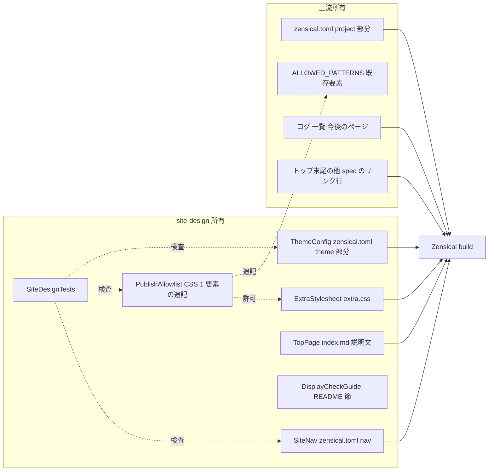
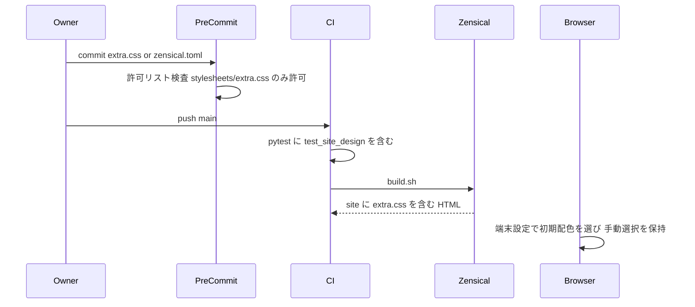

# Design Document: site-design

## Overview
**Purpose**: 学習ログサイトの見た目を 1 か所で所有し、ログ本文・日付・タグ・一覧を日本語で読みやすくする。ライト/ダークは端末設定に従い、手動でも切り替えられる。トップページではサイトの目的が伝わるようにする。今後追加されるページも、通常の文書構造だけで同じ見た目になる。

**Users**: オーナー（書き手兼閲覧者）と、オーナーが学習記録を紹介する相手が閲覧に使う。後続 spec（tech-timeline、learning-recommendation）の実装者は、ページ構造だけを書けば同じ見た目になるという約束に従う。

**Impact**: daily-log-page の `zensical.toml` にテーマ設定（配色、書体、機能フラグ）と追加 CSS の登録、トップページと一覧ページだけを日本語の区分名で並べる `nav` を足し、`content/stylesheets/extra.css` を新設する。公開許可リスト `wil.records.ALLOWED_PATTERNS` には CSS 1 ファイルだけを許すパターンを追加する。`content/index.md` の説明文の書き換え、`README.md` への確認手順の追記、回帰テスト 1 ファイルの追加も行う。テンプレート上書きと独自 JS は持たない。

### Goals
- テーマ組み込み機能と追加 CSS 1 ファイルだけで、Requirement 1〜8 の見た目を満たす
- 他 spec に見た目の責務を漏らさない。ページは通常の Markdown 構造だけで書く
- 設定の参照切れと上流設定の消失を、公開前にテストで止める

### Non-Goals
- ページの内容と生成（log-index、tech-timeline、learning-recommendation）
- テンプレート上書き（`custom_dir`）、独自 JS（`extra_javascript`）、Web フォント
- 生成ページの置き場所・ファイル名の変更（各生成 spec の所有。本 spec はナビの区分名と並びだけを決める）
- ロゴ・ファビコン・ブランド制作、検索品質の改善
- Zensical の版の変更（上流の固定 `==0.1.1` のまま）

## Boundary Commitments

### This Spec Owns
- サイトのテーマ設定: `zensical.toml` の `[project] extra_css` と `[project.theme]` の `palette`・`font`・`features`
- ナビゲーションの構成: `zensical.toml` の `[project] nav`（区分名・並び・長さ。roadmap の決定）。後続の生成 spec は「ナビ契約」に従い 1 項目を追記するだけ
- 見た目の定義の唯一のファイル `content/stylesheets/extra.css` とその中のすべての規則
- 他 spec に対するスタイル契約（後述「スタイル契約」）。ページが使ってよい構造と、ページが持ってはならない見た目の指定
- トップページ `content/index.md` の見出しと説明文（他 spec が末尾に追記したリンク行を除く）。daily-log-page の SiteContent は初期の文面を用意するだけで、以後の見出しと説明文は本 spec が引き継ぐ
- 手順書 `README.md` の「見た目の確認」節（追記）
- 回帰テスト `tests/test_site_design.py`
- 上流ファイルへの追記: `wil.records.ALLOWED_PATTERNS` への 1 要素 `r"stylesheets/extra\.css"`（上流が明示的に許可）

### Out of Boundary
- `zensical.toml` の `site_name`・`site_url`・`docs_dir`・`site_dir`・`[project.theme] language`・`[project.plugins.tags]`（daily-log-page 所有。本 spec は変更しない）
- `wil.records` の型・関数・検証規則（許可リストへの 1 要素追加を除く）、ログの書式、サンプルログ
- 一覧ページ・生成ページの Markdown 構造と内容、`content/generated/` の名前、`scripts/*.sh`、`.github/workflows/deploy.yml`
- トップページ末尾に他 spec が追記するリンク行（log-index、tech-timeline、learning-recommendation の各所有。1 文字も変えない）
- タグの正規化、検索

### Allowed Dependencies
- Zensical（上流で固定済み `==0.1.1`）の組み込みテーマ機能: 配色（`palette`）、書体（`font`）、機能フラグ（`features`）、`extra_css`、テーマの CSS 変数（`--md-text-font`、`--md-code-font`、`--md-typeset-a-color`、`--md-accent-fg-color` など）
- Python 標準ライブラリ `tomllib`（テストのみ）と、上流の `wil.records.ALLOWED_PATTERNS`（テストで参照）
- 新規の外部依存は追加しない。外部サーバー（Web フォント・CDN）に依存しない
- 依存方向: 本 spec の CSS は生成 HTML の本文領域と要素型にのみ依存し、特定ページの構造には依存しない

### Revalidation Triggers
- スタイル契約（使ってよい構造、禁止事項）の変更 — tech-timeline、learning-recommendation、log-index
- 見た目の定義ファイルのパス・数の変更（許可リストとテストの変更を伴う）— daily-log-page
- `content/index.md` の構成変更でトップページ末尾のリンク行の位置や前提が変わる場合 — log-index、tech-timeline、learning-recommendation
- daily-log-page の SiteContent（トップページの初期文面）を再適用・変更する場合 — 本 spec の TopPage と衝突するため daily-log-page 側で再確認する
- Zensical の版更新（CSS のセレクタ、アイコン名、`font = false` の挙動の再確認）— 全体の表示確認
- 上流が `language`・tags プラグイン・`docs_dir` を変更した場合 — 本 spec のテストの更新
- ナビ契約・`nav` の項目、一覧ページのパスまたは H1 の変更 — log-index、tech-timeline、learning-recommendation

## Architecture

### Existing Architecture Analysis
- 実装はまだ無く、上流 2 spec の設計を既存システムとして扱う。`zensical.toml` の `[project]` 表に全設定があり、`docs_dir = "content"` の中だけが公開される
- 公開許可リストは pre-commit（`files: ^content/`）とビルドの検証段の両方で使われる。`content/` に置くファイルはすべてここで許可されていなければならない
- CI は `uv run pytest` を `./scripts/build.sh` より先に実行する。テストの失敗で公開が止まる

### Architecture Pattern & Boundary Map



**Architecture Integration**:
- Selected pattern: テーマ設定 + 追加 CSS 1 ファイル。テンプレートは上書きしない
- Domain/feature boundaries: 見た目はすべて ThemeConfig と ExtraStylesheet にある。ページ側（上流・後続）は構造だけを持つ
- Existing patterns preserved: 公開範囲は `docs_dir` と許可リストで決まる。上流所有ファイルへの変更は追記のみ（トップページの説明文を除く）
- New components rationale: ExtraStylesheet は組み込み設定で足りない本文の細部のため、SiteDesignTests は参照切れと上流設定の消失を止めるため
- Steering compliance: 依存を増やさない。組み込み機能を優先する。秘密情報・外部通信を持たない

### Technology Stack

| Layer | Choice / Version | Role in Feature | Notes |
|-------|------------------|-----------------|-------|
| Site generator | Zensical `==0.1.1`（上流で固定） | テーマ、配色切り替え、上部へ戻る、前後リンク、追加 CSS の読み込み | 既定の `modern` バリアント。版は変えない |
| Styling | CSS（1 ファイル、プリプロセッサなし） | 書体変数、行間、入れ子リスト、リンク下線、フォーカス枠、タグのラベル | テーマの CSS 変数を使い、両配色に自動で追従させる |
| Fonts | 端末のシステム書体 | 日本語本文・等幅 | `font = false`。Web フォントなし |
| Test | pytest、標準 `tomllib` | 設定の回帰検査 | 新規依存なし |

## File Structure Plan

### Directory Structure
```
.
├── content/
│   └── stylesheets/
│       └── extra.css          # 新規。見た目の定義の唯一のファイル（ExtraStylesheet）
└── tests/
    └── test_site_design.py    # 新規。設定の回帰検査（SiteDesignTests）
```

### Modified Files
- `zensical.toml` — `[project]` に `extra_css = ["stylesheets/extra.css"]` を追加し、`[project.theme]` に `font = false`、`features`、`[[project.theme.palette]]` 2 要素を追加する（ThemeConfig）。既存のキー（`language` を含む）と `[project.plugins.tags]` は変えない
- `src/wil/records.py` — `ALLOWED_PATTERNS` の末尾に `r"stylesheets/extra\.css"` を 1 要素追加する（PublishAllowlist）。他は変えない
- `content/index.md` — 先頭の見出しと説明文を書き換える（TopPage）。末尾に他 spec が追記したリンク行（log-index、tech-timeline など）はすべて 1 文字も変えずに残す
- `README.md` — 末尾に「見た目の確認」節を追記する（DisplayCheckGuide）。既存の節は変えない

## System Flows



- テストが失敗すると build に進まず公開されない（9.2、9.3）
- 配色の選択と保持はテーマ組み込みの処理で行い、独自 JS は無い（4.1〜4.4、8.4）

## Requirements Traceability

| Requirement | Summary | Components | Interfaces | Flows |
|-------------|---------|------------|------------|-------|
| 1.1 | 日本語書体、行の高さ 1.7 倍以上 | ExtraStylesheet, ThemeConfig | `--md-text-font`、本文の `line-height` | — |
| 1.2 | 入れ子リスト 3 階層の区別 | ExtraStylesheet | 入れ子 `ul`/`ol` の規則 | — |
| 1.3 | 見出しの階層の区別 | ExtraStylesheet | `h2`〜`h4` の規則（既定で満たせば書かない） | — |
| 1.4 | コードの区別 | ExtraStylesheet | テーマ既定のコード表示（確認のみ） | — |
| 1.5 | コード・表のはみ出し | ExtraStylesheet | テーマ既定の横スクロール（確認のみ） | — |
| 1.6 | 360px で横スクロールなし | ExtraStylesheet | 長い語の折り返し規則 | — |
| 1.7 | 外部から書体を読まない | ThemeConfig | `font = false` | — |
| 2.1 | タイトル（日付）を本文先頭に大きく | ThemeConfig, ExtraStylesheet | テーマ既定のページタイトル（確認のみ。満たさない場合の扱いは ExtraStylesheet 参照） | — |
| 2.2 | タグをラベル状に全部表示 | ExtraStylesheet | タグ要素の規則 | — |
| 2.3 | タグの折り返し | ExtraStylesheet | タグ要素の規則 | — |
| 3.1 | 年度・月の見出しの階層 | ExtraStylesheet | `h2`/`h3` の規則（1.3 と共通） | — |
| 3.2 | 一覧項目の間の余白 | ExtraStylesheet | `li` の余白 | — |
| 3.3 | 等幅の数字 | ExtraStylesheet | `font-variant-numeric: tabular-nums` | — |
| 3.4 | 印なしで一覧の見た目 | ExtraStylesheet | スタイル契約 | — |
| 4.1, 4.2 | 端末設定に従う初期配色 | ThemeConfig | `[[project.theme.palette]]` の `media` | ビルド→閲覧 |
| 4.3 | 日本語名の切り替え操作 | ThemeConfig | `toggle.name`、`toggle.icon` | — |
| 4.4 | 手動選択の保持 | ThemeConfig | テーマ組み込みの保持（確認のみ） | ビルド→閲覧 |
| 4.5 | 両配色で同じ構造 | ExtraStylesheet | 配色に依存しない規則、色はテーマ変数 | — |
| 5.1, 5.2 | 目的と一覧リンクが最初の画面に | TopPage | `content/index.md` 本文 | — |
| 5.3 | 一覧・検索へ 1 操作 | TopPage, ThemeConfig | 一覧リンク行、ヘッダーの検索（既定） | — |
| 6.1 | 上部へ戻る | ThemeConfig | `navigation.top` | — |
| 6.2 | ナビに載るページの前後リンク | ThemeConfig, SiteNav | `navigation.footer`、`nav` の並び | — |
| 7.1 | 文字とリンク 4.5:1 | ThemeConfig, ExtraStylesheet | 組み込み色、不足時の配色別上書き | — |
| 7.2 | 操作部品 3:1 | ExtraStylesheet | タグの枠線、テーマ既定の切り替えボタン | — |
| 7.3 | フォーカス枠 3:1 | ExtraStylesheet | `:focus-visible` の規則 | — |
| 7.4 | 本文リンクの下線 | ExtraStylesheet | 本文内 `a` の規則 | — |
| 8.1, 8.2 | 全ページ共通の見た目 | ExtraStylesheet | スタイル契約 | — |
| 8.3 | 見た目の定義は 1 か所 | ExtraStylesheet, SiteDesignTests | スタイル契約、`extra_css` が 1 ファイルだけ | — |
| 8.4 | 独自の処理を追加しない | ThemeConfig, SiteDesignTests | `extra_javascript` と `custom_dir` が無いこと | — |
| 8.5 | 公開ファイルは CSS 1 つだけ | PublishAllowlist, SiteDesignTests | `r"stylesheets/extra\.css"` | コミット・ビルド |
| 9.1 | 確認手順書 | DisplayCheckGuide | README「見た目の確認」節 | — |
| 9.2 | 参照切れでテスト失敗 | SiteDesignTests | `extra_css` の参照先の存在 | CI |
| 9.3 | 言語宣言・タグ設定の消失でテスト失敗 | SiteDesignTests | `language`、tags プラグイン | CI |
| 10.1 | トップと一覧だけを日本語名・決まった順で | SiteNav | `nav` の項目表 | ビルド→閲覧 |
| 10.2 | ログ・技術別ページでナビが伸びない | SiteNav | `nav` に載せない（一覧のリンクと検索で到達） | — |
| 10.3 | ナビの形の崩れでテスト失敗 | SiteDesignTests | `nav` の形の検査 | CI |

## Components and Interfaces

| Component | Domain/Layer | Intent | Req Coverage | Key Dependencies (P0/P1) | Contracts |
|-----------|--------------|--------|--------------|--------------------------|-----------|
| ThemeConfig | 設定（`zensical.toml` のテーマ部分） | 配色・書体・機能フラグ・CSS の登録 | 1.7, 2.1, 4.1–4.4, 5.3, 6.1, 6.2, 7.1, 8.4 | Zensical (P0) | State |
| ExtraStylesheet | 見た目（`content/stylesheets/extra.css`） | 本文の細部とスタイル契約の実体 | 1.1–1.6, 2.1–2.3, 3.1–3.4, 4.5, 7.1–7.4, 8.1–8.3 | ThemeConfig (P0) | State |
| PublishAllowlist | 上流への追記（`src/wil/records.py`） | CSS 1 ファイルだけを公開許可 | 8.5 | `wil.records` (P0) | State |
| TopPage | コンテンツ（`content/index.md`） | サイトの目的と一覧への導線 | 5.1–5.3 | log-index の一覧リンク行 (P0) | — |
| DisplayCheckGuide | 手順書（`README.md` の節） | 主要ページの表示確認手順 | 9.1 | — | — |
| SiteNav | 設定（`zensical.toml` の `[project] nav`） | 日本語の区分名で、トップと一覧ページだけを並べる | 6.2, 10.1, 10.2 | 各生成 spec の一覧ページ (P0) | State |
| SiteDesignTests | テスト（`tests/test_site_design.py`） | 設定の回帰検査 | 8.3, 8.4, 8.5, 9.2, 9.3, 10.3 | ThemeConfig, PublishAllowlist, SiteNav (P0) | — |

### 設定

#### ThemeConfig（`zensical.toml` への追加）

| Field | Detail |
|-------|--------|
| Intent | 組み込みテーマ機能で、配色・書体・ナビ補助を宣言し、追加 CSS を登録する |
| Requirements | 1.7, 2.1, 4.1, 4.2, 4.3, 4.4, 5.3, 6.1, 6.2, 7.1, 8.4 |

**Contracts**: State [x]

##### State Management（追加する設定値）
以下は追加後の `zensical.toml` の該当部分（統合後の状態）。上流の既存キーと表見出しは重複させず、追加分だけを書き足す。
```toml
[project]
# 上流のキー（site_name, site_url, docs_dir, site_dir）はそのまま
extra_css = ["stylesheets/extra.css"]

[project.theme]
language = "ja"            # 上流の値。変更しない
font = false               # Google Fonts を読み込まない（1.7）
features = [
  "navigation.top",        # 上部へ戻る（6.1）
  "navigation.footer",     # 前後ページのリンク（6.2）
]

[[project.theme.palette]]
media = "(prefers-color-scheme: light)"
scheme = "default"
primary = "indigo"
accent = "indigo"
toggle.icon = "lucide/sun"
toggle.name = "ダークモードに切り替え"

[[project.theme.palette]]
media = "(prefers-color-scheme: dark)"
scheme = "slate"
primary = "indigo"
accent = "indigo"
toggle.icon = "lucide/moon"
toggle.name = "ライトモードに切り替え"

# [project.plugins.tags] は上流のまま
```
- 端末設定がライト、未指定、または判定できない場合は、最初の要素（ライト）が使われる（4.2）
- `variant` は指定しない（既定 `modern`）。`custom_dir`、`extra_javascript` は追加しない（8.4）。`nav` は SiteNav で定義する
- 検索の入口はテーマ既定のヘッダーにあり、設定しない（5.3）

**Implementation Notes**
- Integration: TOML では `[project.theme]` のキーを `[[project.theme.palette]]` より前に書く（配列表の後に書くと別の表に属するため）
- Validation: 固定版での最初のビルドで、(a) ビルドが成功する、(b) 生成 HTML に Google Fonts への参照が無い、(c) 切り替えボタンの `title` と `aria-label`（読み上げ名）が日本語、(d) `stylesheets/extra.css` が読み込まれる、を確認する
- Risks: `lucide/*` が固定版に無くビルドが失敗した場合は `fontawesome/solid/sun` / `fontawesome/solid/moon` に替える。手動選択の保持（4.4）が働かない場合は独自 JS で補わず、要件の見直しに戻る

#### SiteNav（`zensical.toml` の `[project] nav`）

| Field | Detail |
|-------|--------|
| Intent | ナビをトップページと一覧ページだけにし、日本語の区分名と並びを固定する |
| Requirements | 6.2, 10.1, 10.2 |

**Contracts**: State [x]

##### State Management（`[project]` 表に追加する値）
```toml
nav = [
  { "ホーム" = "index.md" },
  { "学習ログ一覧" = "generated/log-index.md" },
  { "技術一覧" = "generated/tech-timeline.md" },              # tech-timeline 実装済みの場合のみ
  { "学習のおすすめ" = "generated/learning-recommendation.md" }, # learning-recommendation が追記
]
```
- 区分名は各一覧ページの H1 と同じ日本語にする。並びはトップ → 学習ログ一覧 → 技術一覧 → 学習のおすすめ（10.1）
- ログページ（`logs/*.md`）・技術別ページ（`generated/tech-timeline/<slug>.md`）・おすすめの技術別ページは載せない。ビルドと検索の対象には残り、一覧ページのリンクと検索で到達する。ログが何件増えてもナビは最大 4 項目（10.2）
- 前後ページのリンク（`navigation.footer`）はナビに載るページの間だけに出る。ログページには出ず、ログ間の移動は一覧ページから行う（6.2）
- `.pages` 形式の設定や、フォルダ由来の区分名を変える機能フラグは Zensical の公式文書に無いため使わない（research.md）

##### ナビ契約（後続の生成 spec が従う約束）
- 一覧ページを追加する生成 spec は、`nav` の末尾に `{ "<本 spec が定めた区分名>" = "generated/<name>.md" }` を 1 項目だけ追記する。それ以外の項目・順序は変えない（トップページ末尾のリンク行と同じ扱い）
- 生成器がまだ無いページの項目は先に書かない。Zensical は解決できない `nav` の文字列を URL として扱い、`--strict` でも検出されない無効なリンクになるため

##### `--strict` と gitignore された生成ページ
- `nav` の参照先は、ビルド時点の `docs_dir`（ディスク上のファイル）で解決される。git の追跡状況は関係しない
- `scripts/build.sh` と CI は常に「生成 → `zensical build --clean --strict`」の順で動くため、ビルド時点で `generated/*.md` は存在する
- `nav` に無いページ（ログ等）は警告にならず、`--strict` は成功する（調査は 0.1.3 で確認。上流の固定が 0.1.1 に変わったため、実装時のビルド確認で 0.1.1 でも成り立つか確かめる。research.md）。もし将来の版で報告されるようになった場合は、公式の `not_in_nav` で `logs/` 等を指定して抑える
- 逆に、生成ページが無いと項目は黙って無効なリンクになる。pytest は生成前に動くため参照先の存在は検査せず、形だけを検査する（SiteDesignTests）。存在は実装タスクのビルド確認で見る

**Implementation Notes**
- Validation: `./scripts/build.sh` の後、`nav` の各項目に対応する `site/<パス>/index.html`（トップは `site/index.html`）が存在し、ナビに日本語の区分名だけが出て、ログページの日付が並ばないことを確認する
- Risks: 生成 spec が H1 を変えると区分名とずれる — Revalidation Trigger とする

#### PublishAllowlist（`wil.records.ALLOWED_PATTERNS` への追記）
- 追加する要素: `r"stylesheets/extra\.css"`（`content` からの相対 POSIX パスへの fullmatch。上流の仕組みのまま）
- 結果: `content/stylesheets/extra.css` は許可され、`content/stylesheets/other.css`、`content/extra.css` は引き続き「公開ディレクトリに置けないファイル」として拒否される（8.5）

### 見た目

#### ExtraStylesheet（`content/stylesheets/extra.css`）

| Field | Detail |
|-------|--------|
| Intent | テーマ既定で足りない本文の細部を整え、他ページとのスタイル契約を実体化する |
| Requirements | 1.1, 1.2, 1.3, 1.4, 1.5, 1.6, 2.1, 2.2, 2.3, 3.1, 3.2, 3.3, 3.4, 4.5, 7.1, 7.2, 7.3, 7.4, 8.1, 8.2, 8.3 |

**Contracts**: State [x]

##### 規則の一覧（目標の状態。テーマ既定で満たしている項目は規則を書かない）

| 対象 | 目標 | 要件 |
|------|------|------|
| `:root` | `--md-text-font` に日本語システム書体の列（`"Hiragino Sans", "Hiragino Kaku Gothic ProN", "Noto Sans JP", "Yu Gothic UI", Meiryo`）。`font-family` は直接書かない | 1.1 |
| 本文領域 | 行の高さ 1.8、`font-variant-numeric: tabular-nums`、段落とリスト項目（`p`、`li`）だけで長い英数字の語を折り返す（`overflow-wrap: break-word`。表には適用せず、表はテーマ既定の要素内横スクロールに任せる） | 1.1, 1.6, 3.3 |
| 入れ子の箇条書き | 1 階層目 disc、2 階層目 circle、3 階層目 square。各階層で字下げ | 1.2 |
| 箇条書きの項目 | 項目間に 0.25em 程度の余白 | 3.2 |
| `h2`〜`h4` | 階層ごとに大きさと上余白が単調に小さくなる | 1.3, 3.1 |
| ページタイトル（`h1`） | 本文の見出しより大きい（テーマ既定を確認し、満たせば規則なし） | 2.1 |
| 本文内のリンク（段落・リスト・表の中） | 下線あり（`text-underline-offset` で文字に重ねない） | 7.4 |
| `:focus-visible` | 本文領域では `outline: 2px solid` にアクセント色、`outline-offset: 2px`。ヘッダー内（背景が primary 色）では背景と同系色にならないよう `currentColor`（ヘッダーの文字色）で枠を描く | 7.3 |
| タグ要素 | 枠線つきのラベル、横並びで折り返し、上下左右に間隔 | 2.2, 2.3, 7.2 |
| コード・表 | テーマ既定の背景・等幅書体・要素内の横スクロールを確認し、満たせば規則なし | 1.4, 1.5 |
| 配色別の上書き | `[data-md-color-scheme="default"]` / `[data-md-color-scheme="slate"]` の中で、コントラストが不足した変数だけを上書き（不足が無ければ書かない） | 7.1, 7.2, 7.3 |

- 色はテーマの CSS 変数（`--md-default-fg-color`、`--md-typeset-a-color`、`--md-accent-fg-color` など）を参照し、色の値を直接書かない。配色別の上書きだけが例外（4.5）
- セレクタは本文領域と要素型だけを対象にする。特定ページの見出し文言・URL・構造を前提にしない（3.4、8.1、8.2）
- タグ要素・本文領域のセレクタは、固定版の生成 HTML を確認して決める。クラス名は契約に含めない
- 2.1 の前提（H1 を書かないログでもテーマがページタイトルを本文先頭に H1 として出す）が固定版で成り立たない場合は、テンプレート上書きでも CSS でも補わず、要件 2.1 の見直し（daily-log-page と調整）に戻る
- 規模の目安は 100 行以内。超える場合は既定で満たせる規則を書いていないか見直す

##### スタイル契約（他 spec が従う約束）
- **CSS の場所**: `content/stylesheets/extra.css` だけ。登録は `zensical.toml` の `extra_css`。どちらも site-design が所有する
- **ページに書いてよいもの**: 通常の Markdown 構造だけ。見出し（H1 はページタイトル 1 つ、本文は `##` 以下）、箇条書き（入れ子は 3 階層まで想定）、番号付きリスト、リンク、表、コードブロック、インラインコード、強調。テーマ既定で有効な拡張記法（注記ブロックなど）も使ってよく、テーマ既定の見た目になる（本 spec は個別に整えない）
- **ページに書いてはならないもの**: クラスや属性の指定（`{ .class }` など）、インラインの `style` 属性、`<style>` 要素、独自の CSS・JS ファイル、配色や書体の指定
- **約束で得られるもの**: 上記の構造だけで書かれたページは、追加の作業なしにログ・一覧と同じ書体・行間・見出し・リスト・リンク・表・コード・フォーカス表示・配色になる
- **新しい見た目が必要な場合**: 他 spec で CSS を足さず、本 spec の改訂（Revalidation Trigger）として扱う

### コンテンツ

#### TopPage（`content/index.md`）
- 構成（上から）:
  1. H1 `What I Learned — 学習ログ`
  2. 目的の説明 2 文以内: オーナー自身の日々の学習記録であること、1 日 1 ページで公開していること（5.1）
  3. 使い方 1 文: 上部の検索で過去の学びを探せること（5.3）
  4. 末尾: 他 spec が追記したリンク行。log-index の `[学習ログ一覧](generated/log-index.md) から、すべてのログを新しい順に見られます。`、tech-timeline の `[技術一覧](generated/tech-timeline.md) から、…` など。本 spec はこれらを変更・並べ替えしない（5.2、5.3）。説明文は常にこれらの行より上に置く
- 上流の「左のナビゲーションからログを選ぶ」旨の文は、3 に置き換える（狭い画面ではナビが左に無いため）
- 見出し + 説明 3 文 + リンク行 3 行（log-index、tech-timeline、learning-recommendation を想定）でも、幅 360px で一覧へのリンク行までスクロールなしで見える分量に説明文を抑える（5.1、5.2）。front matter は付けない
- 実装時点で log-index の一覧リンク行がまだ無い場合は、log-index の実装を待つ（本 spec がリンク行を書くことはしない）

### 手順書

#### DisplayCheckGuide（`README.md` の「見た目の確認」節）
- 手順: `./scripts/build.sh` で生成を含めてビルドし、`uv run zensical serve` で手元表示する
- 対象ページ: トップ、ログ 1 件（入れ子 3 階層・コード・表・タグを含むもの）、一覧
- 各ページで確認する組み合わせ: ライト/ダーク × 幅 1280px/360px（ブラウザの開発者ツールで幅と配色設定を切り替える）
- 確認項目（要件番号付きのチェックリスト）: 書体と行間（1.1）、入れ子 3 階層（1.2）、見出し（1.3、3.1）、コード・表のはみ出し（1.4、1.5）、ページ全体の横スクロールなし（1.6）、Google Fonts 等への通信なし（開発者ツールのネットワーク欄、1.7）、タイトルとタグ（2.1〜2.3）、一覧の余白と日付の桁（3.2、3.3）、初期配色・切り替え名・保持（4.1〜4.4）、トップの最初の画面（5.1、5.2）、上部へ戻る・前後リンク（6.1、6.2）、コントラスト（開発者ツールのコントラスト表示、7.1、7.2）、Tab キーでのフォーカス枠（本文とヘッダーの操作部品の両方、7.3）、本文リンクの下線（7.4）
- 確認項目に追加: ナビがトップと一覧ページだけを日本語の区分名・決まった順で出し、ログや技術別ページを並べないこと（10.1、10.2）。ログ間の移動は一覧ページから行えること（6.2）
- Zensical の版を上げたときもこの手順を行う

### テスト

#### SiteDesignTests（`tests/test_site_design.py`）
- `zensical.toml` を `tomllib` で読み、次を検査する:
  - `project.extra_css == ["stylesheets/extra.css"]` で、`docs_dir` 基準の参照先ファイルが存在する（9.2、8.3）
  - `project.theme.language == "ja"` と `project.plugins` に `tags` がある（9.3）
  - `project.theme.font is False`（1.7 の設定の回帰）
  - `project.theme.palette` が 2 要素で、`scheme` が `default` と `slate`、各 `toggle.name` が空でない日本語（ASCII 以外の文字を含む）（4.1〜4.3 の設定の回帰）
  - `project.extra_javascript` と `project.theme.custom_dir` が無い（8.4）
  - `project.nav` の先頭が `{ "ホーム" = "index.md" }` で、各項目が区分名 1 つとパス 1 つの平らな組（入れ子なし）、区分名が ASCII 以外の文字を含み、2 項目目以降のパスが `generated/[^/]+\.md` に fullmatch する（`logs/` や `generated/<区域>/` を指さない）。生成ページの存在は検査しない（10.1、10.3）
- 許可リストの検査: `ALLOWED_PATTERNS` のいずれかに `stylesheets/extra.css` が fullmatch し、`stylesheets/other.css`・`extra.css` はどれにも一致しない（8.5）
- 生成 HTML は検査しない（ビルドを伴うため。表示は DisplayCheckGuide で確認する）
- ページ本文（ログ・生成ページ）に見た目の指定が無いことは機械的に検査しない。ログは自由な Markdown で、HTML や属性記法をコード例として書くことがあり、誤検出で記録や公開を止めると「書く手間を増やさない」に反するため。スタイル契約と各 spec のレビューで守る（8.3）

## Data Models
本 spec はデータを持たない。設定値は ThemeConfig、規則は ExtraStylesheet の表で定義する。

## Error Handling

### Error Strategy
- 参照切れ・上流設定の消失・許可外の CSS は pytest の失敗として CI で止める（9.2、9.3、8.5）
- 許可外の CSS ファイルを `content/` に置いた場合は、上流の検証（pre-commit とビルドの検証段）が「公開ディレクトリに置けないファイル」として止める
- 存在しないアイコン名は Zensical のビルド失敗として現れる。代替アイコンに替える（ThemeConfig の Risks）
- CSS の誤りはビルドを失敗させないため、DisplayCheckGuide の確認で検出する

## Testing Strategy

### Unit Tests（`tests/test_site_design.py`）
- 実リポジトリの `zensical.toml` で、`extra_css` の参照先が存在する。参照が消える・ファイル名が変わる・ファイルが削除されると、このテストが失敗する（9.2）
- `language = "ja"` と tags プラグインが残っている（9.3）
- `font = false`、2 配色と日本語の切り替え名、`extra_javascript`・`custom_dir` が無い（1.7、4.3、8.4）
- `ALLOWED_PATTERNS` が `stylesheets/extra.css` だけを許可する（8.5）
- `nav` がトップと一覧ページだけの平らな並びで、区分名が日本語（10.1、10.3）

### Integration Tests
- 上流の既存テスト（実 `content/` に対して検証 CLI が 0 を返す）が、`content/stylesheets/extra.css` を置いた状態で成功する（8.5）
- `content/stylesheets/other.css` を一時的に置くと検証 CLI が 1 を返し、そのパスが報告される（8.5。確認後に削除）

### Build / E2E Checks（実装タスクで手元実行。DisplayCheckGuide の項目）
- `./scripts/build.sh` が成功し、`site/stylesheets/extra.css` が存在し、全ページの HTML がそれを相対パスで読み込む（8.1、Requirement 3.6 of daily-log-page のサブパス要件を壊さない）
- 生成 HTML に `fonts.googleapis.com` / `fonts.gstatic.com` への参照が無い（1.7）
- ライト/ダーク × 1280px/360px で、トップ・ログ・一覧が確認項目を満たす（1.1〜7.4）
- 一時的なログ（入れ子 3 階層、長いコード行、幅の広い表、タグ 5 個以上を含む。確認後に削除しコミットしない）で 1.2、1.5、1.6、2.3 を確認する
- 端末の配色設定をダークにして初回表示がダーク、切り替え後に別ページへ移動・再読み込みしても選んだ配色が保たれる（4.1〜4.4）

## Security Considerations
- 外部の書体・CDN を読み込まないため、閲覧者の情報が第三者に送られない（1.7）
- 独自 JS を持たない（8.4）。公開範囲の拡大は CSS 1 ファイルに限る（8.5）
