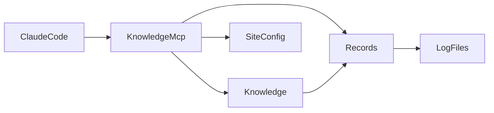
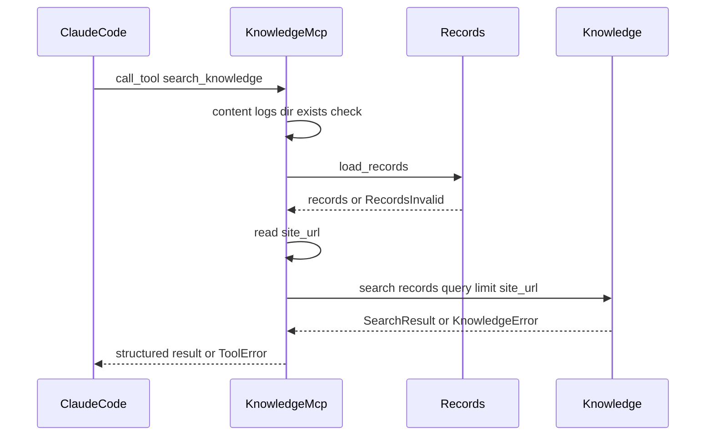

# Design Document: knowledge-mcp

## Overview
**Purpose**: Claude Code での作業中に、オーナーの過去の学習ログから「いま困っていること」に関連する知見を呼び出せるローカル MCP サーバーを提供する。困りごとの検索、日付指定のログ取得、タグ指定のログ一覧の 3 ツールを持ち、結果には日付・tags・summary・見出し・抜粋・公開ページの URL を含める。

**Users**: オーナーが Claude Code（どのプロジェクトで作業中でも）から、呼び出し側の Claude を介して使う。

**Impact**: 共有パッケージ `wil` に検索ロジック `wil.knowledge` と MCP サーバー `wil.knowledge_mcp` を追加し、依存に公式 MCP Python SDK（`mcp` 2.x）を加え、README に登録手順を追記する。公開サイト・ビルドには影響しない。

### Goals
- 3 ツールの入出力契約を定め、呼び出し側の Claude が使い分けられる説明を付ける
- 日本語の困りごとでも一致する、標準ライブラリだけの関連度判定
- ログは `wil.records` 経由で毎回読み、再起動なしで最新を返す。ネットワーク送信・LLM 呼び出しをしない
- 検索・取得ロジックを MCP なしで単体テストでき、サーバーはインプロセスで結合テストできる

### Non-Goals
- 意味検索（埋め込み）、形態素解析、同義語展開
- タグの正規化・別名統合・技術インデックス（tech-timeline）
- 公開サイトへの組み込み、ログの作成・編集
- 起動時インデックス、ファイル監視、キャッシュ

## Boundary Commitments

### This Spec Owns
- MCP ツール契約: `search_knowledge` / `get_log` / `list_logs_by_tag` の名前・引数・戻り値・エラー
- 関連度判定（語句抽出、tags 一致、区間の並び順）と抜粋の規則
- 結果の型 `SearchHit` / `SearchResult` / `LogSummary` / `TagResult` / `LogDetail` / `Heading`
- サーバーの起動方法（`python -m wil.knowledge_mcp`、stdio）と Claude Code への登録手順（README の 1 節）
- ログ置き場所の存在確認と、誤設定時のエラー文言

### Out of Boundary
- ログのパース・検証・ファイル走査（`wil.records`。再実装しない）
- タグの正規化・別名（tech-timeline）。本機能は比較時に `casefold()` するだけで、返すタグは書かれたとおり
- `zensical.toml` の内容（daily-log-page が所有。本機能は `[project].site_url` を読むだけ）
- 公開コンテンツの許可リスト、ビルド手順、CI
- 要約・解釈（呼び出し側の Claude が行う）

### Allowed Dependencies
- 外部: `mcp>=2.3,<3`（公式 MCP Python SDK。extra なし）。推移的に入る pydantic / anyio を直接 import しない（テストの anyio pytest プラグインを除く）
- 上流: `wil.records` の `load_records`、`Record`、`Section`、`RecordsInvalid`、`CONTENT_DIR`、`LOGS_SUBDIR`
- 標準ライブラリ: `re`、`unicodedata`、`tomllib`、`dataclasses`、`datetime`、`pathlib`、`logging`
- 依存方向: `wil.knowledge_mcp` → `wil.knowledge` → `wil.records`。`wil.knowledge` は `mcp` を import しない。`wil.records` は本機能のモジュールを import しない
- ネットワーク・HTTP クライアント・LLM SDK を import しない

### Revalidation Triggers
- `wil.records` の `Record` / `Section` のフィールド、`load_records` の例外契約、`CONTENT_DIR` / `LOGS_SUBDIR`、`url_path` 形式の変更（daily-log-page）
- `zensical.toml` の `site_url` の位置・形式の変更（daily-log-page）
- tech-timeline のタグ正規化をタグ一致に採用する場合（4.2 の比較規則が変わる）
- `mcp` のメジャー版更新（3.x）
- ツール名・引数・戻り値の変更（Claude Code の利用者側の再確認が必要）

## Architecture

### Existing Architecture Analysis
リポジトリはまだ実装を持たない。上流 daily-log-page の設計が `src/wil/records.py`、`pyproject.toml`（uv、`uv_build`、`module-name = "wil"`）、`tests/`、`README.md`、`zensical.toml`（`[project].site_url`）を定める。本機能はこれらが実装された後に追加する。

### Architecture Pattern & Boundary Map



- `ClaudeCode` = Claude Code（stdio で子プロセスとして起動）、`KnowledgeMcp` = `wil.knowledge_mcp`、`Knowledge` = `wil.knowledge`、`Records` = `wil.records`、`LogFiles` = `content/logs/*.md`、`SiteConfig` = `zensical.toml`
- **Selected pattern**: 純粋ロジック + 薄いアダプタ。`Knowledge` は `list[Record]` と入力値だけを受ける純関数群で、ファイルも MCP も知らない。`KnowledgeMcp` がロード・存在確認・エラー変換・ツール登録を行う
- **Steering compliance**: パースは `wil.records` のみ。MCP サーバーは `wil` のサブモジュール。依存は MCP SDK のみ追加
- `Knowledge` → `Records` の依存は型（`Record`）の参照のみ

### Technology Stack

| Layer | Choice / Version | Role in Feature | Notes |
|-------|------------------|-----------------|-------|
| Runtime | Python 3.14（既存） | サーバーとロジック | 上流で固定 |
| MCP | `mcp>=2.3,<3`（`from mcp.server import MCPServer`） | stdio サーバー、ツール登録、入力スキーマ、構造化出力、エラー表現 | brief の「FastMCP」は 2.x で `MCPServer` に改名された同じ公式 API。単体 `fastmcp` パッケージは不採用（research.md） |
| Parsing | `wil.records`（上流） | ログ読み取り | 再実装しない |
| Config read | `tomllib`（標準） | `zensical.toml` の `site_url` | 追加依存なし |
| Test | pytest（既存）、anyio pytest プラグイン（`mcp` の推移的依存 anyio に同梱） | 単体・インプロセス結合テスト | 新しい dev 依存は不要 |

## File Structure Plan

### Directory Structure
```
src/wil/
├── knowledge.py          # 検索・取得の純ロジックと結果型（mcp を import しない）
└── knowledge_mcp.py      # MCPServer の生成、3 ツール、ロードとエラー変換、main（python -m の入口）
tests/
├── test_knowledge.py     # knowledge.py の単体テスト（tmp_path の一時ログを load_records で読む）
└── test_knowledge_mcp.py # サーバーのインプロセス結合テスト（Client(server)、作業ディレクトリを tmp_path に変更）
```

### Modified Files
- `pyproject.toml` — `[project].dependencies` に `"mcp>=2.3,<3"` を追加（daily-log-page 所有ファイルへの追記）
- `uv.lock` — 上記に伴う再ロック
- `README.md` — 「Claude Code から過去の知見を呼び出す」節を追加（登録コマンド、プレースホルダ、動作確認、削除方法）

`src/wil/records.py`、`zensical.toml`、`content/` は変更しない。

## System Flows



- すべてのツール呼び出しで同じ前処理（存在確認 → `load_records` → `site_url`）を行う。キャッシュは持たない（5.2）
- `RecordsInvalid` / `KnowledgeError` / 存在確認失敗は `ToolError` に変換して `is_error=True` で返す。その他の例外は SDK 既定（メッセージ非表示 + stderr にログ）に任せる

## Requirements Traceability

| Requirement | Summary | Components | Interfaces | Flows |
|-------------|---------|------------|------------|-------|
| 1.1 | 区間単位で関連順に返す | Knowledge | `search` | 検索 |
| 1.2 | tags 一致を優先 | Knowledge | `search`（並び順キー） | 検索 |
| 1.3 | 大文字小文字を区別しない | Knowledge | `extract_terms`、`_norm` | — |
| 1.4 | 日本語の文で一致 | Knowledge | `extract_terms` | — |
| 1.5 | 同点は新しい日付が先 | Knowledge | `search`（並び順キー） | — |
| 1.6, 1.7, 1.8 | 件数上限、既定 10、範囲外エラー | Knowledge, KnowledgeMcp | `search(limit)`、`search_knowledge(limit=10)` | — |
| 1.9 | 0 件は正常応答 | Knowledge | `SearchResult(hits=())` | — |
| 1.10 | 空の困りごとはエラー | Knowledge | `KnowledgeError` | — |
| 2.1 | 結果の項目 | Knowledge | `SearchHit` | — |
| 2.2 | 完全な URL | Knowledge, KnowledgeMcp | `page_url`、`load_site_url` | — |
| 2.3 | 見出し無しの値 | Knowledge | `SearchHit.heading = None` | — |
| 2.4 | 抜粋 300 文字 + 省略記号 | Knowledge | `excerpt` | — |
| 2.5 | 構造化した形式 | KnowledgeMcp | dataclass 戻り値 → `structured_content` | — |
| 3.1, 3.2, 3.3 | 日付指定取得とエラー | Knowledge, KnowledgeMcp | `get_log`、`LogDetail` | — |
| 4.1–4.5 | タグ一覧、比較規則、0 件、空タグ | Knowledge, KnowledgeMcp | `logs_by_tag`、`TagResult` | — |
| 5.1 | 共有読み取り機能を使う | KnowledgeMcp | `load_records` | 前処理 |
| 5.2 | 再起動なしで反映 | KnowledgeMcp | 呼び出しごとの `_load` | 前処理 |
| 5.3 | 不正ログはエラー | KnowledgeMcp | `RecordsInvalid` → `ToolError` | 前処理 |
| 5.4 | 置き場所が無い | KnowledgeMcp | `_load` の存在確認 | 前処理 |
| 5.5 | 0 件 | Knowledge | 空の `records` | — |
| 5.6 | 1,000 件 2 秒以内 | KnowledgeMcp, Knowledge | 毎回ロード + 線形走査 | — |
| 6.1, 6.2 | ネットワーク・LLM なし | KnowledgeMcp, ServerTests | stdio のみ、Allowed Dependencies、import 検査 | — |
| 6.3 | 読み取りのみ | KnowledgeMcp, Knowledge | 書き込み API を使わない | — |
| 6.4 | ログ置き場所と設定以外を読まない | KnowledgeMcp, Knowledge | 日付・タグは `records` 内の照合のみでパスに使わない | — |
| 7.1, 7.2 | 登録手順、プレースホルダ | Guide | README の節 | — |
| 7.3 | ツールの説明 | KnowledgeMcp | docstring と `Field(description=...)` | — |
| 7.4 | 3 ツールを提示 | KnowledgeMcp | `server`（MCPServer） | — |
| 8.1 | 検索のテスト | KnowledgeTests | `tests/test_knowledge.py` | — |
| 8.2 | 取得・一覧・エラーのテスト | KnowledgeTests, ServerTests | 両テストファイル | — |
| 8.3 | ネットワーク・Claude Code 非依存 | KnowledgeTests, ServerTests | `tmp_path`、`Client(server)` | — |

## Components and Interfaces

| Component | Domain/Layer | Intent | Req Coverage | Key Dependencies | Contracts |
|-----------|--------------|--------|--------------|------------------|-----------|
| Knowledge | ロジック（`src/wil/knowledge.py`） | 検索・取得・一覧の純関数と結果型 | 1.1–1.10, 2.1–2.4, 3.1–3.3, 4.1–4.5, 5.5 | `wil.records.Record`（P0） | Service |
| KnowledgeMcp | 入口（`src/wil/knowledge_mcp.py`） | ロード・存在確認・エラー変換・3 ツール・stdio 起動 | 1.6–1.8, 2.2, 2.5, 3.1–3.3, 4.1–4.5, 5.1–5.4, 5.6, 6.1–6.4, 7.3, 7.4 | Knowledge（P0）、`wil.records`（P0）、`mcp`（P0） | API, Batch |
| KnowledgeTests | テスト（`tests/test_knowledge.py`） | 検索・取得・一覧の規則と性能 | 5.6, 8.1, 8.2, 8.3 | Knowledge、`wil.records`（P0） | — |
| ServerTests | テスト（`tests/test_knowledge_mcp.py`） | ツール一覧・入出力・エラー変換・ネットワーク不使用 | 2.5, 5.2–5.4, 6.1, 7.4, 8.2, 8.3 | KnowledgeMcp、`mcp.Client`（P0） | — |
| Guide | 文書（`README.md` の 1 節） | 登録・確認・削除の手順 | 7.1, 7.2 | — | — |

### ロジック

#### Knowledge（`wil.knowledge`）

| Field | Detail |
|-------|--------|
| Intent | `list[Record]` から検索結果・ログ詳細・タグ一覧を作る |
| Requirements | 1.1–1.10, 2.1–2.4, 3.1–3.3, 4.1–4.5, 5.5 |

**Responsibilities & Constraints**
- 入力は `records`（`load_records` の戻り値、日付昇順）、利用者入力、`site_url`。ファイル・環境・MCP に触れない（副作用なし）
- 利用者入力の検証（空、件数範囲、日付形式）を行い、違反は `KnowledgeError`（日本語メッセージ）
- tags は返すときに加工しない

**Dependencies**
- Inbound: KnowledgeMcp（P0）、KnowledgeTests（P0）
- Outbound: `wil.records.Record` / `Section`（型のみ、P0）

**Contracts**: Service [x]

##### Service Interface
```python
from dataclasses import dataclass
from wil.records import Record

DEFAULT_LIMIT = 10
MAX_LIMIT = 50
EXCERPT_CHARS = 300
ELLIPSIS = "…"

class KnowledgeError(ValueError):
    """利用者に見せる日本語メッセージを持つ入力・照合エラー。str(err) がそのまま表示される。"""

@dataclass(frozen=True)
class SearchHit:
    date: str                 # "YYYY-MM-DD"
    tags: list[str]           # 書かれたとおり、書かれた順
    summary: str | None
    heading: str | None       # 区間の見出し。level 0 区間（最初の見出しより前）は None
    excerpt: str              # 区間本文の先頭 EXCERPT_CHARS 文字。超過時は末尾に ELLIPSIS
    url: str                  # site_url + record.url_path

@dataclass(frozen=True)
class SearchResult:
    query: str
    terms: list[str]          # 照合に使った語句（呼び出し側が一致理由を推測できるように）
    hits: list[SearchHit]     # 0 件なら []

@dataclass(frozen=True)
class LogSummary:
    date: str
    tags: list[str]
    summary: str | None
    url: str

@dataclass(frozen=True)
class TagResult:
    tag: str                  # 入力をそのまま（strip のみ）
    logs: list[LogSummary]    # 日付の新しい順。0 件なら []

@dataclass(frozen=True)
class Heading:
    level: int                # 1..6
    title: str

@dataclass(frozen=True)
class LogDetail:
    date: str
    tags: list[str]
    summary: str | None
    url: str
    body: str                 # Record.body（frontmatter を除いた本文の原文）
    headings: list[Heading]   # level 0 区間を除いた見出し（出現順）

def extract_terms(text: str) -> list[str]: ...
def page_url(site_url: str, record: Record) -> str: ...
def excerpt(text: str) -> str: ...
def search(records: list[Record], query: str, site_url: str, limit: int = DEFAULT_LIMIT) -> SearchResult: ...
def get_log(records: list[Record], date: str, site_url: str) -> LogDetail: ...
def logs_by_tag(records: list[Record], tag: str, site_url: str) -> TagResult: ...
```

- `extract_terms(text)`（1.3, 1.4）
  - 正規化 `_norm(s) = unicodedata.normalize("NFKC", s).casefold()` の後、次を出現順・重複なしで取り出す
    - 英数字語: `[a-z0-9][a-z0-9+#.\-_]*`（末尾の `.` `-` を除く）で 2 文字以上（`c#`、`c++`、`node.js`、`s3` を拾う）
    - カタカナ連続: `[ァ-ヺー]{2,}`
    - 漢字連続: `[一-鿿㐀-䶿々]+`。3 文字以上の連続は、連続全体に加えて文字 2-gram も語句にする（「冷起動対策」→「冷起動対策」「冷起」「起動」「動対」「対策」）
  - ひらがな・記号・空白は区切りとして捨てる
  - 上記で 1 語も取れず、正規化後の `text.strip()` が空でなければ、その全体を 1 語とする（ひらがなのみの入力）
- `search(records, query, site_url, limit)`（1.1, 1.2, 1.5–1.10, 2.1–2.4）
  - 検証順: `query.strip()` が空 → `KnowledgeError("困りごと（query）を入力してください")`（1.10）。`limit` が 1〜50 の外 → `KnowledgeError("limit は 1〜50 で指定してください")`（1.8）
  - 各ログ: `tag_hits` = 語句のうち、いずれかのタグについて「`_norm(tag)` と等しい、または `extract_terms(tag)` に含まれる」ものの数
  - 各区間: `text_hits` = 語句のうち `_norm(section.title + "\n" + section.body)` に部分文字列として含まれるものの数
  - 候補: `text_hits > 0` の区間。加えて `tag_hits > 0` で候補区間が 1 つも無いログは、本文（strip 後）が空でない最初の区間を 1 件だけ候補にする（`text_hits = 0`）
  - 並び順: `(-tag_hits, -text_hits, -date.toordinal(), ログ内の区間の出現順)` の昇順。先頭 `limit` 件を返す（1.2, 1.5, 1.6）
  - 候補 0 件なら `hits=[]`（1.9, 5.5）
- `excerpt(text)`（2.4）: `text.strip()` が `EXCERPT_CHARS` 文字以下ならそのまま。超えれば先頭 `EXCERPT_CHARS` 文字 + `ELLIPSIS`
- `page_url(site_url, record)`（2.2）: `site_url.rstrip("/") + "/" + record.url_path`。例 `https://kjman678.github.io/what_i_learned/logs/2026-11-23/`
- `get_log(records, date, site_url)`（3.1–3.3）
  - `date.strip()` が `\d{4}-\d{2}-\d{2}` に fullmatch しない、または `datetime.date.fromisoformat` が失敗 → `KnowledgeError("日付は YYYY-MM-DD 形式の実在する日付で指定してください（例: 2026-11-23）")`
  - 一致する `Record` が無い → `KnowledgeError(f"{date} のログはありません")`
  - ファイルパスを組み立てず、`records` の中から照合する（6.4）
- `logs_by_tag(records, tag, site_url)`（4.1–4.5）
  - `tag.strip()` が空 → `KnowledgeError("タグ（tag）を入力してください")`
  - いずれかのタグが `t.casefold() == tag.strip().casefold()` のログを、日付の新しい順で `LogSummary` にする。NFKC や別名による同一視はしない（4.2）
- Invariants: 戻り値の `tags` は `list(record.tags)` と等しい（4.3）。`url` は常に `page_url` の結果

**Implementation Notes**
- 区間の本文が空で見出しだけの区間も `title` で一致しうる。その場合 `excerpt` は空文字
- 1 ログの多数の区間が上位を占めることがある（ログ単位の集約はしない）。`# ponytail:` コメントで上限と改善策（ログごとの最大件数）を残す

### 入口

#### KnowledgeMcp（`wil.knowledge_mcp`）

| Field | Detail |
|-------|--------|
| Intent | 3 ツールを stdio で提供し、ロード・存在確認・エラー変換を行う |
| Requirements | 1.6–1.8, 2.2, 2.5, 3.1–3.3, 4.1–4.5, 5.1–5.4, 5.6, 6.1–6.4, 7.3, 7.4 |

**Responsibilities & Constraints**
- モジュール変数 `server = MCPServer("wil-knowledge", instructions=...)`。`instructions` は「オーナーの過去の学習ログを検索する。結果の要約・解釈は呼び出し側が行う」旨の日本語 1〜2 文
- 各ツールは同期関数。呼び出しごとに `_load()` を実行する（キャッシュなし）
- stdout に書かない（`print` 禁止）。`main()` は `server.run()`（既定 stdio）を呼ぶだけ
- ファイル書き込み・ネットワーク・サブプロセスを使わない（6.1–6.3）

**Dependencies**
- Inbound: Claude Code（stdio、P0）、ServerTests（P0）
- Outbound: Knowledge（P0）、`wil.records.load_records` / `RecordsInvalid` / `CONTENT_DIR` / `LOGS_SUBDIR`（P0）
- External: `mcp` — `MCPServer`、`ToolError`（`mcp.server.mcpserver.exceptions`）（P0）

**Contracts**: API [x] / Batch [x]

##### 内部関数
```python
SITE_CONFIG = Path("zensical.toml")

def load_site_url(config: Path = SITE_CONFIG) -> str: ...
# tomllib で読み [project].site_url を返す。ファイル・キーが無ければ KnowledgeError

def _load() -> tuple[list[Record], str]: ...
# 1. (CONTENT_DIR / LOGS_SUBDIR).is_dir() でなければ KnowledgeError(
#    f"ログの置き場所 {CONTENT_DIR / LOGS_SUBDIR} が見つかりません（作業ディレクトリ: {Path.cwd()}）。"
#    "登録コマンドの uv run --directory <リポジトリの絶対パス> を確認してください")   (5.4)
# 2. load_records() を呼ぶ。RecordsInvalid は呼び出し元に送出                       (5.1, 5.3)
# 3. load_site_url()                                                                 (2.2)

def _run(fn: Callable[[], T]) -> T: ...
# fn を実行し、KnowledgeError → ToolError(str(e))、
# RecordsInvalid → ToolError("不正なログがあるため読み込めません:\n" + "\n".join(str(e) for e in exc.errors))

def main() -> None: ...   # server.run()。`if __name__ == "__main__": main()`
```

##### API Contract（MCP ツール）

| Tool | 引数 | 戻り値（structured_content） | エラー（`is_error=True`、本文は日本語） |
|------|------|------------------------------|------------------------------------------|
| `search_knowledge` | `query: str`（必須）、`limit: int = 10` | `SearchResult` | 空の query、limit 範囲外、置き場所なし、不正ログ、設定なし |
| `get_log` | `date: str`（必須、`YYYY-MM-DD`） | `LogDetail` | 形式不正・暦日不正、該当ログなし、置き場所なし、不正ログ、設定なし |
| `list_logs_by_tag` | `tag: str`（必須） | `TagResult` | 空の tag、置き場所なし、不正ログ、設定なし |

- 引数には `Annotated[..., Field(description=...)]` で日本語の説明を付ける。`limit` の範囲は説明文に書き、検証は Knowledge の 1 か所で行う
- ツールの docstring（＝説明、7.3）:
  - `search_knowledge`: 「今困っていることに関連する過去の学習ログの該当箇所を、関連の高い順に返す。query には困りごとの文か、技術名・エラー名などの主要な語句を空白区切りで渡すとよい（語句の一致で判定するため、言い換えは拾えない）。全文が必要なら get_log を使う」
  - `get_log`: 「指定した日付（YYYY-MM-DD）の学習ログの本文全体と見出し一覧を返す」
  - `list_logs_by_tag`: 「指定したタグを持つ学習ログを新しい順に一覧する。タグは大文字小文字を区別せず、それ以外は完全一致」
- 0 件は正常応答（`hits=[]` / `logs=[]`）（1.9, 4.4）
- 戻り値は dataclass。SDK が `output_schema` と `structured_content`、テキスト `content` を生成する（2.5）

##### Batch / Job Contract（プロセス起動）
- Trigger: Claude Code が登録コマンド `uv run --directory <リポジトリの絶対パス> python -m wil.knowledge_mcp` を子プロセスとして起動（stdio）
- Input / validation: 作業ディレクトリがリポジトリルートであること。起動時には検証せず、各ツール呼び出しで `_load()` が確認する（後から `content/logs` が作られても再起動不要）
- Output: stdio 上の MCP メッセージのみ。ログは `logging`（stderr）
- Idempotency & recovery: 状態を持たないため、プロセスの再起動で回復する

**Implementation Notes**
- Integration: `from mcp.server import MCPServer`、`from mcp.server.mcpserver.exceptions import ToolError`。`mcp.server.fastmcp` は 2.x で存在しない
- Validation: ServerTests で `list_tools` の 3 名、正常応答の `structured_content`、各エラーの `is_error` と本文を確認する
- Risks: `uv run --directory` が作業ディレクトリを移すことを実装時に `uv run --help` で確認する。移さない場合は `--directory` の代わりに `sh -c 'cd <path> && uv run …'` を README に記す

### 文書

#### Guide（`README.md` への追記）
- 節「Claude Code から過去の知見を呼び出す（knowledge MCP）」
- 登録（user スコープ、どのプロジェクトからでも使える）:
  `claude mcp add --scope user --transport stdio wil-knowledge -- uv run --directory <このリポジトリの絶対パス> python -m wil.knowledge_mcp`（7.1, 7.2。実パスを書かない）
- 前提: `uv sync` 済み。確認: Claude Code の `/mcp` で `wil-knowledge` が接続済みで 3 ツールが見えること
- 削除: `claude mcp remove --scope user wil-knowledge`
- 外部送信をしないこと、ログ置き場所エラーが出たら `--directory` を確認すること

## Data Models

### Domain Model
- 本機能は永続データを持たない。読み取り専用で `Record`（上流）から結果の値オブジェクト（`SearchHit` ほか）を都度作る
- 検索の単位は `Section`。`SearchHit` は 1 区間に対応し、`(date, heading)` と出現順で一意
- 不変条件: 結果の `tags` は書かれたとおり。`url` は `site_url` と `url_path` の連結。`hits` は並び順キーの昇順、長さは `limit` 以下

### Data Contracts & Integration
- 構造化出力の例（`search_knowledge`）:
```json
{
  "query": "Lambda のコールドスタートが遅い",
  "terms": ["lambda", "コールドスタート", "遅"],
  "hits": [
    {
      "date": "2026-11-23",
      "tags": ["aws", "lambda"],
      "summary": "Lambda のコールドスタート対策を調べた",
      "heading": "学んだこと",
      "excerpt": "- SnapStart\n  - Java 以外でも使える条件",
      "url": "https://kjman678.github.io/what_i_learned/logs/2026-11-23/"
    }
  ]
}
```

## Error Handling

### Error Strategy
- 利用者に見せるべき失敗はすべて `ToolError` で返す（SDK は素の例外のメッセージを隠すため）。本文は日本語で、何を直せばよいかを含める
- 不正ログは黙って除外しない。`RecordsInvalid.errors` の全件を `path: reason` で列挙する（5.3）
- 想定外の例外は SDK 既定の扱い（`is_error=True`、stderr にトレースバック）

### Error Categories and Responses
- 入力誤り: 空の query / tag、limit 範囲外、日付形式・暦日 → 期待値を示す
- 該当なし: 日付指定のログなし → エラー（3.2）。検索・タグ一覧の 0 件 → 正常応答（1.9, 4.4）
- 環境誤り: `content/logs` なし（作業ディレクトリと `--directory` の確認を促す）、`zensical.toml` / `site_url` なし
- データ誤り: 不正ログ（ファイルと理由の一覧）

### Monitoring
- 追加しない。障害は Claude Code の `/mcp` 表示と stderr ログで確認する

## Testing Strategy

### Unit Tests（`tests/test_knowledge.py`、`tmp_path/content/logs` に一時ログを書いて `load_records(tmp_path / "content")` で読む）
- `extract_terms`: 「Lambda のコールドスタートが遅い」→ `lambda`・`コールドスタート`・`遅` を含み、ひらがなを含まない。「冷起動対策」で 2-gram が加わる。全角英字・大文字が小文字化される。ひらがなのみの入力は全体 1 語（1.3, 1.4）
- 並び順: tags 一致ログの区間が、本文で多くの語句に一致する非 tags ログの区間より上位。本文一致語数が多い区間が上位。同点は新しい日付が先（1.1, 1.2, 1.5）
- tags のみ一致で本文に語句が無いログは、本文が空でない最初の区間が 1 件だけ返る（1.2）
- `limit`: 既定 10、指定件数以下、0 と 51 で `KnowledgeError`。空白のみの query で `KnowledgeError`。一致なしで `hits == []`。ログ 0 件で `hits == []`（1.6–1.10, 5.5）
- 結果の項目: `date`、書かれたとおりの `tags`、`summary` の None、level 0 区間の `heading is None`、301 文字の区間で抜粋が 300 文字 + `…`、`url` が `https://kjman678.github.io/what_i_learned/logs/YYYY-MM-DD/`（2.1–2.4）
- `get_log`: 正常（本文全体・見出し一覧）、存在しない日付、`2026-02-30`・`20261123`・`2026/11/23` で `KnowledgeError`（3.1–3.3）
- `logs_by_tag`: `AWS` で `aws` のログが新しい順に返る。`aws-lambda` は `aws` に一致しない。返すタグは書かれたとおり。0 件で `logs == []`。空タグで `KnowledgeError`（4.1–4.5）
- 性能: 1,000 件の一時ログ（各 3 区間）で `load_records` + `search` が 2 秒以内（5.6）

### Integration Tests（`tests/test_knowledge_mcp.py`、`monkeypatch.chdir(tmp_path)` に `content/logs/` と `zensical.toml` を置き、`async with Client(server, raise_exceptions=True)` でインプロセス呼び出し。`@pytest.mark.anyio`）
- `list_tools` が `search_knowledge`・`get_log`・`list_logs_by_tag` の 3 つを返し、それぞれ説明を持つ（7.3, 7.4）
- `search_knowledge` の `structured_content` が `SearchResult` の形（2.5）
- ログを追加した後の 2 回目の呼び出しで、新しいログが結果に現れる（5.2）
- 不正ログ（tags 欠落）を置くと `is_error=True` で本文にファイルパスと理由が含まれる（5.3）
- `content/logs` の無い作業ディレクトリで `is_error=True`、本文に `--directory` が含まれる（5.4）
- `socket.socket.connect` を例外を送出する関数に差し替えても 3 ツールが成功する（6.1）
- `zensical.toml` が無い場合、空白のみの query（`KnowledgeError`）の場合にも `is_error=True` で日本語の理由が返る（2.5, 8.2）
- `wil.knowledge` と `wil.knowledge_mcp` が HTTP クライアント・LLM SDK を import していない（6.2）
- `python -m wil.knowledge_mcp < /dev/null` が正常終了し stdout が空（stdout 汚染なし）
- テスト補助（一時ログの作成）は各テストファイル内に持ち、共通 fixture ファイルは作らない

### Manual Check（実装完了時）
- README の手順で user スコープに登録し、別プロジェクトの Claude Code から `/mcp` で 3 ツールが見え、検索結果が返ること（7.1）

## Security Considerations
- 入力（日付・タグ・query）をファイルパスに使わない。読み取るのは `content/logs/*.md`（`wil.records` 経由）と `zensical.toml` のみ（6.4）
- ネットワーク・LLM・サブプロセスを使わない。依存は公式 MCP SDK のみ追加（6.1, 6.2）
- 公開リポジトリのため、README に個人環境の絶対パスを書かない（7.2）

## Performance & Scalability
- 目標: ログ 1,000 件以下で各要求 2 秒以内（5.6）。毎回ロード + 全区間の線形走査（O(区間数 × 語句数)）
- 上限と移行先: 数千件を超えて遅くなった場合は、ファイルの更新時刻をキーにした `Record` のキャッシュを KnowledgeMcp に追加する。語句一致の品質が不足した場合は形態素解析または埋め込み検索を再検討する（いずれも依存追加を伴うため、要求の改訂を先に行う）
