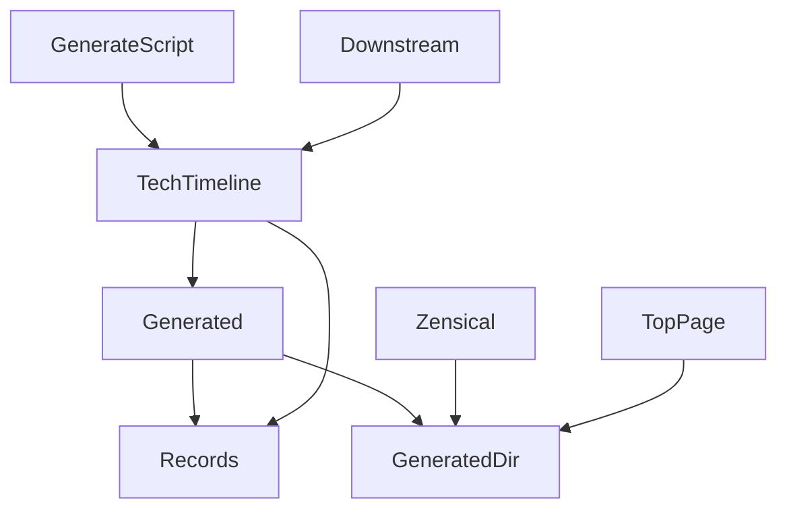
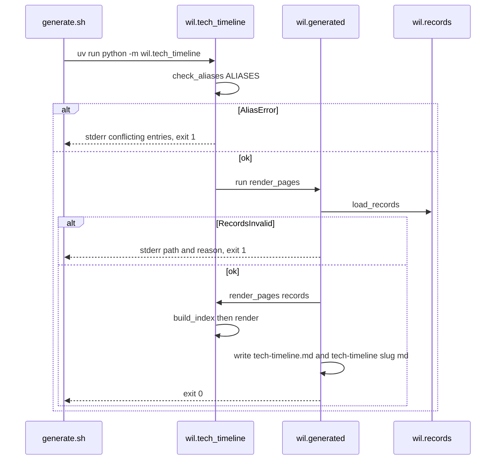

# Design Document: tech-timeline

## Overview
**Purpose**: ログの tags を表記ゆれを吸収して技術単位にまとめた「技術インデックス」と、それを元にした技術一覧ページ `generated/tech-timeline/` と技術別タイムラインページ `generated/tech-timeline/<slug>/` を、ビルドのたびにログから生成する。技術インデックスは learning-recommendation が読む公開 API とする。

**Users**: オーナーと閲覧者が「ある技術をいつ学んだか」を辿る。learning-recommendation の実装者が技術インデックスを読む。

**Impact**: 生成器 `wil.tech_timeline`（技術インデックス API・別名表・描画・CLI を 1 モジュールに持つ）とテストを追加し、上流所有ファイルには追記のみを行う（`scripts/generate.sh` に 1 行、`content/index.md` に 1 行、`README.md` に 1 節）。

### Goals
- tags の表記ゆれ（大文字小文字・全角半角・空白と `- _ . ・`・別名）をインデックス側だけで吸収し、書き手の手間を増やさない
- 技術ごとの学習日・抜粋・初回/最終/回数・ページの場所を、決定的な純関数で求める
- 下流が import して使える安定した API を固定する

### Non-Goals
- おすすめ・未学習領域（learning-recommendation）、見た目とナビの構成（区分名・並び・長さ。site-design）
- 日本語検索の品質改善、本文からの技術名抽出、LLM の利用
- 年度・月のグルーピング（タイムラインは日付の時系列のみ。`fiscal_year` は使わない）
- Zensical 組み込み tags の listings 有効化（tags の設定は daily-log-page 所有で変更しない）

## Boundary Commitments

### This Spec Owns
- タグ正規化の規則: 照合キー `tag_key`、技術の識別子 `tech_key`、別名の対応表 `ALIASES` とその検査（`AliasError`）
- 技術インデックスの公開契約: 型 `Tech` / `TechEntry`、関数 `build_index` / `tech_key` / `tag_key`、定数 `ALIASES` / `INDEX_PAGE` / `PAGE_DIR` / `EXCERPT_MAX`、技術別ページの場所の規則（slug）
- 抜粋の選び方
- 生成器 `wil.tech_timeline`（`render_pages`、`main`）と出力 `content/generated/tech-timeline.md`、`content/generated/tech-timeline/<slug>.md`
- テスト `tests/test_tech_timeline.py`
- 上流ファイルへの追記（いずれも既存内容を変えない追加のみ）:
  - `scripts/generate.sh` に `uv run python -m wil.tech_timeline` の 1 行（log-index 契約の登録箇所）
  - `content/index.md` 末尾に技術一覧へのリンク 1 行
  - `zensical.toml` の `nav` が既にある場合（site-design 実装後）、その末尾に `{ "技術一覧" = "generated/tech-timeline.md" }` の 1 項目（site-design のナビ契約）。まだ無い場合は site-design が `nav` を作るときにこの項目を載せる
  - `README.md` に「技術タイムラインと別名の対応表」の節

### Out of Boundary
- `wil.records` の型・関数・検証規則・`ALLOWED_PATTERNS`（daily-log-page）
- `wil.generated`、`scripts/generate.sh` の段構成、`.gitignore`、`wil.log_index` とその出力（log-index）
- `zensical.toml`（`nav` への 1 項目の追記を除く）、`scripts/build.sh`、`.github/workflows/deploy.yml`、各ログページのタグ表示
- 見た目・CSS、ナビの構成（区分名・並び・長さ）（site-design）
- おすすめの生成・ページ（learning-recommendation）。本 spec は下流固有の項目を持たない
- knowledge-mcp・log-writing-skill のタグ比較規則（各 spec が採用を判断する）

### Allowed Dependencies
- `wil.tech_timeline` → `wil.generated`（`run`、`escape_inline`）、`wil.records`（`Record`、`Section`、`LOGS_SUBDIR`）。他の `wil.*`（`wil.log_index` を含む）を import しない
- 標準ライブラリ（`dataclasses`、`datetime`、`re`、`unicodedata`、`collections`、`collections.abc`、`sys`）のみ。新規の外部依存なし。Zensical を import しない
- 下流からの依存: learning-recommendation のモジュールが `wil.tech_timeline` の**インデックス API**（`build_index`、`tech_key`、`tag_key`、`Tech`、`TechEntry`、`AliasError`、`INDEX_PAGE`、`PAGE_DIR`）を import することは、steering の「07 は 06 の技術インデックスを読む」例外として許可する。描画関数（`render_pages`、`render_index`、`render_tech`）と `main` は下流契約に含めず、import しない
- 呼び出し方向: `scripts/generate.sh` → `python -m wil.tech_timeline` → `wil.generated.run` → `wil.records.load_records`

### Revalidation Triggers
- `Tech` / `TechEntry` のフィールド名・型・意味、`build_index` / `tech_key` / `tag_key` のシグネチャ・順序規則の変更（learning-recommendation）
- 正規化規則（`tag_key`）の変更（learning-recommendation、log-writing-skill の `variant_key`、knowledge-mcp が採用している場合）
- slug 規則、`INDEX_PAGE` / `PAGE_DIR` の変更（learning-recommendation からのリンク、`content/index.md` のリンク、site-design）
- 抜粋規則・`EXCERPT_MAX` の変更（learning-recommendation が抜粋を根拠表示に使う場合）
- 上流: `Record` / `Section` / `load_records` / `url_path` / `LOGS_SUBDIR`、`wil.generated.run` / `wil.generated.escape_inline` の契約、区域 `content/generated/` の変更

## Architecture

### Existing Architecture Analysis
- 上流は未実装の設計契約。`load_records()` は日付昇順の `list[Record]`、不正時は `RecordsInvalid`。`Record.tags` は書かれたとおり、`Record.sections` は見出し単位（フェンス内の `#` は見出しにしない）
- log-index: `scripts/generate.sh` が `content/generated/` を削除してから生成器を順に実行。`run(render_pages)` が読み取り・誤り報告（終了コード 1、書き出しなし）・書き出し・名前検査を担う。`.gitignore`・`ALLOWED_PATTERNS` は区域単位で設定済み。ナビは site-design のナビ契約（一覧ページ 1 項目を `nav` 末尾に追記）
- Zensical の組み込み tags は listings まで対応するが表記ゆれ・日付・集計は扱わず、組み込み検索は英語のみ（research.md）。これらは既存のまま使い、足りない部分だけを生成で補う

### Architecture Pattern & Boundary Map



- `GenerateScript` = `scripts/generate.sh`（log-index 所有、1 行追記）、`Generated` = `wil.generated`（log-index）、`Records` = `wil.records`（daily-log-page）、`GeneratedDir` = `content/generated/`、`TopPage` = `content/index.md`（1 行追記）、`Downstream` = learning-recommendation
- 本 spec の所有: `TechTimeline` = `wil.tech_timeline`
- **Selected pattern**: log-index のビルド前生成方式。インデックス API・描画・CLI を 1 モジュールに置き、生成器の import 規則（`wil.records` と `wil.generated` のみ）を満たしたまま下流に API を提供する
- **Dependency direction**: `wil.records` ← `wil.generated` ← `wil.tech_timeline` ← learning-recommendation（左ほど下位。逆方向の import は禁止）
- **Steering compliance**: プラグイン・hooks 非依存、パースは `wil.records` のみ、生成は純粋変換、生成物は gitignore、新規依存なし

### Technology Stack

| Layer | Choice / Version | Role in Feature | Notes |
|-------|------------------|-----------------|-------|
| Generator / Index | Python 3.12 標準ライブラリ | 正規化・集計・描画 | 新規依存なし |
| Shared | `wil.records`、`wil.generated`（上流） | 読み取り・書き出し | 再実装しない |
| Site | Zensical `==0.1.3`（上流で固定） | 生成ページのビルド、組み込み検索・tags | `nav` 末尾に 1 項目（site-design のナビ契約）のみ追記 |
| Test | pytest（上流 dev 依存） | 単体テスト | CI の既存 `uv run pytest` |

## File Structure Plan

### Directory Structure
```
.
├── src/wil/
│   └── tech_timeline.py       # 新規。別名表、正規化、技術インデックス API、抜粋、slug、描画、main
├── tests/
│   └── test_tech_timeline.py  # 新規。正規化・別名検査・インデックス・抜粋・slug・描画・0 件・決定性
└── content/generated/         # 生成物（gitignore、log-index が設定済み）
    ├── tech-timeline.md       # 技術一覧。URL generated/tech-timeline/
    └── tech-timeline/
        └── <slug>.md          # 技術別タイムライン。URL generated/tech-timeline/<slug>/
```

### Modified Files（上流所有。いずれも追記のみ）
- `scripts/generate.sh` — `uv run python -m wil.log_index` の下に `uv run python -m wil.tech_timeline` を 1 行追加（7.1、7.4）
- `content/index.md` — 末尾に `[技術一覧](generated/tech-timeline.md) から、技術ごとに学んだ日を時系列で見られます。` の 1 行を追加（6.1、6.4）
- `README.md` — 節「技術タイムラインと別名の対応表」を追加。別名の追加方法（`ALIASES` に `("表記", "表示名")` を 1 行）、矛盾時にビルドが失敗すること、ログ側の書き換えは不要なこと（1.6）
- `zensical.toml` — `nav` 末尾に 1 項目（ナビ契約）（6.2）

`scripts/build.sh`、`.gitignore`、`src/wil/records.py`、`src/wil/generated.py`、`src/wil/log_index.py` は変更しない。

## System Flows



- 失敗は `generate.sh` → `build.sh` の `set -eu` で伝播し、Zensical ビルドとデプロイに到達しない。Pages は直前の内容のまま（7.5）
- `generate.sh` が毎回区域を削除するため、ログから消えた技術のページは残らない（7.2）

## Requirements Traceability

| Requirement | Summary | Components | Interfaces | Flows |
|-------------|---------|------------|------------|-------|
| 1.1 | 表記ゆれを同一視 | TechTimeline | `tag_key` | — |
| 1.2 | 別名で統合 | TechTimeline | `ALIASES`, `tech_key` | — |
| 1.3 | 別名照合にも吸収を適用 | TechTimeline | `tech_key`（`tag_key` で照合） | — |
| 1.4 | 表示名の決定 | TechTimeline | `build_index`（表示名規則） | — |
| 1.5 | 別表記の保持 | TechTimeline | `Tech.variants` | — |
| 1.6 | 書き手に追加作業を求めない | TechTimeline, GuideSection | `ALIASES`（ログ外）、README 節 | — |
| 1.7 | 対応表の矛盾で失敗 | TechTimeline | `check_aliases`, `AliasError`, `main` | 生成 |
| 1.8 | 空になる表記 | TechTimeline | `tag_key`（フォールバック） | — |
| 2.1 | tags の全技術、余分なし | TechTimeline | `build_index` | — |
| 2.2 | 学習日を古い順 | TechTimeline | `Tech.entries` | — |
| 2.3 | 同一ログ内の重複を 1 件 | TechTimeline | `build_index` | — |
| 2.4 | 学習日の項目 | TechTimeline | `TechEntry` | — |
| 2.5 | 初回・最終・回数 | TechTimeline | `Tech.first` / `last` / `count` | — |
| 2.6 | ページの場所 | TechTimeline | `Tech.page`, `slug` | — |
| 2.7 | 決定的 | TechTimeline | `build_index`（順序規則） | — |
| 2.8 | 不正ログで誤り | TechTimeline, Generated | `load_records` → `RecordsInvalid`、`run` | 生成 |
| 3.1–3.5 | 抜粋の選び方・省略・照合 | TechTimeline | `excerpt` | — |
| 4.1, 4.2, 4.4, 4.5 | 一覧の並び・行・総数・0 件 | TechTimeline | `render_index` | — |
| 4.3 | 一覧から技術別ページへ | TechTimeline | `render_index`（`tech-timeline/<slug>.md` リンク） | ビルド（`--strict`） |
| 4.6 | 構造を崩さない | TechTimeline | `escape_inline`（`wil.generated`） | — |
| 5.1–5.4, 5.6 | 技術別ページの内容 | TechTimeline | `render_tech` | — |
| 5.5 | 日付からログへ | TechTimeline | `render_tech`（`../../logs/D.md` リンク） | ビルド（`--strict`） |
| 5.7 | 構造を崩さない | TechTimeline | `escape_inline`（`wil.generated`） | — |
| 5.8 | 場所の安定と非衝突 | TechTimeline | `slug`（単射、`index` 予約） | — |
| 6.1, 6.4 | トップページのリンク、既存不変 | TopPageLink | `content/index.md` 追記行 | — |
| 6.2 | ナビに項目 | GeneratedPages | `nav` の項目「技術一覧」（H1 と同じ）、技術別ページは載せない | ビルド |
| 6.3 | 英数字の名前・別表記で検索 | TechTimeline, GeneratedPages | `render_tech`（H1 = 表示名、別表記を本文に表示）、組み込み検索 | ビルド |
| 6.5 | 日本語検索は保証しない | GuideSection, GeneratedPages | 一覧ページを主な入口とする | — |
| 7.1 | 毎回作り直し | GenerateRegistration | `generate.sh` 登録行 | 生成 |
| 7.2 | 消えた技術のページを残さない | GenerateRegistration | `generate.sh` の区域削除（log-index） | 生成 |
| 7.3 | 同一内容 | TechTimeline | `render_pages`（純粋・決定的） | — |
| 7.4 | log-index 方式、非コミット | GenerateRegistration, GeneratedPages | `run`、区域の gitignore（log-index） | — |
| 7.5 | 不正ログで失敗・公開維持 | Generated, GenerateRegistration | `run` 終了コード 1、`set -eu` | 生成 |
| 8.1 | インデックス全体の読み取り | TechTimeline | `build_index(records)` | — |
| 8.2 | 任意の表記 → 識別子 | TechTimeline | `tech_key` | — |
| 8.3 | 読み取りに副作用なし | TechTimeline | `build_index` / `tech_key` は純関数 | — |
| 8.4 | 項目の固定と再確認 | TechTimeline | Data Contracts、Revalidation Triggers | — |
| 9.1–9.3 | 自動テスト | TechTimelineTests | `tests/test_tech_timeline.py` | — |
| 9.4 | CI でテスト | TechTimelineTests | 上流 deploy.yml の `uv run pytest` | — |

## Components and Interfaces

| Component | Domain/Layer | Intent | Req Coverage | Key Dependencies | Contracts |
|-----------|--------------|--------|--------------|------------------|-----------|
| TechTimeline | 生成器 + 公開 API（`src/wil/tech_timeline.py`） | 正規化・技術インデックス・抜粋・slug・描画・CLI | 1.1–1.8, 2.1–2.8, 3.1–3.5, 4.1–4.6, 5.1–5.8, 6.3, 7.3, 8.1–8.4 | Records (P0), Generated (P0) | Service, Batch |
| GenerateRegistration | `scripts/generate.sh` への 1 行追記 | 生成器の登録 | 7.1, 7.2, 7.4, 7.5 | TechTimeline (P0) | Batch |
| GeneratedPages | 出力 `content/generated/tech-timeline.md`、`content/generated/tech-timeline/*.md` | 公開場所とナビ掲載 | 6.2, 6.3, 6.5, 7.4 | Zensical (P1) | State |
| TopPageLink | `content/index.md` への 1 行追記 | トップから一覧へ | 6.1, 6.4 | GeneratedPages (P0) | — |
| GuideSection | `README.md` への節追記 | 別名表の追記方法 | 1.6, 6.5 | — | — |
| TechTimelineTests | `tests/test_tech_timeline.py` | 規則・描画のテスト | 9.1–9.4 | TechTimeline (P0) | — |

### 生成器 + 公開 API

#### TechTimeline（`wil.tech_timeline`）

| Field | Detail |
|-------|--------|
| Intent | tags → 技術インデックス → 技術ページ。インデックス部分は下流契約 |
| Requirements | 1.1–1.8, 2.1–2.8, 3.1–3.5, 4.1–4.6, 5.1–5.8, 6.3, 7.3, 8.1–8.4 |

**Responsibilities & Constraints**
- `build_index`・`tech_key`・`tag_key`・描画関数は I/O・現在時刻・環境に依存しない純関数（7.3、8.3）
- ログの読み取りは `wil.generated.run`（内部で `load_records`）経由のみ。技術は `Record.tags` からのみ得る
- 別名表 `ALIASES` はこのモジュールの定数で、正規化規則の唯一の定義箇所

**Dependencies**
- Inbound: `scripts/generate.sh`（P0）、learning-recommendation（インデックス API のみ、P0）
- Outbound: `wil.generated.run`（P0）、`wil.records.Record` / `Section` / `LOGS_SUBDIR`（P0）

**Contracts**: Service [x] / Batch [x]

##### Service Interface
```python
from collections.abc import Sequence
from dataclasses import dataclass
from datetime import date
from wil.records import Record

ALIASES: tuple[tuple[str, str], ...]
# (書かれうる表記, 技術の表示名) の組。例: ("Lambda", "AWS Lambda")。初期値は空でもよい
INDEX_PAGE: str = "tech-timeline.md"   # 区域（content/generated）相対の一覧ページ
PAGE_DIR: str = "tech-timeline"        # 区域相対の技術別ページのディレクトリ
EXCERPT_MAX: int = 120

class AliasError(ValueError):
    problems: tuple[str, ...]   # 1 件以上。例 '"Lambda" が "AWS Lambda" と "Amazon Lambda" に対応付けられています'
    # str(err) は problems を改行で連結したもの

@dataclass(frozen=True)
class TechEntry:                 # 1 技術 × 1 ログ = 1 学習日
    date: date
    url_path: str                # Record.url_path（例 "logs/2026-11-23/"）
    summary: str | None          # Record.summary
    excerpt: str                 # 抜粋（空文字あり）。エスケープ前の原文
    written_as: tuple[str, ...]  # このログでこの技術として書かれた表記（tags の順、重複なし）

@dataclass(frozen=True)
class Tech:
    key: str                     # 技術の識別子 = tech_key(表記)
    name: str                    # 表示名
    variants: tuple[str, ...]    # 全ログで書かれた表記のうち name と異なるもの（文字列の昇順、重複なし）
    entries: tuple[TechEntry, ...]  # 日付の昇順。1 件以上
    page: str                    # 区域相対のページパス f"{PAGE_DIR}/{slug(key)}.md"

    @property
    def first(self) -> date: ...  # entries[0].date
    @property
    def last(self) -> date: ...   # entries[-1].date
    @property
    def count(self) -> int: ...   # len(entries)

Aliases = Sequence[tuple[str, str]]
# 以下の aliases=None は「呼び出し時点のモジュール定数 ALIASES」を意味する（テストでの差し替えを可能にする）

def tag_key(tag: str) -> str: ...
def tech_key(tag: str, aliases: Aliases | None = None) -> str: ...
def check_aliases(aliases: Aliases | None = None) -> None: ...   # 矛盾があれば AliasError
def build_index(records: Sequence[Record], aliases: Aliases | None = None) -> tuple[Tech, ...]: ...

# 以下は生成器内部（下流契約外）
def slug(key: str) -> str: ...
def excerpt(record: Record, forms: Sequence[str]) -> str: ...
def render_index(index: Sequence[Tech]) -> str: ...
def render_tech(tech: Tech) -> str: ...
def render_pages(records: Sequence[Record]) -> dict[str, str]: ...
def main() -> int: ...
```

**規則**
- `tag_key(tag)`: `unicodedata.normalize("NFKC", tag).casefold()` から空白文字と `-` `_` `.` `・` をすべて除去する（log-writing-skill の `variant_key` と同一規則）。結果が空なら `tag.strip()` を返す（1.1、1.8）
- `tech_key(tag, aliases)`: `k = tag_key(tag)`。`aliases` の中に `tag_key(表記) == k` の組があれば `tag_key(その表示名)`、無ければ `k`（1.2、1.3、8.2）。`check_aliases` 済みの表を前提とする
- `check_aliases(aliases)`: 次をすべて集めて 1 件以上あれば `AliasError`（1.7）
  - 同じ照合キーの表記が異なる表示名（文字列として）に対応付けられている
  - 照合キーが同じで文字列が異なる表示名が複数ある（表示名が一意に決まらない）
  - 表示名の照合キーが、別の表示名へ対応付けられた表記の照合キーと一致する（連鎖）。自分自身への対応（例 `("aws lambda", "AWS Lambda")`）は連鎖としない
- `build_index(records, aliases)`:
  - 最初に `check_aliases(aliases)` を呼ぶ（下流にも同じ検査を適用）
  - 各ログの各 tag を `tech_key` で技術に割り当てる。1 ログで同じ技術に複数の表記があれば 1 件の `TechEntry` にまとめ、`written_as` に書かれた順で残す（2.3）
  - 表示名: `aliases` の表示名のうち照合キーが `Tech.key` と一致するものがあればそれ。無ければ、その技術の表記ごとに使われたログ数を数え、最多の表記（同数は文字列の昇順で最初）（1.4）
  - `variants`: 全 `written_as` の和集合から `name` を除き、文字列の昇順（1.5）
  - 抜粋の照合語 `forms` = `(name, *variants)`
  - 戻り値の順序: `(name.casefold(), name)` の昇順（2.7、4.1）。ログ 0 件なら空タプル
- `slug(key)`: `key` の各文字について `[a-z0-9]` はそのまま、それ以外は `f"-{ord(c):x}-"`。結果が `"index"` なら `"index-"`（5.8）。`tag_key` の結果は `-` を含まない（空フォールバック時を除き、その場合も各文字が置換される）ため、異なる識別子が同じ slug にならない
- `excerpt(record, forms)`（3.1–3.5）:
  - 照合は `unicodedata.normalize("NFKC", s).casefold()` 同士の部分一致
  - (1) `record.sections` を出現順に見て、`title + "\n" + body` がいずれかの `forms` を含む最初の区間を選ぶ。その `body` のうち、行頭が ` ``` ` または `~~~` の行でフェンスを開閉し、フェンス外で `strip()` 後に空でない最初の行。無ければその区間の `title`（level 0 区間で title が空なら次の段へ）
  - (2) 無ければ `record.summary`（`None` でない場合）
  - (3) 無ければ `record.body` のフェンス外で、ATX 見出し行（`#{1,6}` + 空白または行末）を除く最初の空でない行。無ければ `""`
  - 結果を `strip()` し、`len > EXCERPT_MAX` なら先頭 `EXCERPT_MAX` 文字 + `"…"`
- エスケープ: 表示名・別表記・抜粋は log-index 所有の `wil.generated.escape_inline` で処理する。本モジュールに独自のエスケープ関数は置かない
- `main()`: `check_aliases()` が `AliasError` なら `str(err)` を標準エラーに出して `1`。そうでなければ `run(render_pages)` を返す。`if __name__ == "__main__": raise SystemExit(main())`

##### Batch / Job Contract
- Trigger: `uv run python -m wil.tech_timeline`（リポジトリルート。通常は `scripts/generate.sh` 経由）
- Output: `content/generated/tech-timeline.md` と、技術ごとの `content/generated/tech-timeline/<slug>.md`。終了コード 0 成功 / 1 別名表の矛盾または不正ログ
- Idempotency: 同じログ集合と別名表から同一内容を書く

**出力 Markdown の構造**
- 一覧 `INDEX_PAGE`（4.1–4.6）:
  1. `# 技術一覧`
  2. 空行、`全 N 技術（名前順）。技術名から、その技術を学んだ日を時系列で見られます。`。0 件のときは代わりに `まだ技術がありません。`
  3. 技術ごとに 1 行: `- [{name}]({PAGE_DIR}/{slug}.md) — {count} 回（初回 {first}、最終 {last}）`。`{name}` は `escape_inline` 済み、日付は ISO 形式
- 技術別 `Tech.page`（5.1–5.7、6.3）:
  1. `# {name}`（`escape_inline` 済み。ページタイトルと検索対象になる）
  2. 空行、`[技術一覧](../{INDEX_PAGE})`
  3. 空行、`- 初回: {first}`、`- 最終: {last}`、`- 回数: {count} 回`、別表記があれば `- 別表記: {v1}, {v2}`（各 `escape_inline` 済み）
  4. 空行、`## 学習した日（古い順）`
  5. 空行、学習日ごとに 1 行: 抜粋あり `- [{date}](../../{LOGS_SUBDIR}/{date}.md) — {excerpt}`、抜粋なし `- [{date}](../../{LOGS_SUBDIR}/{date}.md)`（`{excerpt}` は `escape_inline` 済み）
- 見出し・リストの前後は空行 1 つ。ファイル末尾は改行 1 つ
- `render_pages(records)` = `{INDEX_PAGE: render_index(ix), **{t.page: render_tech(t) for t in ix}}`（`ix = build_index(records)`）

### 統合（上流ファイルへの追記）

#### GenerateRegistration（`scripts/generate.sh`）
- `uv run python -m wil.log_index` の下に `uv run python -m wil.tech_timeline` を 1 行追加。区域の削除と `set -eu` は log-index のまま（7.1、7.2、7.5）

#### GeneratedPages（出力と公開場所）
- 公開 URL: `generated/tech-timeline/`（一覧）、`generated/tech-timeline/<slug>/`（技術別）。`use_directory_urls` 既定 true による
- ナビ: site-design のナビ契約に従い、`nav` 末尾に一覧の 1 項目 `{ "技術一覧" = "generated/tech-timeline.md" }` だけを置く（`nav` が既にあれば本 spec が追記し、無ければ site-design が載せる）。生成器の登録より先に書かない。技術別ページはナビに載せず、一覧ページのリンクと検索で到達する（6.2）
- 検索: 組み込み検索がページの H1 と本文を索引する。英数字の表示名・別表記で技術別ページが出ることを E2E で確認する（6.3）。日本語検索の品質は保証しない（6.5）
- `.gitignore` と `ALLOWED_PATTERNS` は log-index が区域単位で設定済み。本 spec は変更しない（7.4）

**Implementation Notes**
- Validation: ビルド後に (a) `site/generated/tech-timeline/index.html` と各 `site/generated/tech-timeline/<slug>/index.html` が存在、(b) 一覧 → 技術別、技術別 → ログ・一覧のリンクが相対 URL で `--strict` が通る、(c) ナビに「技術一覧」があり、技術別ページが並ばない、(d) 組み込み検索で英数字の技術名・別表記を入力すると技術別ページが結果に出る
- Risks: (d) が成り立たない場合は設計に戻る

#### TopPageLink（`content/index.md`）
- 末尾に 1 行: `[技術一覧](generated/tech-timeline.md) から、技術ごとに学んだ日を時系列で見られます。`（6.1）。既存の文は変更しない（6.4）。生成後のビルドでのみリンクが成立するため、生成器の登録後に追記する

#### GuideSection（`README.md`）
- 節「技術タイムラインと別名の対応表」: 技術ページは自動生成されること、表記ゆれ（大文字小文字・全角半角・空白と `- _ . ・`）は自動で吸収されること、別名は `src/wil/tech_timeline.py` の `ALIASES` に `("表記", "表示名")` を 1 行追加すること、矛盾があるとビルドが失敗し該当表記が表示されること、ログの tags を書き換える必要は無いこと（1.6）、技術名の検索は技術一覧ページから探すのが確実で、組み込み検索は英数字の名前のみ期待できること（6.5）

## Data Models

### Domain Model
- 集約は `Tech`（識別子 `key`）。`TechEntry` は `Tech` に従属する値オブジェクトで、`(key, date)` で一意
- 不変条件:
  - `Tech.entries` は 1 件以上、`date` の厳密な昇順（同日重複なし）
  - `Tech.count == len(entries)`、`first == entries[0].date`、`last == entries[-1].date`
  - `Tech.name not in Tech.variants`
  - `build_index` の全 `Tech.key` は互いに異なり、全 `Tech.page` も互いに異なり、いずれも `INDEX_PAGE` と同じ URL にならない
  - 全 `Tech.entries` の件数の和 = 全ログの「異なる技術の数」の和

### Data Contracts & Integration

**下流（learning-recommendation）の読み方**
```python
from wil.records import load_records
from wil.tech_timeline import build_index, tech_key

index = build_index(load_records())          # tuple[Tech, ...]、表示名順
by_key = {t.key: t for t in index}
lambda_tech = by_key.get(tech_key("lambda")) # 任意の表記から引く
link = f"../{lambda_tech.page}"              # 区域の 1 階層下のページ（例 learning-recommendation/<name>.md）からのソース相対リンク。区域直下のページ（content/generated/X.md）からは f"{lambda_tech.page}"
```
- 下流は `Tech` / `TechEntry` のフィールドと `build_index` / `tech_key` / `tag_key` のみを使う。正規化や抜粋を独自に再計算しない
- `TechEntry.excerpt` はエスケープ前の原文。下流が Markdown に出すときは自分でエスケープする
- 生成例（入力: 2026-01-10〔tags `Lambda`、本文に「Lambda の料金」区間〕、2026-11-23〔tags `aws-lambda`, `AWS`、summary「Lambda のコールドスタート対策」〕、`ALIASES = (("Lambda", "AWS Lambda"),)`）

`content/generated/tech-timeline.md`
```markdown
# 技術一覧

全 2 技術（名前順）。技術名から、その技術を学んだ日を時系列で見られます。

- [AWS](tech-timeline/aws.md) — 1 回（初回 2026-11-23、最終 2026-11-23）
- [AWS Lambda](tech-timeline/awslambda.md) — 2 回（初回 2026-01-10、最終 2026-11-23）
```

`content/generated/tech-timeline/awslambda.md`
```markdown
# AWS Lambda

[技術一覧](../tech-timeline.md)

- 初回: 2026-01-10
- 最終: 2026-11-23
- 回数: 2 回
- 別表記: Lambda, aws\-lambda

## 学習した日（古い順）

- [2026-01-10](../../logs/2026-01-10.md) — 従量課金の単位を確認した
- [2026-11-23](../../logs/2026-11-23.md) — Lambda のコールドスタート対策
```
（2026-11-23 は本文に `AWS Lambda` / `Lambda` / `aws-lambda` を含む区間が無い想定のため summary が抜粋になる）

## Error Handling

### Error Strategy
- 別名表の矛盾: `AliasError`。`main` は全問題を標準エラーに出して終了コード 1、何も書き出さない（1.7）。`build_index` も同じ例外を送出するため、下流も同じ表を前提にできる
- 不正ログ: `wil.generated.run` が `path: reason` を全件出して 1（2.8、7.5）
- 生成器の失敗は `generate.sh` → `build.sh` で伝播し、ビルド・デプロイに到達しない（7.5）
- 空になる表記はエラーにしない（1.8）

## Testing Strategy

### Unit Tests（`tests/test_tech_timeline.py`。`Record` / `Section` を直接組み立てる）
- 正規化: `MCP`/`mcp`、`Next.js`/`nextjs`、全角 `ＡＷＳ`/`AWS`、`AWS Lambda`/`aws-lambda`/`aws_lambda` が同じ `tag_key`。`C`/`C++` は異なる。`-` は空にならず `"-"`（1.1、1.8、9.1）
- 別名: `ALIASES=(("Lambda","AWS Lambda"),)` で `tech_key("lambda") == tech_key("AWS Lambda")`、全角 `Ｌａｍｂｄａ` も同じ（1.2、1.3）
- 別名の検査: 同じ表記 → 異なる表示名、`("A","X"),("B","x")` のような表示名の揺れ、連鎖 `("A","B"),("B","C")` がそれぞれ `AliasError` で問題文に該当表記を含む。自己対応は通る（1.7、9.1）
- 表示名: 別名の表示名が優先。無ければ最多表記、同数は文字列の昇順（1.4、9.1）
- インデックス: 3 ログから作り、技術の集合が tags と一致、学習日が日付昇順、同一ログ内の `MCP`/`mcp` が 1 件で `written_as` が 2 表記、`first`/`last`/`count`、`variants` が昇順で表示名を含まない、`page` が `tech-timeline/<slug>.md`、入力順を変えても結果が同一（2.1–2.7、9.2）
- 抜粋: 区間一致（大文字小文字・全角を無視）、フェンス内の行を飛ばす、区間本文が空なら見出し、区間不一致で summary、summary も無ければ本文の最初の行（見出し行を除く）、何も無ければ空、121 文字で 120 文字 + `…`（3.1–3.5、9.2）
- slug: `aws` → `aws`、`c++` → `c-2b--2b-`、日本語、`index` → `index-`、異なる識別子の slug が衝突しない（5.8、9.3）
- 描画: 一覧の H1・総数・名前順（大文字小文字無視）・リンク先・回数と日付、0 件の文。技術別の H1・一覧への `../tech-timeline.md`・初回/最終/回数・別表記の有無・`../../logs/D.md` リンク・抜粋なしで `—` が出ない。`[x] *y* <b>` を含む表示名と抜粋がエスケープされる（log-index の `escape_inline` と同じ入出力例）（4.1–4.6、5.1–5.7、9.3）
- `render_pages`: キー集合が `INDEX_PAGE` + 各 `Tech.page`、0 件で一覧のみ（7.3、9.3）
- `main`: 矛盾した `ALIASES` に差し替えると 1 を返し標準エラーに問題が出る（`monkeypatch`）（1.7）
- `tag_key` と log-writing-skill の `variant_key` の規則のずれ検出は、log-writing-skill のテスト（`tests/test_log_tags.py`）が持つ。本 spec にはそのテストもタスクも置かない

### Build / E2E Checks（実装タスクで手元実行）
- `./scripts/build.sh` が成功し、一覧と技術別ページの HTML が出力される（6.2、7.1、7.4）
- 一覧 → 技術別 → ログのリンクがたどれ、トップページのリンクが一覧を開く（4.3、5.5、5.6、6.1）
- 組み込み検索で英数字の技術名と別表記を入力して技術別ページが出る（6.3）
- ログから tag を消して再生成すると、その技術のページが消える（7.2）
- 一時的に不正ログを置くと `./scripts/generate.sh` が非ゼロで終わる（7.5）
- `uv run pytest` が新テストを含めて成功する（9.4）

## Security Considerations
- 生成物はログの tags・summary・本文の 1 行を再掲するだけで、新しい情報源を公開しない
- 表示名・別表記・抜粋は HTML 特殊文字と Markdown 記号をエスケープし、生の HTML を出さない
- slug は `[a-z0-9-]` のみで、区域外を指すパスを作らない（`run` の名前検査とあわせて二重に防ぐ）

## Open Questions / Risks
- `fiscal_year` は本 spec では不要。将来タイムラインを年度で区切る要件が出たら、`wil.log_index` から共有の場所へ移すかを log-index と決める（本 spec では複製しない）
- 正規化による誤統合（`.NET` と `NET` など）は別名表では分離できない。実例が出たら規則を見直す（Revalidation Trigger）
- 日本語・記号を含む技術名の URL が読みにくい。見た目の改善は site-design
