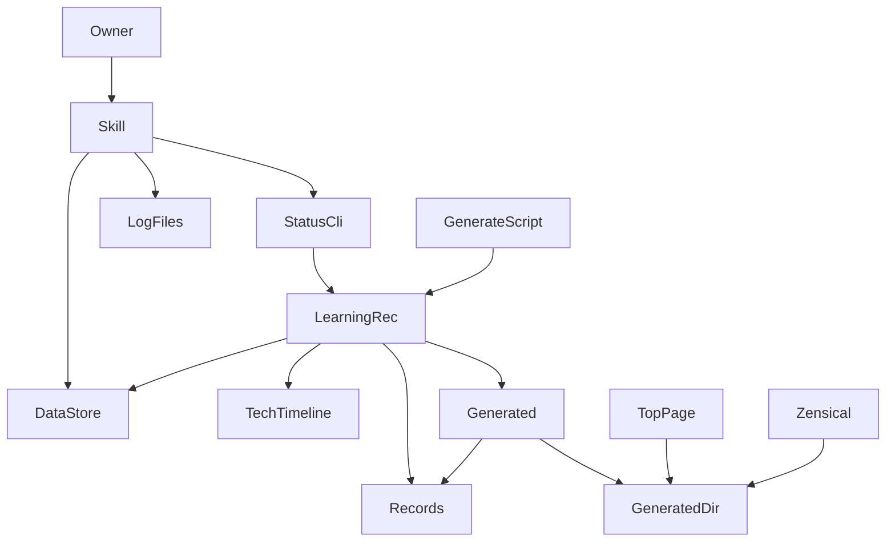
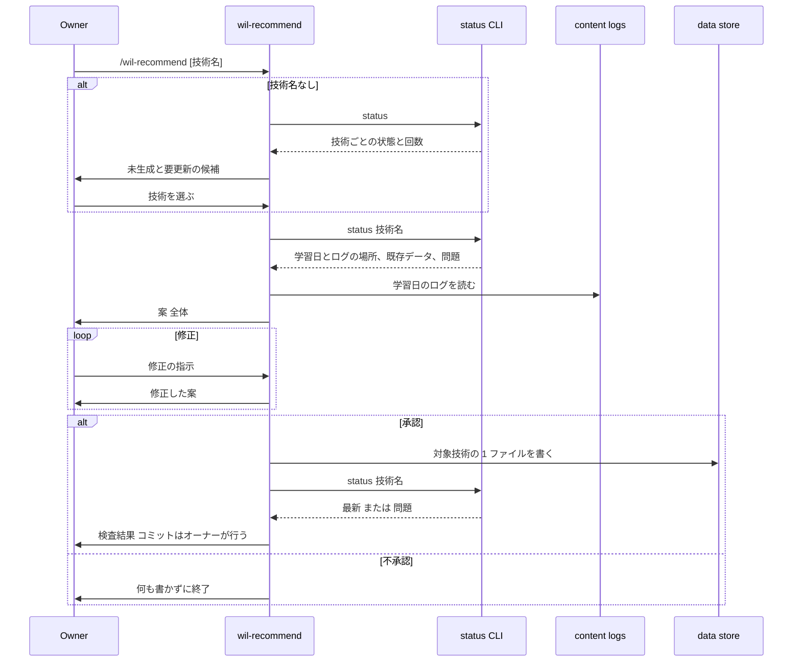
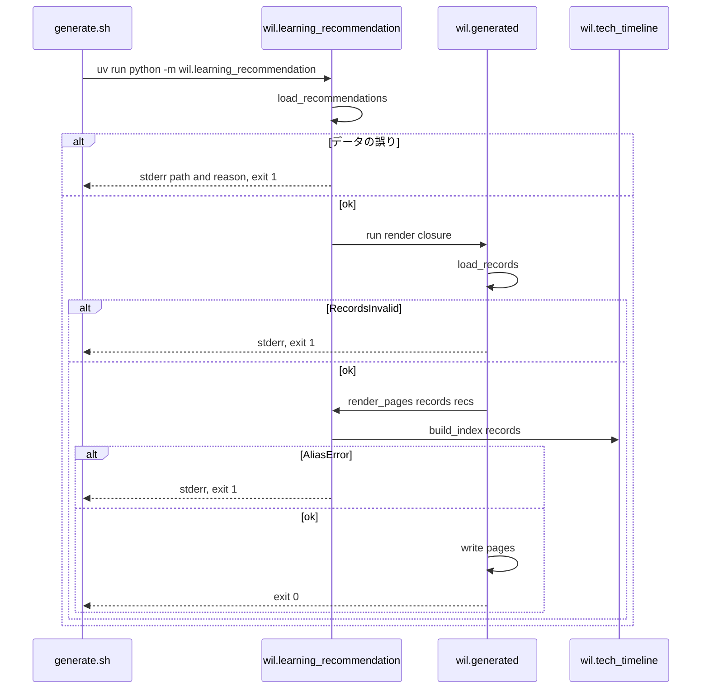

# Design Document: learning-recommendation

## Overview
**Purpose**: 技術ごとに「学習済みの内容（ログに基づく要点と根拠）」と「まだ学習していない、学ぶとよい内容（生成 AI の提案）」を示すおすすめページを公開する。おすすめはオーナーの手元の Claude Code セッションで生成し、オーナーの承認後に技術ごとのデータファイルとしてコミットする。公開サイトはビルドのたびに、そのデータと現在のログ（技術インデックス）から一覧ページ `generated/learning-recommendation/` と技術別ページ `generated/learning-recommendation/<name>/` を作る。

**Users**: オーナーが手元で `/wil-recommend` を起動しておすすめを作る・更新する。オーナーと閲覧者がおすすめページを読み、根拠のログへ辿る。

**Impact**: 生成器 `wil.learning_recommendation`（データの型・読み取り・根拠の検査・描画・CLI）、project skill `.claude/skills/wil-recommend/SKILL.md`、テストを追加する。データ置き場 `data/learning-recommendation/` を新設する（`content/` の外。`.gitignore`・`ALLOWED_PATTERNS` は変更不要）。上流所有ファイルには追記のみを行う（`scripts/generate.sh` に 1 行、`content/index.md` に 1 行、`README.md` に 1 節）。

### Goals
- 公開サイトとリポジトリに鍵を置かず、実行時に LLM を呼ばずに、おすすめを公開する
- 学習済みの要点が、どのログのどの記述に基づくかを機械的に検査でき、ページから辿れる
- ログが増えたとき、更新が必要な技術が分かり、その技術の 1 ファイルだけを更新できる

### Non-Goals
- ログの作成・編集（log-writing-skill）、技術インデックスと正規化規則（tech-timeline）、過去知見の提供（knowledge-mcp）
- 要約文の意味的な正しさの機械判定（承認で確かめる）
- 全技術の一括生成、定期的な自動生成、CI での生成
- 見た目・CSS・ナビのラベルや並び（site-design）

## Boundary Commitments

### This Spec Owns
- おすすめデータの形式（`data/learning-recommendation/*.json` のスキーマ）と、その読み取り・形式検査・技術への照合
- 根拠の検査規則（日付の照合、引用の照合、状態「未生成・最新・要更新」の判定）と CLI `python -m wil.learning_recommendation status [TECH]`
- 生成器 `wil.learning_recommendation`（`render_pages`、`main`）と出力 `content/generated/learning-recommendation.md`、`content/generated/learning-recommendation/<name>.md`
- skill `wil-recommend` の手順（対象の選び方、ログの読み方、案の提示と承認、書き込み、検査）
- テスト `tests/test_learning_recommendation.py`
- 上流ファイルへの追記（既存内容を変えない追加のみ）:
  - `scripts/generate.sh` に `uv run python -m wil.learning_recommendation` の 1 行
  - `content/index.md` 末尾に一覧へのリンク 1 行
  - `zensical.toml` の `nav` 末尾に `{ "学習のおすすめ" = "generated/learning-recommendation.md" }` の 1 項目（site-design のナビ契約。site-design の後に実装する）
  - `README.md` に「学習のおすすめ」の節

### Out of Boundary
- `wil.records`（型・関数・検証規則・`ALLOWED_PATTERNS`）、`zensical.toml`（`nav` への 1 項目の追記を除く）、`scripts/build.sh`、`.github/workflows/deploy.yml`、`.pre-commit-config.yaml`、`.gitignore`（daily-log-page）
- `wil.generated`、`scripts/generate.sh` の段構成、区域 `content/generated/`（log-index）
- 技術インデックス・正規化・別名の対応表・技術別タイムラインページ（tech-timeline）。おすすめページへのリンクを技術別タイムラインページに足すことも含め、tech-timeline の出力を変えない
- ログファイル `content/logs/*.md` の作成・変更（log-writing-skill とオーナー）
- 見た目・ナビの整理（site-design）。本 spec のページは site-design のスタイル契約の範囲の Markdown 構造だけを使う
- git のステージ・コミット・push（オーナー）

### Allowed Dependencies
- `wil.learning_recommendation` → `wil.tech_timeline` のインデックス API のうち `build_index`、`tech_key`、`Tech`、`AliasError` のみ（steering の「07 は 06 の技術インデックスを読む」例外。`check_aliases`・`slug`・描画関数・`main` は import しない）
- `wil.learning_recommendation` → `wil.generated`（`run`、`escape_inline`）、`wil.records`（`Record`、`LOGS_SUBDIR`、`load_records`、`RecordsInvalid`）
- 標準ライブラリ（`json`、`re`、`unicodedata`、`dataclasses`、`datetime`、`pathlib`、`sys`、`collections.abc`）のみ。新規の外部依存なし。Zensical を import しない
- skill → `wil.learning_recommendation` の `status` CLI、`content/logs/*.md`（読み取りのみ）、`data/learning-recommendation/*.json`（対象技術の 1 ファイルのみ書き込み）、Claude Code 標準ツール（Read / Write / Bash）
- 呼び出し方向: `scripts/generate.sh` → `python -m wil.learning_recommendation` → `wil.generated.run` → `wil.records.load_records`。`wil.tech_timeline` と `wil.records` は本モジュールを import しない

### Revalidation Triggers
- おすすめデータのスキーマ（キー名・型・必須性）の変更（skill とモジュールを同時に更新）
- `INDEX_PAGE` / `PAGE_DIR`（本 spec）の変更（トップページのリンク行、site-design）
- 上流: `Tech` / `TechEntry` のフィールド、`build_index` / `tech_key` の意味・順序規則、`Tech.page` の形式（`<tech-timeline の PAGE_DIR>/<name>.md`）、`AliasError`（tech-timeline）
- 上流: `wil.generated.run` / `escape_inline` の契約、区域 `content/generated/`、`generate.sh` の段構成（log-index）
- 上流: `Record.body` の意味、`LOGS_SUBDIR`、`load_records` の挙動（daily-log-page）
- 上流: ナビ契約・`nav` の項目（site-design）

## Architecture

### Existing Architecture Analysis
- 上流はすべて未実装の設計契約。`load_records()` は日付昇順の `list[Record]`、不正時 `RecordsInvalid`。`generate.sh` は `content/generated/` を削除してから生成器を順に実行し、生成器の非ゼロ終了で `build.sh` が止まる
- `content/generated/` は毎回削除されるため、コミットするデータは置けない。`content/` の他の場所に置くと `ALLOWED_PATTERNS` の変更（daily-log-page/log-index への変更依頼）が要り、データファイルがそのまま公開される。`content/` の外に置けば両方を避けられる。置き場は steering `structure.md` の「コミットする生成元データ: `data/<feature>/`」（サイトには出ないが公開リポジトリには含まれる）に従う
- tech-timeline の `Tech.page` は区域相対で、区域内で 1 階層下のページからは `../{tech.page}` で技術別タイムラインへリンクできる（区域直下のページからは不可）

### Architecture Pattern & Boundary Map



- 本 spec の所有: `Skill` = `.claude/skills/wil-recommend/SKILL.md`、`LearningRec` = `wil.learning_recommendation`（`StatusCli` はその `status` サブコマンド）、`DataStore` = `data/learning-recommendation/`
- 上流: `TechTimeline` = `wil.tech_timeline`（インデックス API のみ）、`Generated` = `wil.generated`、`Records` = `wil.records`、`LogFiles` = `content/logs/`、`GenerateScript` = `scripts/generate.sh`（1 行追記）、`TopPage` = `content/index.md`（1 行追記）、`GeneratedDir` = `content/generated/`、`zensical.toml` の `nav`（site-design のナビ契約、1 項目追記）。本 spec は daily-log-page、log-index、tech-timeline、site-design の実装後に実装する
- **Selected pattern**: オフライン生成 + コミット済みデータ + ビルド前生成。判断（要約・提案）は skill、決定的な規則（照合・検査・古さ・描画）は Python
- **Dependency direction**: `wil.records` ← `wil.generated` ← `wil.tech_timeline` ← `wil.learning_recommendation` ← skill（左ほど下位。逆方向の import・呼び出しは禁止）
- **Steering compliance**: 実行時サーバー・実行時 LLM なし、鍵なし、パースは `wil.records` のみ、正規化は tech-timeline のみ、生成は純粋変換、生成物は gitignore、新規依存なし

### Technology Stack

| Layer | Choice / Version | Role in Feature | Notes |
|-------|------------------|-----------------|-------|
| Offline generation | Claude Code project skill | 要約・提案の作成、承認の対話、データの書き込み | オーナーの手元のセッションで動く。鍵をリポジトリに置かない |
| Data | JSON（UTF-8、標準ライブラリ `json`） | 技術ごとのおすすめデータ | `data/learning-recommendation/`、コミットする |
| Generator / CLI | Python 3.12 標準ライブラリ | 読み取り・検査・描画・`status` | 新規依存なし |
| Shared | `wil.records`、`wil.generated`、`wil.tech_timeline`（上流） | ログ・書き出し・技術インデックス | 再実装しない |
| Site | Zensical `==0.1.3`（上流で固定） | 生成ページのビルド | `nav` 末尾に 1 項目（site-design のナビ契約）のみ追記 |
| Test | pytest（上流 dev 依存） | 単体テスト | CI の既存 `uv run pytest` |

起動方法の選定理由（詳細は `research.md`）: ローカルスクリプトで API を直接呼ぶ方式は、手元の鍵管理と SDK 依存の追加、承認の対話の自作が必要になる。Claude Code の skill はオーナーが普段使うセッションで動き、鍵がリポジトリにもスクリプトにも現れず、案の提示 → 修正 → 承認がそのまま使える。log-writing-skill と同じ「skill + 決定的な補助 CLI」の分担に揃える。

## File Structure Plan

### Directory Structure
```
.
├── .claude/skills/wil-recommend/
│   └── SKILL.md                         # 新規。おすすめ生成・更新の手順（ログは読むだけ。書き込みはデータ 1 ファイルのみ）
├── data/learning-recommendation/        # 新規。コミットするおすすめデータ（公開コンテンツの外）。最初は空でよい（ディレクトリが無ければ 0 件）
│   └── <name>.json                      # 1 技術 = 1 ファイル。<name> は技術別タイムラインページのファイル名と同じ（慣例）
├── src/wil/
│   └── learning_recommendation.py       # 新規。データの型・読み取り・形式検査・照合・根拠の検査・状態・描画・CLI
├── tests/
│   └── test_learning_recommendation.py  # 新規。形式検査・重複・根拠の検査・状態・描画・main
└── content/generated/                   # 生成物（gitignore、log-index が設定済み）
    ├── learning-recommendation.md       # 一覧。URL generated/learning-recommendation/
    └── learning-recommendation/
        └── <name>.md                    # 技術別。URL generated/learning-recommendation/<name>/
```

### Modified Files（上流所有。いずれも追記のみ）
- `scripts/generate.sh` — `uv run python -m wil.tech_timeline` の下に `uv run python -m wil.learning_recommendation` を 1 行追加（6.1、6.3）
- `content/index.md` — 末尾に `[学習のおすすめ](generated/learning-recommendation.md) から、技術ごとに学習済みの内容と次に学ぶとよい内容を見られます。` の 1 行を追加（5.5）
- `README.md` — 節「学習のおすすめ」を追加（7.1、7.2）
- `zensical.toml` — `nav` 末尾に 1 項目（ナビ契約）（5.6）

`.gitignore`、`src/wil/records.py`（`ALLOWED_PATTERNS` を含む）、`src/wil/generated.py`、`src/wil/tech_timeline.py`、`scripts/build.sh`、`.pre-commit-config.yaml`、`content/logs/` は変更しない。データは `content/` の外にあるため `ALLOWED_PATTERNS` の変更は不要。

## System Flows

### おすすめの生成・更新（オーナーの手元）



- 検査で問題が出た場合、skill はデータを直して `status` を再実行する（2.12）。ログの問題が原因なら直さずにオーナーへ示す

### ビルド前生成



- 失敗は `generate.sh` → `build.sh` の `set -eu` で伝播し、ビルドとデプロイに到達しない（6.4–6.6）。`AliasError` は `render_pages` 内で発生し、`run` が書き出す前に `main` まで伝わるため、何も書き出されない
- 通常の `generate.sh` では tech-timeline の生成器が先に別名表の矛盾で失敗する。本生成器単体で実行した場合にも同じ規則で失敗する

## Requirements Traceability

| Requirement | Summary | Components | Interfaces | Flows |
|-------------|---------|------------|------------|-------|
| 1.1–1.3 | データの項目 | LearningRec, DataStore | `Recommendation`, `Learned`, `Suggestion`, データスキーマ | — |
| 1.4 | コミットされ消えない | DataStore | `data/learning-recommendation/`（`content/generated/` の外） | — |
| 1.5 | データそのものを公開しない | DataStore | `content/` の外に置く | — |
| 1.6 | 表記ゆれ・別名で照合 | LearningRec | `tech_key(rec.tech)` による照合 | — |
| 2.1, 2.2 | 手元でのみ、鍵不要 | RecommendSkill | Claude Code skill（鍵を扱わない） | 生成・更新 |
| 2.3 | 候補の提示と選択 | RecommendSkill, LearningRec | `status`（回数の降順） | 生成・更新 |
| 2.4–2.7 | ログだけから要点、引用、提案、個人情報 | RecommendSkill | skill 手順 | 生成・更新 |
| 2.8, 2.9 | 承認後に書く、不承認なら書かない | RecommendSkill | skill 手順 | 生成・更新 |
| 2.10 | 対象 1 ファイル以外を変えない | RecommendSkill | skill 手順（書き込み先の制限） | 生成・更新 |
| 2.11 | 既存文言の維持 | RecommendSkill | skill 手順 | 生成・更新 |
| 2.12 | 書き込み後の検査 | RecommendSkill, LearningRec | `status TECH` | 生成・更新 |
| 3.1–3.3 | 技術の存在、日付、引用の照合 | LearningRec | `check` | — |
| 3.4 | 状態の表示 | LearningRec | `state`, `status` | — |
| 3.5 | 全問題を示し失敗 | LearningRec | `load_recommendations`, `check`, `status` の終了コード | — |
| 3.6 | 技術指定の詳細 | LearningRec | `status TECH` | — |
| 4.1 | 技術別ページの生成条件 | LearningRec | `pair`, `render_pages` | ビルド前生成 |
| 4.2–4.6 | ページの内容・リンク・注記 | LearningRec | `render_page` | — |
| 4.7 | 構造を崩さない | LearningRec | `wil.generated.escape_inline` | — |
| 4.8 | 見つからない日付 | LearningRec | `render_page`（リンクなし + 文言） | — |
| 4.9 | 生成後の変化の表示 | LearningRec | `drift`, `render_page` | — |
| 5.1–5.3 | 一覧の内容・変化・0 件 | LearningRec | `render_index` | — |
| 5.4 | 技術の無いデータを無視 | LearningRec | `pair` | — |
| 5.5 | トップページのリンク | TopPageLink | `content/index.md` 追記行 | — |
| 5.6 | ナビ | GeneratedPages | `nav` の項目「学習のおすすめ」（H1 と同じ）、技術別ページは載せない | ビルド |
| 6.1, 6.3 | 毎回作り直し、非コミット | GenerateRegistration, GeneratedPages | `generate.sh` 登録行、区域の gitignore（log-index） | ビルド前生成 |
| 6.2 | 同一内容 | LearningRec | `render_pages`（純粋・決定的） | — |
| 6.4 | データの誤りで失敗 | LearningRec | `load_recommendations`, `main` | ビルド前生成 |
| 6.5 | 不正ログ・別名表の矛盾で失敗 | LearningRec, Generated | `run`、`AliasError` の捕捉 | ビルド前生成 |
| 6.6 | 失敗時は公開を維持 | GenerateRegistration | `set -eu`（上流） | ビルド前生成 |
| 6.7 | 実行時 LLM なし、鍵なし | LearningRec, RecommendSkill | 生成器は LLM を呼ばない、skill は鍵を扱わない | — |
| 7.1, 7.2 | 手順書 | GuideSection | `README.md` 追記節 | — |
| 8.1–8.3 | 自動テスト | LearningRecTests | `tests/test_learning_recommendation.py` | — |
| 8.4 | CI でテスト | LearningRecTests | 上流 deploy.yml の `uv run pytest` | — |

## Components and Interfaces

| Component | Domain/Layer | Intent | Req Coverage | Key Dependencies | Contracts |
|-----------|--------------|--------|--------------|------------------|-----------|
| LearningRec | 生成器 + CLI（`src/wil/learning_recommendation.py`） | データの読み取り・検査・照合・描画・`status` | 1.1–1.3, 1.6, 2.3, 2.12, 3.1–3.6, 4.1–4.9, 5.1–5.4, 6.2, 6.4, 6.5, 6.7 | TechTimeline (P0), Generated (P0), Records (P0) | Service, Batch |
| DataStore | データ（`data/learning-recommendation/*.json`） | おすすめの正本 | 1.1–1.5 | — | State |
| RecommendSkill | 手元ツール（`.claude/skills/wil-recommend/SKILL.md`） | 生成・更新の対話手順 | 2.1–2.12, 6.7 | LearningRec (P0), Claude Code (P0) | — |
| GenerateRegistration | `scripts/generate.sh` への 1 行追記 | 生成器の登録 | 6.1, 6.3, 6.6 | LearningRec (P0) | Batch |
| GeneratedPages | 出力 `content/generated/learning-recommendation*.md` | 公開場所とナビ掲載 | 5.6, 6.3 | Zensical (P1) | State |
| TopPageLink | `content/index.md` への 1 行追記 | トップから一覧へ | 5.5 | GeneratedPages (P0) | — |
| GuideSection | `README.md` への節追記 | 更新手順と検査の範囲 | 7.1, 7.2 | — | — |
| LearningRecTests | `tests/test_learning_recommendation.py` | 規則・描画のテスト | 8.1–8.4 | LearningRec (P0) | — |

### 生成器 + CLI

#### LearningRec（`wil.learning_recommendation`）

| Field | Detail |
|-------|--------|
| Intent | コミット済みデータ + 技術インデックス → おすすめページ。あわせて根拠の検査 CLI |
| Requirements | 1.1–1.3, 1.6, 2.3, 2.12, 3.1–3.6, 4.1–4.9, 5.1–5.4, 6.2, 6.4, 6.5, 6.7 |

**Responsibilities & Constraints**
- `parse_recommendation` / `load_recommendations` / `main` / `status` だけが I/O を行う。`pair`・`drift`・`state`・`check`・描画関数は I/O・現在時刻・環境に依存しない純関数（6.2）
- 技術の同定は `tech_key` と `build_index` の結果だけで行い、正規化・slug・抜粋を再計算しない
- LLM を呼ばない。ネットワークに接続しない（6.7）

**Dependencies**
- Inbound: `scripts/generate.sh`（P0）、RecommendSkill（`status`、P0）
- Outbound: `wil.tech_timeline.build_index` / `tech_key` / `Tech` / `AliasError`（P0）、`wil.generated.run` / `escape_inline`（P0）、`wil.records.Record` / `LOGS_SUBDIR` / `load_records` / `RecordsInvalid`（P0）

**Contracts**: Service [x] / Batch [x]

##### Service Interface
```python
from collections.abc import Sequence
from dataclasses import dataclass
from datetime import date
from pathlib import Path
from wil.records import Record
from wil.tech_timeline import Tech

DATA_DIR: Path = Path("data/learning-recommendation")  # リポジトリルート基準
INDEX_PAGE: str = "learning-recommendation.md"         # 区域相対の一覧ページ
PAGE_DIR: str = "learning-recommendation"              # 区域相対の技術別ページのディレクトリ

@dataclass(frozen=True)
class Learned:                      # 学習済みの要点
    text: str
    dates: tuple[date, ...]         # 根拠ログの日付。1 件以上、重複なし、書かれた順
    quote: str                      # 根拠ログ本文からの逐語の引用

@dataclass(frozen=True)
class Suggestion:                   # 未学習の項目
    topic: str
    reason: str
    dates: tuple[date, ...]         # きっかけのログの日付。1 件以上、重複なし、書かれた順

@dataclass(frozen=True)
class Recommendation:
    path: Path                      # データファイルのパス（誤りの表示用）
    tech: str                       # 書かれた技術名。照合は tech_key(tech)
    generated_on: date
    based_on: tuple[date, ...]      # 生成時に対象とした学習日。1 件以上、昇順に整列、重複なし
    learned: tuple[Learned, ...]    # 1 件以上
    suggestions: tuple[Suggestion, ...]  # 1 件以上

class RecommendationError(Exception):
    path: Path
    reason: str                     # 日本語の理由。str(err) == f"{path}: {reason}"

def parse_recommendation(path: Path) -> Recommendation: ...      # 形式違反は RecommendationError（1 ファイル 1 理由）
def load_recommendations(data_dir: Path = DATA_DIR) -> tuple[tuple[Recommendation, ...], tuple[RecommendationError, ...]]: ...
def pair(index: Sequence[Tech], recs: Sequence[Recommendation]) -> tuple[tuple[Tech, Recommendation], ...]: ...
def drift(tech: Tech, rec: Recommendation) -> tuple[tuple[date, ...], tuple[date, ...]]: ...   # (追加, 対象外)
def state(tech: Tech, rec: Recommendation | None) -> str: ...    # "未生成" | "最新" | "要更新"
def check(records: Sequence[Record], index: Sequence[Tech], recs: Sequence[Recommendation]) -> list[str]: ...
def render_index(pairs: Sequence[tuple[Tech, Recommendation]]) -> str: ...
def render_page(tech: Tech, rec: Recommendation) -> str: ...
def render_pages(records: Sequence[Record], recs: Sequence[Recommendation]) -> dict[str, str]: ...
def main(argv: list[str] | None = None) -> int: ...
```

**規則**
- `parse_recommendation(path)`（1.1–1.3、6.4、8.1）: UTF-8 として読み JSON として解釈する。次の最初の違反を `RecommendationError` にする
  - 最上位がオブジェクトで、キーがちょうど `tech`、`generated_on`、`based_on`、`learned`、`suggestions`（不足・余分はいずれも誤り）
  - `learned` の各要素のキーがちょうど `text`、`dates`、`quote`。`suggestions` の各要素のキーがちょうど `topic`、`reason`、`dates`
  - 文字列項目（`tech`、`text`、`quote`、`topic`、`reason`）は `str`、`strip()` 後に空でなく、改行（`\n`、`\r`）を含まない
  - 日付は `str` で `\d{4}-\d{2}-\d{2}` に完全一致し、`date.fromisoformat` で暦日として解釈できる
  - `based_on`・`learned`・`suggestions`・各 `dates` は 1 件以上のリスト。`based_on` と各 `dates` に重複が無い
  - 理由の例: `"learned[0].quote が空です"`、`"based_on[1] が日付（YYYY-MM-DD）ではありません"`、`"未知のキー foo があります"`
- `load_recommendations(data_dir)`（3.5、6.4）: `data_dir` 直下の `*.json` をパス順に `parse_recommendation`。`data_dir` が無ければ `((), ())`。成功したデータのうち `tech_key(rec.tech)` が先行データと同じものは `RecommendationError(path, f"{先行のパス} と同じ技術 {tech} のデータです")` として誤りに回し、戻り値のデータには含めない。戻り値は（正常なデータ、全誤り）
- `pair(index, recs)`（4.1、5.4、1.6）: `index` の順に、`tech_key(rec.tech) == tech.key` のデータと組にする。対応する技術が無いデータは含めない
- `drift(tech, rec)`（4.9、5.2）: 現在の学習日 `D = {e.date for e in tech.entries}`、`B = set(rec.based_on)`。（`D - B` の昇順、`B - D` の昇順）
- `state(tech, rec)`（3.4）: `rec is None` → `"未生成"`、`drift` が両方空 → `"最新"`、それ以外 → `"要更新"`
- `check(records, index, recs)`（3.1–3.3、3.5）: 各 `rec` について問題文 `f"{rec.path}: {理由}"` を集める
  - 対応する技術が `index` に無い: `"技術 {tech} が技術インデックスにありません"`
  - `learned` / `suggestions` の各日付 `d` が `D` に無い、または `rec.based_on` に無い
  - `based_on` の日付が `D` に無い
  - 各 `Learned` について、`_norm(quote)` が、`dates` のうち `D` にある日付のログ（`records` の `date` が一致するもの）の `_norm(body)` のいずれにも部分文字列として含まれない: `"learned[i].quote が根拠ログの本文に見つかりません"`
  - `_norm(s)` = `unicodedata.normalize("NFKC", s).casefold()` の空白文字の連続を 1 つの空白に置き換え、前後の空白を除いたもの
- `render_pages(records, recs)`（4.1、5.1、6.2）: `ix = build_index(records)`（`AliasError` は送出したまま）、`ps = pair(ix, recs)`。`{INDEX_PAGE: render_index(ps), **{page_of(t): render_page(t, r) for t, r in ps}}`
  - `page_of(t)` = `f"{PAGE_DIR}/{PurePosixPath(t.page).name}"`（tech-timeline のページ名を流用し、slug を再計算しない）
- エスケープ（4.7）: `wil.generated.escape_inline(text) -> str`（log-index 所有）をそのまま使う。本モジュールにエスケープ関数を定義しない
- `main(argv)`:
  - 引数なし（log-index 契約どおりの形。`generate.sh` が使う）: `recs, errors = load_recommendations()`。`errors` があれば各 `str(err)` を標準エラーに出して `1`。そうでなければ `run(lambda rs: render_pages(rs, recs))` を返す。`AliasError` を捕捉したら `str(err)` を標準エラーに出して `1`
  - `status [TECH]`: 下記 Batch 契約。その他の引数は使い方を標準エラーに出して `2`
  - `if __name__ == "__main__": raise SystemExit(main())`

##### Batch / Job Contract
- **生成**: Trigger `uv run python -m wil.learning_recommendation`（リポジトリルート、通常は `scripts/generate.sh` 経由）。Output `content/generated/learning-recommendation.md` と `content/generated/learning-recommendation/<name>.md`（組ごと）。終了コード 0 成功 / 1 データの誤り・不正ログ・別名表の矛盾。Idempotency: 同じデータ・ログ・別名表から同一内容
- **status**: Trigger `uv run python -m wil.learning_recommendation status [TECH]`（skill とオーナー）
  - `load_records()`（`RecordsInvalid` → 標準エラーに全件、`1`）、`build_index`（`AliasError` → 標準エラー、`1`）、`load_recommendations()`、`check`
  - `TECH` なし: 標準出力に全技術を 1 行ずつ、学習回数の降順（同数は `build_index` の順）で `{state}\t{count} 回\t{name}\t{データのパス}` を出す。データのパスは既存データがあればそのパス、無ければ `DATA_DIR / (PurePosixPath(t.page).stem + ".json")`（新規作成時の推奨パス）。要更新なら末尾に `\t追加 {n} 日、対象外 {m} 日`
  - `TECH` あり: `tech_key(TECH)` で技術を引く。無ければ標準エラーに `"技術 {TECH} が見つかりません"`、`1`。あれば標準出力に `技術: {name}`、`状態: {state}`、`データ: {パス}`、`学習日:` に続けて学習日ごとに `{date}\tcontent/logs/{date}.md`、要更新なら追加・対象外の日付（3.6）
  - いずれも、`load_recommendations` の誤りと `check` の問題をすべて標準エラーに 1 行ずつ出し、1 件でもあれば `1`、無ければ `0`（3.5）

**出力 Markdown の構造**
- 一覧 `INDEX_PAGE`（5.1–5.3）:
  1. `# 学習のおすすめ`
  2. 空行、`全 N 技術（名前順）。技術ごとに、学習済みの内容と、次に学ぶとよい内容をまとめています。`。0 件のときは代わりに `まだおすすめがありません。`
  3. 組ごとに 1 行: `- [{name}]({PAGE_DIR}/{ファイル名}) — 生成日 {generated_on}、学習済み {len(learned)} 件、おすすめ {len(suggestions)} 件`。要更新なら末尾に `（生成後に学習ログが変化しています）`
- 技術別 `page_of(t)`（4.2–4.9）:
  1. `# {name} の学習のおすすめ`
  2. 空行、`[学習のおすすめ一覧](../{INDEX_PAGE})、[{name} の学習タイムライン](../{t.page})`
  3. 空行、`- 生成日: {generated_on}`、`- 対象ログ: {len(based_on)} 日分`
  4. 要更新なら空行、`**注意**: 生成後に、学習ログが {追加} 日分追加され、{対象外} 日分が対象外になっています。内容が古い可能性があります。`（0 の側の句は出さない）
  5. 空行、`## 学習済みの内容`、空行、要点ごとに `- {text}（根拠: {日付の列}）` と、その下に 4 空白インデントの `    - 引用: 「{quote}」`
  6. 空行、`## まだ学習していない、学ぶとよい内容`、空行、項目ごとに `- **{topic}** — {reason}（きっかけ: {日付の列}）`
  7. 空行、`**注記**: 「まだ学習していない、学ぶとよい内容」は、生成 AI がこのページの学習ログをもとに提案したものです。正確さや網羅性は保証しません。`
- 日付の列: 日付を書かれた順に `、` で連結。`d` が現在の学習日にあれば `[{d}](../../{LOGS_SUBDIR}/{d}.md)`、無ければ `{d}（この技術のログに見つかりません）`（4.8）
- `{name}`・`{text}`・`{quote}`・`{topic}`・`{reason}` は `escape_inline` 済み。日付は ISO 形式。見出し・リストの前後は空行 1 つ。ファイル末尾は改行 1 つ
- 使う構造は見出し・箇条書き（2 階層）・リンク・強調だけ（site-design のスタイル契約内）

### データ

#### DataStore（`data/learning-recommendation/`）

**Contracts**: State [x]

##### State Management（スキーマ）
```json
{
  "tech": "AWS Lambda",
  "generated_on": "2026-11-23",
  "based_on": ["2026-01-10", "2026-11-23"],
  "learned": [
    {
      "text": "従量課金の単位（リクエスト数と実行時間）を確認した",
      "dates": ["2026-01-10"],
      "quote": "リクエスト数と実行時間で課金される"
    }
  ],
  "suggestions": [
    {
      "topic": "Provisioned Concurrency",
      "reason": "コールドスタート対策を調べているため、次の手段として比較するとよい",
      "dates": ["2026-11-23"]
    }
  ]
}
```
- 1 技術 = 1 ファイル。ファイル名は `status` が示す推奨パス（技術別タイムラインページと同じ名前 + `.json`）。照合はファイル名ではなく `tech` で行う
- 書式: UTF-8、インデント 2、非 ASCII 文字はそのまま、キーは上記の順、末尾に改行 1 つ。更新時は変わらない要素の文言と順序を保つ（差分を技術 1 ファイルの必要部分に限る、1.4、2.11）
- `content/` の外にあるため公開ディレクトリの検査対象外で、ファイルとしては公開されない（1.5）。gitignore の対象ではなくコミットされる（1.4）。公開リポジトリに置かれるため、内容はページと同じく公開される前提で扱う

### 手元ツール

#### RecommendSkill（`.claude/skills/wil-recommend/SKILL.md`）

| Field | Detail |
|-------|--------|
| Intent | おすすめの生成・更新を、承認つきの対話で行う |
| Requirements | 2.1–2.12, 6.7 |

**Responsibilities & Constraints**
- frontmatter: `name: wil-recommend`、`description` に「技術ごとの学習のおすすめデータを作成・更新する。ログは読むだけで作成・変更しない（ログの記録は /wil-log）」、`allowed-tools: Read, Write, Bash`
- 書き込みは対象技術のデータ 1 ファイル（`status` が示すパス）だけ。`content/`・他のデータファイル・`src/`・設定は書かない。git のステージ・コミット・push をしない（2.10）
- 鍵を扱わない。外部 API を呼ぶスクリプトを実行しない（2.2、6.7）

**手順**
1. 対象の決定（2.3）: 引数に技術名があればそれ。無ければ `uv run python -m wil.learning_recommendation status` を実行し、状態が「未生成」「要更新」の技術を回数の多い順に最大 10 件示して、オーナーに 1 つ選んでもらう。ログの記録を求められたら `/wil-log` を案内して終了する
2. 文脈の取得: `status <技術名>` を実行し、学習日とログの場所、既存データのパス、問題を得る。技術が見つからなければその旨を示して終了する
3. ログを読む（2.4）: 示された全学習日のログを Read で読む（書き込まない）。既存データがあれば読む
4. 案の作成:
   - 学習済みの要点（2.4、2.5）: 3〜7 件。読んだログに書かれた内容だけから作る。要点ごとに根拠の日付と、根拠ログの本文の 1 行から Markdown 記法を含まない連続した文字列をそのまま写した引用（目安 15〜60 字）を付ける
   - 未学習の項目（2.6）: 3〜5 件。ログに書かれていない関連領域から選び、理由と、きっかけとなったログの日付を付ける
   - 個人情報と秘密（2.7）: ログに無い氏名・所属・居住地・連絡先などを書かない。ログ中の鍵・トークン・社内 URL らしき文字列を引用・要約に含めない
   - 更新時（2.11）: 新しいログで変わらない既存の要点・項目は文言と順序を変えず、追加・修正を必要な部分に限る
   - `based_on` は手順 2 で示された全学習日、`generated_on` は今日の日付（`date +%F`）
5. 提示と承認（2.8、2.9）: 案の全体（要点と引用・根拠日付、項目と理由・日付）を読みやすい形で示し、承認を求める。修正指示は反映して再提示する。承認されなければ何も書かずに終了する
6. 書き込み: 承認された内容を DataStore の書式で対象の 1 ファイルに書く
7. 検査（2.12）: `status <技術名>` を実行し結果を示す。データの問題（引用が見つからない、日付の誤りなど）は直して再実行する。ログ側の問題は直さずに示す
8. 終了の案内: `./scripts/generate.sh && uv run zensical serve` で確認できること、コミットと push はオーナーが行うことを伝える

### 統合（上流ファイルへの追記）

#### GenerateRegistration（`scripts/generate.sh`）
- `uv run python -m wil.tech_timeline` の下に `uv run python -m wil.learning_recommendation` を 1 行追加。区域の削除と `set -eu` は log-index のまま（6.1、6.3、6.6）

#### GeneratedPages（出力と公開場所）
- 公開 URL: `generated/learning-recommendation/`（一覧）、`generated/learning-recommendation/<name>/`（技術別）。`use_directory_urls` 既定 true による
- ナビ: site-design のナビ契約に従い、`nav` 末尾に一覧の 1 項目 `{ "学習のおすすめ" = "generated/learning-recommendation.md" }` だけを追記し、他の項目と順序は変えない。生成器の登録より先に書かない。技術別ページはナビに載せず、一覧ページのリンクと検索で到達する（5.6）
- `.gitignore` と `ALLOWED_PATTERNS` は log-index が区域単位で設定済み。本 spec は変更しない（6.3）

**Implementation Notes**
- Validation: ビルド後に (a) `site/generated/learning-recommendation/index.html` と各技術別ページの HTML が存在、(b) 一覧 → 技術別、技術別 → 一覧・技術別タイムライン・各ログのリンクが相対 URL で `--strict` が通る、(c) ナビに「学習のおすすめ」があり、技術別ページが並ばない
- Risks: 技術別タイムラインへの `../{t.page}` は 1 階層下のページからのみ正しい。一覧ページからは技術別タイムラインへリンクしない

#### TopPageLink（`content/index.md`）
- 末尾に 1 行: `[学習のおすすめ](generated/learning-recommendation.md) から、技術ごとに学習済みの内容と次に学ぶとよい内容を見られます。`（5.5）。既存の文と他機能のリンク行は変更しない。生成器の登録後に追記する（`--strict` のリンク検証は生成後のビルドでのみ成立）

#### GuideSection（`README.md`）
- 節「学習のおすすめ」: おすすめは手元で `/wil-recommend [技術名]` を実行して作ること（鍵は不要、Claude Code のセッションで動く）、更新が必要な技術は `uv run python -m wil.learning_recommendation status` で分かること、検査は `status <技術名>` で行い問題があると非ゼロで終わること、データは `data/learning-recommendation/` に技術ごとに保存されオーナーがコミット・push して公開すること、データの誤りがあるとビルドが失敗すること（7.1）
- 検査の範囲: 機械的な検査は根拠の日付と引用がログにあることまでで、要約の妥当性・個人情報や秘密情報が含まれていないことは承認時にオーナーが確かめること（7.2）

## Data Models

### Domain Model
- 集約は `Recommendation`（識別子 = `tech_key(tech)`。全データで一意）。`Learned` と `Suggestion` は従属する値オブジェクト
- 不変条件（`parse_recommendation` 後）: `based_on`・`learned`・`suggestions`・各 `dates` は 1 件以上で重複なし、文字列は空でなく改行を含まない
- 不変条件（`check` が問題なしのとき）: 全 `dates` ⊆ `based_on` ⊆ 対象技術の現在の学習日。各 `Learned.quote` は根拠ログの本文に（正規化後に）含まれる
- 生成ページの不変条件: 技術別ページの集合 = `pair` の組の集合。ページ名は互いに異なる（tech-timeline の `Tech.page` が互いに異なるため）

### Data Contracts & Integration
- 生成例（入力: 上記スキーマ例のデータ、ログ 2026-01-10〔tags `Lambda`〕、2026-11-23〔tags `aws-lambda`〕、2026-12-01〔tags `Lambda`〕、`ALIASES = (("Lambda", "AWS Lambda"),)`）

`content/generated/learning-recommendation.md`
```markdown
# 学習のおすすめ

全 1 技術（名前順）。技術ごとに、学習済みの内容と、次に学ぶとよい内容をまとめています。

- [AWS Lambda](learning-recommendation/awslambda.md) — 生成日 2026-11-23、学習済み 1 件、おすすめ 1 件（生成後に学習ログが変化しています）
```

`content/generated/learning-recommendation/awslambda.md`
```markdown
# AWS Lambda の学習のおすすめ

[学習のおすすめ一覧](../learning-recommendation.md)、[AWS Lambda の学習タイムライン](../tech-timeline/awslambda.md)

- 生成日: 2026-11-23
- 対象ログ: 2 日分

**注意**: 生成後に、学習ログが 1 日分追加されています。内容が古い可能性があります。

## 学習済みの内容

- 従量課金の単位（リクエスト数と実行時間）を確認した（根拠: [2026-01-10](../../logs/2026-01-10.md)）
    - 引用: 「リクエスト数と実行時間で課金される」

## まだ学習していない、学ぶとよい内容

- **Provisioned Concurrency** — コールドスタート対策を調べているため、次の手段として比較するとよい（きっかけ: [2026-11-23](../../logs/2026-11-23.md)）

**注記**: 「まだ学習していない、学ぶとよい内容」は、生成 AI がこのページの学習ログをもとに提案したものです。正確さや網羅性は保証しません。
```
（例示のため記号のエスケープは省略。実際の出力では `(`、`)`、`.`、`-` などに `escape_inline` が適用される）

## Error Handling

### Error Strategy
- **データ自身の誤り**（形式違反、同じ技術の重複）: 生成器は全件を `path: reason` で標準エラーに出して `1`、何も書き出さない（6.4）。`status` も同じ誤りを示して `1`（3.5）
- **ログ側の変化による不一致**（技術が消えた、根拠日付のログからタグが外れた、新しい学習日が増えた）: 生成器は失敗させず、対象外のデータはページにしない（5.4）、見つからない日付はリンクなしで示す（4.8）、変化を注意文で示す（4.9）。`status` は問題として示して `1`（3.1、3.2、3.5）
- **上流の誤り**（不正ログ、別名表の矛盾）: `run` と `AliasError` の捕捉により `1`、書き出しなし（6.5）
- 失敗は `generate.sh` → `build.sh` で伝播し、Pages は直前の内容のまま（6.6）
- skill: `status` が非ゼロのとき、データ側の問題を直して再検査する。ログ側の問題は直さずオーナーに示す

## Testing Strategy

### Unit Tests（`tests/test_learning_recommendation.py`。`Record` を直接組み立て、データは `tmp_path` に JSON を書く）
- 形式検査（1.1–1.3、6.4、8.1）: 正常データが `Recommendation` になる。キー不足・未知のキー・空文字・改行入り文字列・`2026-1-5`・`2026-02-30`・`20261123`・空リスト・`dates` の重複・JSON でない内容・最上位が配列、の各ケースで `RecommendationError` の理由に該当箇所が含まれる
- 読み取り（3.5、6.4、8.1）: ディレクトリが無いと 0 件。`*.json` 以外を無視。`AWS Lambda` と `aws-lambda` を `tech` に持つ 2 ファイルで後者が重複の誤りになり、データからは除かれる。誤りが複数ファイルにあると全件返る
- 照合と状態（1.6、3.4、4.9、5.4、8.2）: 別名表を差し替えて `Lambda` のデータが `AWS Lambda` の技術と組になる。技術の無いデータは `pair` に出ない。`drift` の追加・対象外、`state` の 3 状態
- 根拠の検査（3.1–3.3、8.2）: 技術の不在、`dates` が学習日に無い、`dates` が `based_on` に無い、`based_on` が学習日に無い、引用が本文に無い、がそれぞれ問題文になる。引用が全角/半角・大文字小文字・改行をまたぐ空白の違いだけなら一致する。正常データで問題 0 件
- 描画（4.2–4.9、5.1–5.3、8.3）: 一覧の H1・総数・名前順・リンク `learning-recommendation/<name>.md`・件数・要更新の文言・0 件の文。技術別の H1、一覧への `../learning-recommendation.md`、タイムラインへの `../{t.page}`、生成日・対象ログ数、根拠リンク `../../logs/D.md`、見つからない日付がリンクなしで文言付き、引用の入れ子行、項目の強調と理由、注記、要更新のときだけ注意文（0 の句を出さない）。`[x] *y* <b>` を含む `text`・`quote`・`topic`・`reason`・`tech` がエスケープされる（`wil.generated.escape_inline` を通した結果と一致する）
- `render_pages`（4.1、6.2）: キー集合が `INDEX_PAGE` + 組ごとのページ。データ 0 件で一覧のみ。入力順を変えても同一結果
- `main`（6.4、6.5、3.5、3.6）: `monkeypatch.chdir(tmp_path)` で `content/logs/` と `data/learning-recommendation/` を作り、引数なしで 0 を返してページが書かれる。形式違反のデータで 1・何も書かれない。矛盾した別名表（`monkeypatch` で `wil.tech_timeline.ALIASES` を差し替え）で 1。`status` が問題なしで 0、引用の不一致で 1 と標準エラーの問題文。`status 未知の技術` で 1。`status <技術>` が学習日とログの場所を出す

### Build / E2E Checks（実装タスクで手元実行）
- データ 1 件を置いて `./scripts/build.sh` が成功し、一覧と技術別ページの HTML が出力され、各リンクが `--strict` で通る（4.1、4.5、5.1、5.6、6.1）
- トップページのリンクが一覧を開く。ナビに「学習のおすすめ」がある（5.5、5.6）
- 形式違反のデータを置くと `./scripts/generate.sh` が非ゼロで終わり、パスと理由が出る（6.4）
- 根拠ログのタグを外して再生成すると、ビルドは成功し、その日付がリンクなしで「見つかりません」と表示され、注意文が出る（4.8、4.9）
- `/wil-recommend` を 1 回実行し、承認前は何も書かれないこと、承認後に対象の 1 ファイルだけが変わり `git status` に他の変更が無いこと、`status <技術>` が 0 で終わることを確認する（2.8–2.12）
- `uv run pytest` が新テストを含めて成功する（8.4）

## Security Considerations
- 鍵・トークンをリポジトリ・Pages・スクリプトに置かない。生成は Claude Code のセッションで行い、生成器・CI は LLM もネットワークも使わない（2.2、6.7）
- 公開されるのは承認済みのデータとログ由来の情報だけ。個人情報・秘密情報の混入は skill の手順で避け、承認時にオーナーが確かめる。コミット時は既存 pre-commit（gitleaks、detect-private-key）がデータファイルも検査する
- 出力文字列は HTML 特殊文字と Markdown 記号をエスケープし、生の HTML を出さない。ページ名は tech-timeline の `[a-z0-9-]` のファイル名を流用し、`run` の名前検査とあわせて区域外へ書かない

## Open Questions / Risks
- 解決済み（tech-timeline）: 設計の下流例「区域内の別ページ（例 learning-recommendation.md）からのソース相対リンク `../{page}`」は、区域直下のページからはリンク切れになる。正しくは区域直下から `{page}`、1 階層下から `../{page}`。本 spec は 1 階層下のページからだけリンクする。tech-timeline 側の例は修正済み
- 解決済み（steering `structure.md`）: 「コミットする生成元データ: `data/<feature>/`」が定義された（サイトには出ないが公開リポジトリには含まれる。生成器だけが読む）。本 spec のデータ置き場はこれに従う
- `ALLOWED_PATTERNS` の変更は不要（データは `content/` の外、生成ページは既存の `generated/.+\.md` に含まれる）
- 引用の照合は「その文字列がログにある」までしか保証しない。要約の妥当性は承認に依存する
